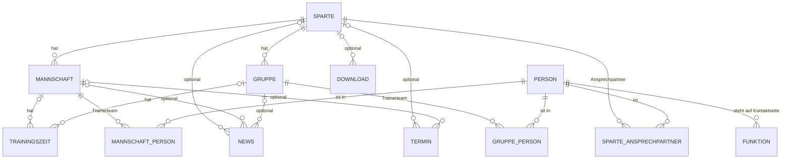
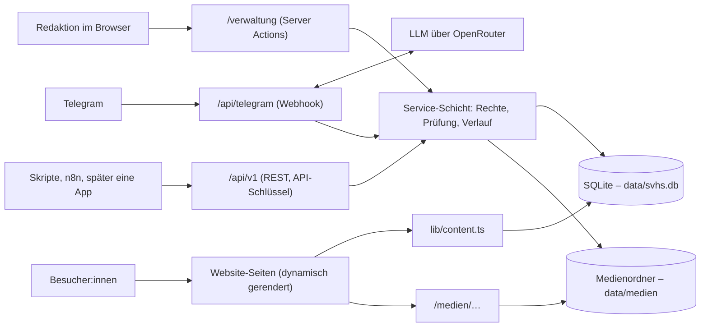
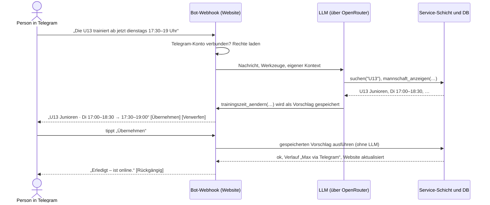

# KONZEPT – Eigene Vereinsverwaltung statt Sanity

Stand: 2026-10-03 (Login per QR-Code, REST-API und Telegram-Bot ergänzt; Umstellung auf SQLite,
eigenen Server und OpenRouter; Datenübernahme erledigt)  
Status: Entwurf zur Abstimmung. Datenmodell und Datenübernahme sind umgesetzt, die Verwaltung
selbst noch nicht.  
Scope: Mannschaften und Gruppen, Trainingszeiten, Trainer:innen/Ansprechpartner:innen, Sparten und
Kontaktseite. Bearbeitet wird über die Verwaltung, eine REST-API und einen Telegram-Bot. News,
Termine und Downloads liegen schon in der Datenbank; ihre Bearbeitung in der Verwaltung folgt
später (siehe Abschnitt 14). Die Partner entfallen.

---

## 1) Kurzfassung

- Unter **`/verwaltung`** bekommt die Website eine kleine eigene Verwaltung. Sie wird direkt ins
  bestehende Next.js-Projekt eingebaut und deckt genau unsere Inhalte ab.
- **Leitidee: Alles zu einer Mannschaft auf einer Seite.** Trainingszeiten, Trainerteam, Foto und
  Beschreibung stehen in einem Formular. Ein Klick auf „Speichern“ macht die Änderung sofort live.
- **Anmeldung per QR-Code.** Ein Admin legt den Zugang an und bekommt einen QR-Code. Die Person
  scannt ihn mit der Handykamera und ist angemeldet. Am PC tippt sie den Code ein. Es gibt keine
  Passwörter, keine Konten und keinen Mailversand.
- **Abgestufte Rechte:** Admin, Spartenleitung (eigene Sparte) und Trainer:in (nur die eigene
  Mannschaft bzw. Gruppe).
- **REST-API und Telegram-Bot:** Dieselben Funktionen gibt es auch als REST-API. Darauf baut ein
  Telegram-Bot auf. Er versteht Nachrichten wie „U13 trainiert ab jetzt dienstags 17:30“ mit einem
  LLM (über OpenRouter, Modell noch offen) und bereitet die Änderung selbst vor. Ein Tipp auf
  „Übernehmen“, und sie ist online.
- **Technik:** SQLite-Datenbank als Datei (`data/svhs.db`), Fotos im lokalen Medienordner
  (`data/medien`), beides auf einem **eigenen Server** (geplant: Hetzner). LLM für den Bot über
  OpenRouter. Es gibt keinen separaten Datenbankdienst.
- Die bestehenden Daten aus Sanity wurden am **03.10.2026 automatisch übernommen** (siehe
  Abschnitt 13). Sanity, `/studio` und das Studio-Handbuch sind entfernt. Bis die Verwaltung
  steht, werden die Inhalte per Drizzle Studio gepflegt.

---

## 2) Warum weg von Sanity – was konkret stört

Stand vor der Umstellung. Die technischen Punkte 7–9 sind mit dem Umzug erledigt.

### Für die Redaktion

1. **Zugang:** Neue Mitglieder kann nur der Projekt-Owner über manage.sanity.io einladen. Jede
   Person braucht ein eigenes Sanity-Konto (Google, GitHub oder E-Mail).
2. **Keine abgestuften Rechte:** Wer eingeloggt ist, darf alles. Das steht so auch im Handbuch.
   Ein:e Trainer:in kann also nicht „nur die eigene Mannschaft“ pflegen.
3. **Entwurf/Publish und die Reihenfolge-Falle:** Eine neue Person muss zuerst separat
   veröffentlicht werden. Sonst meldet das Studio beim Speichern der Mannschaft nur vage
   „Validierungsfehler“.
4. **Verteilte Daten:** Für eine Uhrzeit sucht man in einer Liste mit 93 Trainingszeiten. Ein
   Trainerwechsel läuft über eine andere Liste, eine neue Person über eine dritte.
5. **Halb englische Oberfläche** (Publish, Replace, Add item, Generate). Dazu kommen Altbestands-
   und Fallback-Felder im Formular („Direkte Eingaben für bestehende Einträge“, „Name (Fallback)“).
6. Bis eine Änderung live ist, vergehen **rund 60 Sekunden**.

### Für die Technik

7. Es gibt **doppelte Modelle**: eingebettete `sparte.mannschaften[]` neben zentralen
   `mannschaft`-Dokumenten, dazu `trainingszeiten_spartes` und viele `coalesce`-Fallbacks in
   `sanity/lib/queries.ts`.
8. Die **Spartenseite ordnet Trainingszeiten per Stichwort-Heuristik zu** (`getZeitenForMannschaft`,
   `getTrainerForMannschaft` in `app/sparten/[slug]/page.tsx`). Dabei sind alle 93 Trainingszeiten
   längst fest mit einer Mannschaft verknüpft.
9. Über 20 Patch- und Migrationsskripte lagen im Repo. Das Studio-Bundle (`sanity`,
   `styled-components`) steckte im Website-Projekt. Beides ist seit dem 03.10.2026 entfernt.

---

## 3) Ist-Bestand in Sanity (abgefragt am 03.10.2026)

| Inhalt | Anzahl | Befund |
|---|---|---|
| Sparten | 15 | Boule und Yoga ohne Mannschaften |
| Mannschaften | 49 | 8 ohne Trainer:in, 12 mit Foto |
| Personen | 51 | 22 mit E-Mail, 16 mit Telefon, 3 mit Foto. 13 Personen sind in mehreren Mannschaften, 5 werden nirgends verwendet |
| Trainingszeiten | 93 | **alle** mit Mannschaft verknüpft, **alle** Uhrzeiten im Format `HH:MM - HH:MM`. Der Ort ist Freitext (9 verschiedene Werte) |
| Kontaktseite (`ansprechpartner`) | 16 | alle mit einer Person verknüpft |
| Jahrgänge / Trainingsplätze | 0 / 0 | werden nicht genutzt und entfallen |
| Bilder | 27 | ca. 17 MB |
| Offene Entwürfe | 2 | Sparte Fußball, ein Ansprechpartner. Vor der Übernahme veröffentlichen oder verwerfen |

Zum Vergleich: 177 Termine (138 von fussball.de, 38 von click-tt, 1 manuell), 4 News,
5 Downloads und 4 Partner. News, Termine und Downloads wurden mit übernommen, die Partner entfallen
(sie wurden nirgends angezeigt).

**Fazit:** Die Datenmenge ist klein und gut strukturiert. Eine automatische Übernahme ist
gut machbar, Handarbeit fällt kaum an.

---

## 4) Leitprinzipien

1. **Denken wie der Verein:** Der Einstieg ist „meine Mannschaft“, nicht „Dokumenttyp Trainingszeit“.
2. **Speichern = live.** Es gibt keinen Entwurf/Publish-Schritt und keine Reihenfolge-Regeln.
   Absicherung bieten der Verlauf und die Wiederherstellen-Funktion.
3. **Einen Zugang einrichten dauert 30 Sekunden:** Name eintragen, QR-Code zeigen, fertig.
4. **Jede:r sieht nur, was sie/er bearbeiten darf.** Das gilt in der Verwaltung, in der API und im Bot.
5. **Komplett deutsch und handytauglich.** Trainer:innen sollen auch vom Sportplatz aus pflegen können.
6. **Einmal pflegen, überall aktuell:** Eine Person existiert einmal, eine Trainingszeit hängt an der Mannschaft.
7. **Der Bot arbeitet zu, der Mensch entscheidet.** Der Bot bereitet Änderungen selbst vor.
   Ausgeführt wird erst nach einem Tipp auf „Übernehmen“, es sei denn, ein Zugang ist für
   „sofort ausführen“ freigeschaltet.
8. **So wenig Technik wie möglich:** Website, Datenbank und Medien laufen auf einem Server, ohne
   separaten Datenbankdienst. Für die Verwaltung braucht niemand ein Fremdkonto, Telegram ist freiwillig.

---

## 5) Rollen und Rechte

| Stufe | Für wen | Darf |
|---|---|---|
| **Admin** | Vorstand, Webverantwortliche | alles, inklusive Sparten, Kontaktseite, Zugänge, API-Schlüssel und Verlauf |
| **Spartenleitung** | z. B. Abteilungsleitung Tischtennis | alle Mannschaften und Gruppen der eigenen Sparte(n) anlegen, bearbeiten und löschen, dazu Spartentext und -foto |
| **Trainer:in** | Trainerteam einer Mannschaft oder Gruppe | nur die eigene(n) Mannschaft(en) bzw. Gruppe(n) bearbeiten: Trainingszeiten, Beschreibung, Foto, Trainerteam |

Technisch bleibt das einfach. Ein Zugang ist entweder Admin, oder er hat eine Liste von
**Bereichen** (Sparten, Mannschaften und/oder Gruppen). Daraus ergeben sich die Rechte:

- `kannSparteBearbeiten` = Admin **oder** Sparte steht in den Bereichen
- `kannMannschaftBearbeiten` = `kannSparteBearbeiten(sparte)` **oder** Mannschaft steht in den
  Bereichen (für Gruppen entsprechend)
- Personen darf bearbeiten, wer eine Mannschaft oder Sparte bearbeiten darf, in der die Person vorkommt.
- Nur Admins: Kontaktseite, Zugänge, API-Schlüssel, Sparten anlegen/löschen, gesamter Verlauf.

Diese Rechte prüft **eine zentrale Service-Schicht auf dem Server**, bei jedem Zugriff. Dabei ist
egal, ob der Zugriff aus der Verwaltung, über die REST-API oder vom Telegram-Bot kommt.

---

## 6) Anmeldung per QR-Code und Anmelde-Code

Entschieden am 03.10.2026: **keine Passwörter, keine Konten, kein Mailversand.** Angemeldet wird
mit einem **Anmelde-Code**. Das ist ein Einmal-Token aus 12 Zeichen wie `K7QM-9XTD-2HWP`. Derselbe
Code steckt auch in einem QR-Code.

- **Handy oder Tablet:** den QR-Code mit der normalen Kamera scannen. Eine App braucht es nicht.
- **PC:** den Code auf `/verwaltung/login` eintippen.

Ein Code gilt nur **einmal** und nur **kurz**. Danach bleibt das Gerät angemeldet.

### Woher kommt ein Code?

| Quelle | Wofür | Gültig |
|---|---|---|
| **Einladung vom Admin** | erste Anmeldung, oder wenn alle Geräte verloren sind | 7 Tage, einmal |
| **„Gerät hinzufügen“** auf einem eigenen, schon angemeldeten Gerät | zweites Gerät, z. B. erst Handy, dann PC | 10 Minuten, einmal |
| **„Telegram verbinden“** (siehe Abschnitt 11) | Telegram-Konto mit dem Zugang verknüpfen | 10 Minuten, einmal |

### Erste Anmeldung

1. Admin: „Zugänge“ → „+ Zugang“ → Name und Bereiche eintragen → „Anmelde-QR erstellen“.
2. Die Person scannt den QR-Code direkt vom Bildschirm, zum Beispiel bei der Trainersitzung.
   Alternativ schickt der Admin den Link per Direktnachricht.
3. Es öffnet sich eine Seite: „Willkommen, Max! Auf diesem Gerät anmelden? [Anmelden]“.
4. Nach dem Klick ist der Code verbraucht. Das Gerät bleibt **180 Tage** angemeldet, und jede
   Nutzung verlängert diese Frist. Ist der Code abgelaufen oder schon benutzt, steht auf der
   Seite, an wen man sich wenden kann.

```
Zugang hinzufügen
  Name        [ Max Beispiel                 ]   (aus „Personen“ übernehmen)
  Darf bearbeiten
    ( ) Alles (Admin)
    ( ) Sparte(n)        [ Tischtennis ✕ ] [+]
    (•) Mannschaft(en)   [ Fußball · U13 Junioren ✕ ] [+]
                                    [ Abbrechen ]  [ Anmelde-QR erstellen ]

Anmelde-Code für Max Beispiel
  ┌───────────┐
  │           │   K7QM-9XTD-2HWP
  │  QR-Code  │   gültig bis 10.10.2026 · nur einmal verwendbar
  │           │
  └───────────┘
  [ Link kopieren ]  [ Code kopieren ]
  ⓘ Nur persönlich oder per Direktnachricht weitergeben – nicht in Gruppen.
```

### Weiteres Gerät

Auf dem angemeldeten Gerät öffnet man „Meine Geräte“ → „Gerät hinzufügen“. Es erscheinen ein
QR-Code und ein Code, beide 10 Minuten gültig. Das neue Gerät scannt den QR-Code (Handy/Tablet),
oder man tippt den Code ein (PC).

```
Meine Geräte
  iPhone · Safari       dieses Gerät     zuletzt aktiv: heute
  Windows · Chrome                       zuletzt aktiv: 01.10.     [ Abmelden ]
  Telegram              verbunden                                  [ Trennen ]
  [ + Gerät hinzufügen ]   [ Telegram verbinden ]
```

### Später als Komfort: „Mit dem Handy anmelden“ am PC

Wie bei WhatsApp Web zeigt die Login-Seite am PC einen QR-Code. Man scannt ihn mit dem Handy,
auf dem man schon angemeldet ist, und bestätigt dort: „Windows · Chrome anmelden?“

Dafür sind eine Wartefunktion am PC und eine Bestätigungsseite am Handy nötig. Das kommt erst,
wenn der Grundablauf läuft (Schritt 7).

### Sicherheitsregeln

- **Einmal-Codes statt dauerhaftem Token.** Ein weitergeleiteter Screenshot oder ein verlorener
  Zettel ist nach der Nutzung oder nach Ablauf wertlos. Ein dauerhafter Token wäre dagegen ein
  Passwort, das niemand ändern kann.
- **Pro Zugang ist immer nur ein Einladungs-Code aktiv.** Erstellt der Admin einen neuen Code,
  wird der alte ungültig.
- **Codes werden nur als Hash gespeichert** und nur einmal angezeigt. Ist ein Code verloren, wird
  einfach ein neuer erstellt.
- **Der Code steht im Link hinter `#`** (`…/verwaltung/anmelden#K7QM9XTD2HWP`). Dieser Teil wird
  nie an den Server geschickt. Er landet also nicht in Server-Logs, und Link-Vorschauen in
  WhatsApp, Signal oder Telegram sehen ihn nicht.
- **Die Anmeldung braucht den Klick auf „Anmelden“.** Programme, die Links vorab öffnen, können
  den Code dadurch nicht verbrauchen.
- **12 Zeichen** ergeben rund 60 Bit Zufall. Das Alphabet ist eindeutig: Verwechslungen wie O/0
  oder I/1 werden automatisch korrigiert. Zusammen mit einer Begrenzung der Fehlversuche pro IP
  (z. B. 10 pro Viertelstunde) lässt sich ein Code nicht erraten.
- **Geräte-Sitzungen** sind eine zufällige ID in einem `httpOnly`/`Secure`-Cookie und werden als
  Hash in der DB gespeichert. Jedes Gerät lässt sich einzeln abmelden. Wird ein Zugang
  deaktiviert, sind sofort alle Geräte, offenen Codes, API-Schlüssel und die Telegram-Verbindung
  ungültig.
- **Nachvollziehbar:** Jede Anmeldung erscheint im Verlauf, zum Beispiel „Max · iPhone · Safari ·
  per Einladungs-Code“. Hat jemand anderes den Code benutzt, sieht der Admin das und meldet das
  Gerät ab.
- **Erster Admin:** Ein Skript (`npm run verwaltung:admin -- "Name"`) legt ihn an und zeigt Code
  und QR-Code im Terminal. Dasselbe Skript dient als Notfall-Zugang, falls alle Admins
  ausgesperrt sind. Es braucht dafür den Datenbankzugang.

### Vergleich

| | Bisher (Sanity) | Neu |
|---|---|---|
| Zugang einrichten | Owner lädt auf manage.sanity.io ein, die Person legt ein Sanity-Konto an und nimmt die Einladung an | Admin legt den Zugang an, die Person scannt den QR-Code |
| Passwort/Konto/E-Mail | Google-, GitHub- oder Sanity-Konto nötig | nichts davon |
| Rechte | alle dürfen alles | Admin / Sparte / eigene Mannschaft |
| Neues Gerät | Login bei Sanity | „Gerät hinzufügen“ auf dem eigenen Handy |
| Zugang entziehen | auf manage.sanity.io | ein Klick in „Zugänge“, alle Geräte sind sofort abgemeldet |

**Gut zu wissen:** Ohne E-Mail gibt es kein „Passwort vergessen“ zum Selbermachen. Wer alle
Geräte verliert oder 180 Tage nicht angemeldet war, bekommt vom Admin einen neuen Code. Das ist
selten und dauert eine Minute.

---

## 7) Bedienkonzept

### 7.1 Übersicht (Startseite nach dem Login)

```
Hallo Max
Deine Mannschaften
  ▸ U13 Junioren (Fußball)      2 Trainingszeiten · 2 Personen
  ▸ U15 Junioren (Fußball)      3 Trainingszeiten · 1 Person     ⚠ kein Foto
[ Mannschaft oder Person suchen …                 ]
Zuletzt geändert
  03.10. 14:12   Lea Muster   U13 Junioren – Trainingszeit geändert (Telegram)
```

- Wer nur eine Mannschaft betreut, landet direkt auf deren Seite.
- Admins und Spartenleitungen sehen alle Mannschaften nach Sparte gruppiert. Hinweise wie
  „kein Trainer“ oder „keine Trainingszeit“ zeigen, wo Daten fehlen. Heute betrifft das zum
  Beispiel 8 Mannschaften ohne Trainer:in.

### 7.2 Mannschaft bearbeiten (Kernstück)

```
SV Holm-Seppensen · Verwaltung                        Max B. · Abmelden
──────────────────────────────────────────────────────────────────────
← Fußball
U13 JUNIOREN                                     Auf Website ansehen ↗

ALLGEMEIN
  Name           [ U13 Junioren                      ]
  Bereich        [ Junioren ▾ ]    Altersklasse [ Jg. 2014/15 ]
  Beschreibung   [ Wir suchen noch Verstärkung …     ]
  Foto           [Bild]  Ändern · Entfernen
                 [x] Auf der Website anzeigen

TRAININGSZEITEN
  [ Dienstag ▾ ]     [17:00] – [18:30]   [ Sportanlage Tostedter Weg ▾ ]
                     [ ganzjährig ▾ ]    [ jede Woche ▾ ]   Hinweis [      ]   Löschen
  [ Donnerstag ▾ ]   [17:00] – [18:30]   [ Turnhalle Wiesenschule ▾ ]
                     [ Winter ▾ ]        [ jede Woche ▾ ]   Hinweis [      ]   Löschen
  + Trainingszeit hinzufügen

TRAINERTEAM & ANSPRECHPARTNER
  (MB) Max Beispiel   0171 1234567   [ Trainer:in ▾ ]    ↑ ↓   Entfernen
  (LM) Lea Muster     lea@…          [ Betreuer:in ▾ ]   ↑ ↓   Entfernen
  + Person hinzufügen

Zuletzt geändert am 03.10.2026, 14:12 von Lea Muster · Verlauf
──────────────────────────────────────────────────────────────────────
                                 Ungespeicherte Änderungen  [ Speichern ]
```

- **Ein Speichern-Knopf für alles.** Das Speichern läuft als eine Datenbank-Transaktion: Es
  wird alles übernommen oder nichts.
- **Uhrzeiten über eine Zeitauswahl** (von/bis) statt Freitext. Auf dem Handy erscheint dafür
  die native Zeitauswahl.
- **Ort mit Vorschlägen** aus den bestehenden Orten. Ein neuer Ort lässt sich einfach eintippen.
- **Hinweis-Feld** für Ausnahmen wie „ab Februar“.
- Beim Verlassen der Seite mit ungespeicherten Änderungen erscheint eine Warnung.
- Die Mannschaft lässt sich **ausblenden statt löschen**. Löschen geht nur mit Rückfrage und
  ist über den Verlauf wiederherstellbar.
- **Gruppen** (Trainings- und Kursgruppen ohne Ligabetrieb, siehe Abschnitt 8) werden mit
  demselben Formular bearbeitet. Das Feld „Bereich“ gibt es dort nicht.

### 7.3 Person hinzufügen (ohne Umweg über eine andere Liste)

```
Person hinzufügen
  [ Beisp|                                       ]
    Max Beispiel        Trainer:in bei U15, U17
    Tom Beispielmann    Kontaktseite · Kassenwart
    + „Beisp…“ als neue Person anlegen
        Name     [ Beisp…             ]
        Telefon  [                    ]   E-Mail [                    ]
        Foto     [ Hochladen ]  (optional)
        ⓘ Diese Angaben erscheinen öffentlich auf der Website.
          Bitte nur mit Einverständnis der Person eintragen.
  Rolle in dieser Mannschaft   [ Trainer:in ▾ ]
                                           [ Abbrechen ]  [ Hinzufügen ]
```

Eine neue Person wird **zusammen mit der Mannschaft gespeichert**. Die Reihenfolge-Falle aus
Sanity gibt es damit nicht mehr.

### 7.4 Weitere Seiten

| Seite | Wer | Inhalt |
|---|---|---|
| **Personen** | alle (im eigenen Bereich) | Liste mit Suche. Bearbeiten: Name, Telefon, E-Mail, WhatsApp (abweichende Nummer, optional), Foto. Die Seite zeigt, wo die Person vorkommt (z. B. „Trainer:in bei U13, Kontaktseite“). Löschen geht nur, wenn die Person nirgends mehr verwendet wird |
| **Sparten** | Admin, Spartenleitung | Name, Icon, Farbe, Kurz- und Langtext, Foto, Ansprechpartner:innen der Sparte, Reihenfolge der Mannschaften und Gruppen |
| **Kontaktseite** | Admin | Gruppen „Vorstand / Abteilungsleiter / Weitere Ansprechpartner“ (Tabelle `funktionen`). Jede Zeile besteht aus Person und Funktion, sortierbar |
| **Meine Geräte** | alle | eigene Geräte sehen und abmelden, Gerät hinzufügen, Telegram verbinden oder trennen |
| **Zugänge** | Admin | Liste aller Zugänge mit Geräten, letzter Anmeldung und Telegram-Status. Anmelde-QR erstellen, Bereiche ändern, Bot-Modus festlegen, API-Schlüssel verwalten, Zugang deaktivieren |
| **Verlauf** | Admin (Spartenleitung für die eigene Sparte) | Wer hat wann was geändert und über welchen Weg (Verwaltung, API, Telegram), mit Vorher/Nachher und „Wiederherstellen“ |
| **Einstellungen** | Admin | optional: „Trainingszeiten gültig ab“ (heute fest im Code: 01.12.2025) und die allgemeinen Kontaktdaten der Kontaktseite |

---

## 8) Datenmodell (umgesetzt am 03.10.2026)

Die Inhaltstabellen sind umgesetzt: Schema in `lib/db/schema.ts`, Migration in
`drizzle/0000_initial.sql`, ausführliche Beschreibung in `DATA_MODEL.md`. Die Verwaltungstabellen
kommen mit Schritt 1 als weitere Migration dazu.



### Inhaltstabellen

Alle Tabellen mit eigener `id` haben zusätzlich `erstellt_am` und `geaendert_am`. Bild- und
Dateifelder enthalten den relativen Pfad im Medienordner.

| Tabelle | Felder |
|---|---|
| `sparten` | id, **slug**, name, icon, farbe, kurzbeschreibung, beschreibung, foto, sichtbar, reihenfolge |
| `mannschaften` | id, **sparte_id**, name, bereich, altersklasse, beschreibung, foto, sichtbar, reihenfolge. Nur Teams mit Ligabetrieb (Fußball, Tischtennis) |
| `gruppen` | id, **sparte_id**, name, altersklasse, beschreibung, foto, sichtbar, reihenfolge. Trainings- und Kursgruppen ohne Ligabetrieb, z. B. auch Fußball-Torwarttraining |
| `trainingszeiten` | id, **mannschaft_id und/oder gruppe_id** (mindestens eines Pflicht), wochentag (1–7), **beginn**, **ende** (`HH:MM`), ort, saison (ganzjährig/Sommer/Winter), rhythmus (jede Woche/alle 2 Wochen), hinweis, reihenfolge |
| `personen` | id, name, email, telefon, whatsapp, foto, notiz (intern) |
| `mannschaft_personen`, `gruppe_personen` | mannschaft_id bzw. gruppe_id, person_id, **rolle** (Standard Trainer:in; Vorschläge Co-Trainer:in, Torwarttrainer:in, Betreuer:in, Übungsleiter:in), reihenfolge |
| `sparte_ansprechpartner` | sparte_id, person_id, rolle (Standard Ansprechpartner:in, z. B. Abteilungsleitung), reihenfolge |
| `funktionen` | id, person_id, bezeichnung (z. B. „1. Vorsitzender“), gruppe (vorstand/abteilungsleitung/weitere), sparte_id (optional), reihenfolge. Vereinsfunktionen auch ohne Mannschaft oder Sparte |
| `news` | id, **slug**, titel, teaser, inhalt (Markdown), bild, bild_breite, bild_hoehe, kategorie, datum, veroeffentlicht, sparte_id / mannschaft_id / gruppe_id (alle optional; ohne Bezug gehört die News dem Verein) |
| `termine` | id, titel, datum, uhrzeit (Freitext), ort, beschreibung, bild, bereich, tags, sparte_id, mannschaft_id, **quelle** (manuell/fussball-de/click-tt), **externe_id** |
| `downloads` | id, titel, beschreibung, kategorie, datei, datum, sparte_id (optional), reihenfolge |

Für die Verwaltung kommen an den Inhaltstabellen noch hinzu: `version` (an Mannschaft, Gruppe,
Trainingszeit und Person) und `geaendert_von`. Beides fehlt im aktuellen Schema und folgt mit
Schritt 1.

### Verwaltungstabellen (geplant)

| Tabelle | Zweck |
|---|---|
| `zugaenge` | id, name, ist_admin, aktiv, person_id (optional: „das bin ich“, z. B. für „meine neue Nummer“ im Bot), telegram_user_id (optional), bot_modus (Bestätigung/Sofort), erstellt_von, letzter_login |
| `zugang_bereiche` | zugang_id, sparte_id **oder** mannschaft_id **oder** gruppe_id |
| `anmelde_codes` | zugang_id, Hash des Codes, Zweck (Einladung/Gerät/Telegram), laeuft_ab, verwendet_am, erstellt_von |
| `geraete` | zugang_id, Hash der Sitzungs-ID, Gerätename (z. B. „iPhone · Safari“), angemeldet_am, zuletzt_aktiv, laeuft_ab |
| `api_schluessel` | zugang_id, Name, Hash, sichtbarer Anfang (z. B. `svhs_7Kq…`), nur_lesen, laeuft_ab, zuletzt_benutzt |
| `bot_vorschlaege` | zugang_id, Chat, Änderungen (JSON), Status (offen/übernommen/verworfen/abgelaufen), laeuft_ab, Originalnachricht |
| `bot_gespraeche` | Chat, Gesprächsverlauf (JSON), zuletzt_aktiv |
| `fehlversuche` | Hash der IP, Zeitpunkt. Dient der Begrenzung der Code-Eingabe |
| `verlauf` | Zeitpunkt, zugang_id, **Quelle** (Verwaltung/API/Telegram), Aktion, Objekttyp und -ID, Bezeichnung, Vorher/Nachher (JSON), Notiz (z. B. die Telegram-Nachricht) |

### Was sich gegenüber Sanity ändert

- **Die Trainingszeit hängt fest an Mannschaft und/oder Gruppe** (per CHECK abgesichert). Damit
  fallen Heuristik, `trainingszeiten_spartes` und Legacy-Felder (`sparte`, `gruppe`, `trainer`,
  `email`, `telefon` an der Trainingszeit) weg.
- **Mannschaften und Gruppen sind getrennt.** Mannschaften haben Ligabetrieb und einen Bereich,
  Gruppen sind Trainings- und Kursgruppen. Beide gehören zu genau einer Sparte.
- **Die Rolle gilt pro Zuordnung** (Trainer:in in U13, Betreuer:in in U15) statt `person.rollen[]`.
  Bisher zeigte die Website immer `rollen[0]`, auch wenn die Person in einer Mannschaft eine andere
  Rolle hatte. Das konnte die 13 Personen treffen, die in mehreren Mannschaften stehen.
- **Die Uhrzeit wird strukturiert** gespeichert (`beginn`/`ende`). Die 93 Bestandswerte wurden
  automatisch umgewandelt, und die Sortierung nach Uhrzeit funktioniert richtig.
- **Der Ort bleibt Text** (später mit Vorschlagsliste). Eine eigene Trainingsplatz-Verwaltung gibt
  es nicht (in Sanity 0 Einträge). Ein Klammerzusatz wie „(ab Februar)“ gehört ins Feld `hinweis`.
- **Der Jahrgang-Typ entfällt** (0 Einträge). Stattdessen gibt es ein Freitextfeld „Altersklasse“
  an Mannschaft und Gruppe.
- **Kontaktseite = `funktionen`.** Vereinsfunktionen hängen an der Person, nicht an einer Mannschaft.
- **News, Termine und Downloads haben echte Bezüge** (Fremdschlüssel) statt Sparten als Freitext.
  Der News-Text ist Markdown statt Portable Text.
- **`version`** an Mannschaft, Gruppe, Trainingszeit und Person soll verhindern, dass sich
  gleichzeitige Änderungen gegenseitig überschreiben (Verwaltung, API und Bot). Kommt mit Schritt 1.
- **Kein eingebetteter Altbestand und keine Fallback-Felder mehr.**

---

## 9) Technische Architektur

**Eine Service-Schicht, drei Eingänge.** Verwaltung, REST-API und Telegram-Bot nutzen dieselben
Funktionen. Rechte, Prüfung und Verlauf sitzen damit an einer einzigen Stelle.



| Baustein | Wahl | Warum |
|---|---|---|
| Datenbank | **SQLite** als Datei (`data/svhs.db`) über `better-sqlite3` ✅ umgesetzt | kein separater Datenbankdienst, Backup = Datei sichern, echte Verknüpfungen, Transaktionen und CHECK-Constraints; für unsere Datenmenge mehr als ausreichend |
| DB-Zugriff | **Drizzle ORM**, Migrationen mit `drizzle-kit` ✅ umgesetzt | typsicher und schlank, das Schema liegt als TypeScript im Repo; Migrationen laufen beim ersten Zugriff automatisch |
| Hosting | **eigener Server** (geplant: Hetzner), `next start` hinter nginx | SQLite und Medienordner brauchen ein dauerhaft beschreibbares Dateisystem; Vercel ist damit nicht nutzbar |
| Service-Schicht | `lib/verwaltung/service.ts` | eine Stelle für Rechte, Prüfung und Verlauf, genutzt von Verwaltung, API und Bot |
| Schemas | **zod** | ein Schema für Formularprüfung, API-Prüfung, OpenAPI-Beschreibung und Bot-Werkzeuge |
| Fotos | **lokaler Medienordner** `data/medien`, ausgeliefert unter `/medien/<pfad>` ✅ umgesetzt | liegt neben der Datenbank auf dem Server, kein Fremddienst. Bilder werden vor dem Speichern verkleinert (max. 1600 px, WebP). Hochgeladene Dateien (auch PDFs) bekommen immer einen Inhalts-Hash im Namen (`<name>-<hash8>.<ext>`), weil `/medien` solche Namen ein Jahr lang cacht; beim Löschen eines Bildes den Bildcache von `next/image` leeren (`OPERATIONS.md`, Abschnitt 7.4) |
| QR-Codes | Paket `qrcode` (erzeugt SVG auf dem Server) | Die Website braucht keinen eigenen Scanner, die Handykamera reicht |
| Formulare | **Server Actions** | keine eigene API für die Oberfläche nötig |
| Aktualität | Seiten rendern dynamisch (`force-dynamic`) ✅ umgesetzt | Änderungen sind **sofort** sichtbar, auch über API und Bot. Ein `revalidateTag` ist nicht mehr nötig |
| Zeitgesteuerte Aufgaben | **crontab** auf dem Server | ruft die Cron-Endpunkte (Spiele-Sync) per `curl` auf und startet das nächtliche Backup |
| LLM | über **OpenRouter**, Modell noch offen | siehe Abschnitt 11 |
| Testen | Kopie der Datenbankdatei (z. B. aus dem nächtlichen Backup) | Testen, ohne Live-Daten zu gefährden |

### Ordnerstruktur (Vorschlag)

```
app/verwaltung/
  layout.tsx                 ← Login-Prüfung, Navigation (ohne Website-Navbar/Footer)
  login/page.tsx             ← Anmelde-Code eintippen
  anmelden/page.tsx          ← Ziel des QR-Codes („Willkommen … [Anmelden]“)
  page.tsx                   ← Übersicht
  mannschaften/[id]/page.tsx
  personen/  sparten/  kontakte/  geraete/  zugaenge/  verlauf/
app/api/v1/…                 ← REST-API (Route Handler)
app/api/telegram/route.ts    ← Webhook des Telegram-Bots
app/medien/[...pfad]/route.ts ← liefert den Medienordner aus (vorhanden)
lib/db/schema.ts             ← Tabellen (Drizzle, vorhanden)
lib/db/index.ts              ← Verbindung (vorhanden)
lib/medien.ts                ← Medienpfade und URLs (vorhanden)
lib/auth.ts                  ← Codes, Geräte-Sitzungen, API-Schlüssel
lib/verwaltung/service.ts    ← Service-Schicht: Rechte, Prüfung, Verlauf
lib/verwaltung/schemas.ts    ← zod-Schemas
lib/verwaltung/actions.ts    ← Server Actions der Oberfläche (rufen die Service-Schicht)
lib/bot/                     ← Telegram-Anbindung, Werkzeuge, System-Prompt, Vorschläge
lib/content.ts               ← liest aus der DB, mit gleichen Funktionsnamen (vorhanden)
drizzle/                     ← SQL-Migrationen (vorhanden)
scripts/verwaltung-admin.mjs ← ersten Admin anlegen, Notfall-Zugang
scripts/sanity-export.mjs    ← einmaliger Export aus Sanity (vorhanden)
scripts/import-aus-sanity.ts ← Import in die DB (vorhanden)
```

### Auswirkungen auf die Website

Umgesetzt am 03.10.2026:

- `lib/content.ts` behält seine Funktionsnamen (`getSparten`, `getSparteBySlug`,
  `getTrainingszeiten`, `getAnsprechpartner` usw.) und liest aus der Datenbank. Die Seiten
  mussten kaum angepasst werden.
- Die **Spartenseite ist einfacher:** Jede Mannschaft und Gruppe bringt ihre Trainingszeiten und
  ihr Trainerteam direkt mit. Die Stichwort-Heuristik und die Embedded-/Zentral-Logik entfallen.
- Bilder kommen vom eigenen Server (`/medien/…`); eine externe Bild-Domain in `next.config.js`
  ist nicht mehr nötig.

Noch offen:

- Hat eine Mannschaft oder Gruppe keine Personen, zeigt die Spartenseite die
  Ansprechpartner:innen der Sparte (klare Regel statt Heuristik). Mit der neuen Spartenseite prüfen.
- `components/SiteChrome.tsx` blendet Navbar und Footer auch unter `/verwaltung` aus.

---

## 10) REST-API

Die REST-API stellt dieselben Funktionen wie die Verwaltung für Programme bereit: für den
Telegram-Bot, für Skripte (statt der früheren Patch-Skripte) und später zum Beispiel für
n8n oder eine App.

### Grundregeln

- **Basis:** `/api/v1`, JSON, Feldnamen wie im Datenmodell.
- **Anmeldung:** `Authorization: Bearer <API-Schlüssel>`. Ein Schlüssel gehört zu einem Zugang
  und hat **genau dessen Rechte**, auf Wunsch nur lesend.
  - Admins erstellen Schlüssel unter „Zugänge“. Ein Schlüssel wird einmal angezeigt und nur als
    Hash gespeichert. Er kann ablaufen und ist jederzeit widerrufbar.
  - Schlüssel beginnen mit `svhs_`. So erkennt man sie in Logs und Code sofort, und
    Secret-Scanner können gezielt danach suchen.
- **Dieselbe Service-Schicht** wie die Verwaltung: gleiche Prüfungen, gleiche Rechte. Jeder
  Schreibzugriff landet im Verlauf (Quelle „API“).
- **Gleichzeitige Änderungen:** Jedes Objekt hat eine `version`. Wer mit einer veralteten Version
  schreibt, bekommt `409 Konflikt` und überschreibt nichts.
- **Fehler** kommen als JSON mit deutscher Meldung und Feldangaben, mit den üblichen
  Statuscodes (400, 401, 403, 404, 409, 422, 429).
- **Begrenzung:** zum Beispiel 60 Anfragen pro Minute und Schlüssel.
- **Beschreibung:** `/api/v1/openapi.json` wird aus denselben zod-Schemas erzeugt wie die
  Formularprüfung und die Bot-Werkzeuge.

### Endpunkte (v1)

| Methode | Pfad (unter `/api/v1`) | Zweck |
|---|---|---|
| `GET` | `/sparten` | Sparten mit ihren Mannschaften (kompakt) |
| `GET` | `/mannschaften?sparte=…&suche=…` | Mannschaften finden |
| `GET` | `/mannschaften/{id}` | Mannschaft mit Trainingszeiten und Trainerteam |
| `POST` / `PATCH` / `DELETE` | `/mannschaften`, `/mannschaften/{id}` | anlegen, ändern, löschen (Anlegen/Löschen: Spartenleitung, Admin) |
| `POST` | `/mannschaften/{id}/trainingszeiten` | Trainingszeit hinzufügen |
| `PATCH` / `DELETE` | `/trainingszeiten/{id}` | Trainingszeit ändern oder entfernen |
| `PUT` | `/mannschaften/{id}/personen` | Trainerteam setzen (Liste aus Person und Rolle) |
| `GET` / `POST` | `/personen?suche=…`, `/personen` | Personen finden oder anlegen |
| `PATCH` | `/personen/{id}` | Kontaktdaten ändern |
| `PUT` | `/mannschaften/{id}/foto`, `/personen/{id}/foto` | Foto hochladen |
| `GET` | `/verlauf` | Änderungen im eigenen Bereich |
| `POST` | `/verlauf/{id}/rueckgaengig` | Änderung zurücknehmen |

Kontaktseite, Sparten-Stammdaten und Zugänge bleiben zunächst der Oberfläche vorbehalten.

```http
PATCH /api/v1/trainingszeiten/42
Authorization: Bearer svhs_…
Content-Type: application/json

{ "version": 12, "beginn": "17:30", "ende": "19:00" }
```

Die Antwort `200` enthält die geänderte Trainingszeit mit `"version": 13`. Im Verlauf steht
„Max Beispiel · API · Trainingszeit U13 Junioren geändert“.

---

## 11) Telegram-Bot mit LLM

Trainer:innen und Spartenleitungen schreiben dem Vereinsbot in normaler Sprache, und der Bot
pflegt die Website. Er versteht die Nachricht mit einem LLM (über OpenRouter) und sucht die richtige
Mannschaft. Die Änderung erledigt er über dieselben Funktionen wie die REST-API, immer im Namen
und mit den Rechten der verbundenen Person.

### Was der Bot kann (erste Version)

| Beispiel-Nachricht | Was passiert |
|---|---|
| „Wann trainiert die U13?“ | Antwort aus der Datenbank (nur lesen) |
| „Die U13 trainiert ab jetzt dienstags 17:30 bis 19 Uhr.“ | Trainingszeit ändern |
| „Donnerstags kommt bei den Damen noch 19–20:30 Uhr in der Nordheidehalle dazu.“ | Trainingszeit hinzufügen |
| „Tom Beispiel ist neuer Co-Trainer der U15, Tel. 0171 1234567.“ | Person anlegen und zuordnen |
| „Meine neue Handynummer ist 0160 …“ | eigene Kontaktdaten ändern (der Zugang ist mit der eigenen Person verknüpft) |
| Foto mit „Neues Mannschaftsfoto für die U13“ | Foto setzen |
| „Rückgängig“ | letzte eigene Änderung zurücknehmen |

Nicht per Bot (erste Version): Mannschaften oder Personen löschen, Sparten, Kontaktseite, Zugänge.

### Ablauf



### „Selbstständig“ – aber mit Netz

Der Bot erledigt die Arbeit selbst. Er versteht die Nachricht, findet die Mannschaft und
formuliert die Änderung. Ist etwas mehrdeutig, fragt er nach („U13 Junioren oder U13
Juniorinnen?“). Ausgeführt wird in einem von zwei Modi, einstellbar pro Zugang:

| Modus | Ablauf | Empfehlung |
|---|---|---|
| **Mit Bestätigung** | Der Bot zeigt Vorher/Nachher, ein Tipp auf „Übernehmen“ führt aus | Start für alle |
| **Sofort** | Der Bot ändert direkt und meldet „Erledigt“ mit „Rückgängig“-Knopf | später für erfahrene Zugänge, z. B. nur für Trainingszeiten |

Empfohlen ist eine Einführung in drei Stufen:

1. Der Bot beantwortet nur Fragen.
2. Der Bot ändert mit Bestätigung.
3. „Sofort“ wird für einzelne Zugänge freigeschaltet.

### Telegram verbinden

1. In der Verwaltung: „Meine Geräte“ → „Telegram verbinden“. Es erscheint ein QR-Code, 10 Minuten gültig.
2. Der Scan öffnet Telegram mit dem Vereinsbot (`t.me/<Bot>?start=<Einmal-Code>`). Dort „Starten“ tippen.
3. Der Bot antwortet: „Hallo Max, du bist verbunden. Du darfst bearbeiten: U13 Junioren.“

Das ist derselbe Einmal-Code wie beim Login. Unbekannte Telegram-Konten bekommen nur „Nicht
freigeschaltet“ zurück. Dafür gibt es keinen LLM-Aufruf, also auch keine Kosten. Der Bot
antwortet nur in Einzelchats, nicht in Gruppen.

### Leitplanken

1. **Nie mehr Rechte als in der Verwaltung:** Jedes Werkzeug läuft über die Service-Schicht, mit
   den Rechten der verbundenen Person.
2. **Das LLM schlägt vor, der Server führt aus:** Schreib-Werkzeuge erzeugen einen gespeicherten
   Vorschlag. Beim Tipp auf „Übernehmen“ führt der Server genau diesen Vorschlag aus, ohne
   erneuten LLM-Aufruf. Was angezeigt wurde, wird auch umgesetzt.
3. **Identität und Rechte kommen vom Server**, nicht aus dem Chattext. Inhalte aus der Datenbank
   (z. B. Beschreibungen) gehen als Daten an das LLM, nicht als Anweisungen. Das schützt vor
   untergeschobenen Befehlen (Prompt-Injection).
4. **Begrenzt:**
   - höchstens 10 Änderungen pro Vorschlag
   - Vorschläge verfallen nach einer Stunde
   - Anfragelimit pro Person und Tag
   - Ausgabenlimit bei OpenRouter
5. **Nachvollziehbar:** Der Verlauf zeigt die Quelle „Telegram“ und die Originalnachricht.
   „Rückgängig“ geht im Chat und in der Verwaltung.
6. **Webhook gesichert:** Der geheime Header von Telegram wird geprüft. Doppelte Zustellungen
   (gleiche `update_id`) werden ignoriert.

### Technik

| Baustein | Wahl |
|---|---|
| Telegram-Anbindung | Bot über BotFather anlegen, Webhook-Route `app/api/telegram/route.ts`. Die Route antwortet sofort, die Verarbeitung läuft im Node-Prozess des eigenen Servers weiter (kein `waitUntil` wie bei Vercel nötig) |
| LLM | über **OpenRouter** statt direkt über die Anthropic-API: ein Schlüssel, Modelle verschiedener Anbieter wählbar. **Modellwahl offen.** Der Antwortgrund wird geprüft, damit abgebrochene oder abgelehnte Antworten nicht als Vorschlag durchgehen |
| Werkzeuge | Werkzeug-Aufrufe (Tool Calling) über OpenRouter. Die Werkzeugbeschreibungen entstehen aus denselben zod-Schemas wie die REST-API. Die konkrete Bibliothek ist noch offen |
| Werkzeugliste | Lesen: `suchen`, `mannschaft_anzeigen`, `trainingszeiten_anzeigen`. Vorschlagen: `trainingszeit_aendern`, `trainingszeit_hinzufuegen`, `trainingszeit_entfernen`, `mannschaft_aendern`, `person_anlegen`, `person_aendern`, `person_zuordnen`, `person_entfernen`, `foto_setzen` |
| Gesprächsverlauf | pro Vorgang, bis „Übernehmen“/„Verwerfen“ oder 30 Minuten Pause. Der Verlauf wird nur angehängt und nie nachträglich gekürzt |
| Prompt-Caching | Werkzeuge und System-Prompt stehen unverändert am Anfang, damit sie zwischengespeichert werden können, sofern das gewählte Modell das unterstützt. Persönliches (Name, Rechte, Datum) kommt danach |
| Fotos | Telegram-Datei laden, verkleinern, im Medienordner speichern, als Vorschlag mit Vorschau |

**Kosten:** hängen vom gewählten Modell ab; OpenRouter rechnet pro Token zum Preis des jeweiligen
Modells ab. Eine typische Anfrage hat zwei bis vier Werkzeugschritte. Bei einigen Dutzend Anfragen
im Monat sind die Kosten gering. Ein Ausgabenlimit bei OpenRouter deckelt sie. Eine genaue
Schätzung folgt mit der Modellwahl.

---

## 12) Sicherheit, Datenschutz, Backups

- **Login und Geräte:** siehe Abschnitt 6.
- **API-Schlüssel:** siehe Abschnitt 10.
- **Bot:** siehe die Leitplanken in Abschnitt 11.
- **Rechte** prüft die Service-Schicht bei jedem Zugriff (siehe Abschnitt 5).
- **Gleichzeitiges Bearbeiten:** Hat jemand anderes die Mannschaft inzwischen gespeichert,
  kommt der Hinweis „Bitte neu laden“, statt die Änderung stillschweigend zu überschreiben.
  Das gilt auch für API und Bot.
- **Verlauf:** Jede Änderung wird mit Person, Quelle, Zeitpunkt, Vorher und Nachher gespeichert
  und kann wiederhergestellt werden.
- **Backup:** Ein nächtlicher Cronjob (crontab) sichert die SQLite-Datei konsistent (`.backup`)
  und den Medienordner, bewahrt 30 Tage auf und kopiert die Sicherung außer Haus. Einrichtung und
  Wiederherstellung: `OPERATIONS.md`, Abschnitt 4.
- **Datenschutz:**
  - Serverstandort in Deutschland bzw. der EU wählen.
  - Auftragsverarbeitungsvertrag mit Hetzner (Hosting) abschließen. Für den Bot klären, welche
    Vereinbarung mit OpenRouter und dem Anbieter des gewählten Modells nötig und möglich ist.
  - **Bot:** Nachrichten laufen über Telegram, und ihr Inhalt geht zur Verarbeitung an
    OpenRouter (USA) und den Anbieter des gewählten Modells. Das kann Namen und Telefonnummern
    von Trainer:innen betreffen. Deshalb nutzen den Bot nur Vereinsverantwortliche, freiwillig,
    und es gehen keine Mitgliederlisten oder sensiblen Daten darüber.
  - Die Datenschutzerklärung um Hosting (eigener Server), Telegram-Bot und LLM ergänzen. Heute
    erwähnt `app/datenschutz/page.tsx` das Hosting nicht.
  - Für Zugänge werden keine E-Mail-Adressen gebraucht, nur Name und Gerätename.
  - Im Formular steht der Hinweis, dass Kontaktdaten öffentlich erscheinen.

---

## 13) Datenübernahme aus Sanity – ✅ erledigt (03.10.2026)

Die Übernahme lief in zwei Schritten und hat **alle** Inhalte erfasst, nicht nur Mannschaften,
Personen und Trainingszeiten:

1. **Export** mit `scripts/sanity-export.mjs` (`npm run export:sanity`): alle veröffentlichten
   Dokumente, die offenen Entwürfe und alle referenzierten Bilder und Dateien (32 Assets, ca.
   17 MB) nach `data/import/`. Das Skript nutzt nur `fetch`, kein Sanity-Paket.
2. **Import** mit `scripts/import-aus-sanity.ts` (`npm run import:sanity`):
   - plant und prüft den ganzen Import, bevor etwas gelöscht wird,
   - legt Datenbank und Medienordner neu an und schreibt alle Zeilen in **einer Transaktion**,
   - kopiert die Bilder und Dateien in den Medienordner,
   - schreibt einen **Bericht** nach `data/import/import-bericht.md`.
3. Wesentliche Umwandlungen:
   - `uhrzeit` „17:00 - 18:30“ wird zu `beginn`/`ende`.
   - `ort` „KuRa Platz Wiesenschule (ab Februar)“ wird zu Ort plus Hinweis.
   - Sanity-`mannschaft` wird zu `mannschaften` (Fußball-Teams, Tischtennis-Ligateams) oder
     `gruppen` (alles andere, inkl. Fußball-Torwarttraining und Tischtennis-Trainingsgruppe).
     `trainer[]` wird zu `mannschaft_personen` bzw. `gruppe_personen`.
   - Eingebettete Sparten-Kontakte und Abteilungsleitungen werden zu `sparte_ansprechpartner`,
     `ansprechpartner` wird zu `funktionen`.
   - News: Portable Text wird zu Markdown. Termine: `fussballDeId`/`clickTtId` werden zu
     `quelle` + `externe_id`. Partner entfallen.
4. Grundlage sind die veröffentlichten Dokumente. Der offene Sparten-Entwurf wurde nur für
   Kontaktdaten mit ausgewertet; andere Entwürfe nennt der Bericht.

Eine `sanity_id` wird nicht gespeichert. Die Zuordnung lässt sich über den Bericht und den
Export nachvollziehen.

### Umstellung

Weil die Website noch nicht produktiv ist, wurde **direkt und vollständig** umgestellt: kein
Redaktionsstopp, kein Schalter `CONTENT_SOURCE`, kein Parallelbetrieb. Sanity, `/studio`, das
Studio-Handbuch, die Sanity-Pakete und die alten Skripte sind entfernt. Einen Rückweg zu Sanity
gibt es nicht mehr; Absicherung bieten der Export in `data/import/` und die Backups.

**Achtung:** `npm run import:sanity` löscht und ersetzt Datenbank und Medienordner. Nach dem
Beginn der Pflege in SQLite nur noch für frische Entwicklungsumgebungen verwenden.

Offen bleibt: im Sanity-Projekt alle Tokens widerrufen (sie stehen in der öffentlichen
Git-Historie) und das Projekt danach löschen (`OPERATIONS.md`, Abschnitt 8.1).

---

## 14) Fahrplan

| Schritt | Inhalt | Umfang | Status (03.10.2026) |
|---|---|---|---|
| **0 – Vorbereitung** | Hetzner-Server einrichten (Node.js, nginx, TLS), Env-Variablen, crontab für die Cronjobs, nächtliches Backup mit Kopie außer Haus (`OPERATIONS.md`) | klein | offen |
| **1 – Fundament** | DB-Schema und Migrationen, Übernahmeskript; Service-Schicht (Rechte, Prüfung, Verlauf), Login per QR-/Anmelde-Code mit Geräteverwaltung, Skript für den ersten Admin, Grundlayout `/verwaltung` | mittel | teilweise: Schema, Migrationen und Übernahme ✅; Verwaltungstabellen und alles Weitere offen |
| **2 – Kern** | „Mannschaft bearbeiten“ (auch für Gruppen) mit Trainingszeiten und Trainerteam, Personen, Foto-Upload, Verlauf. Website liest aus der DB, Spartenseite ohne Heuristik | mittel–groß | teilweise: Website liest aus der DB ✅, Spartenseite ohne Heuristik ✅; Verwaltungsseiten offen |
| **3 – Abrunden** | Sparten, Kontaktseite, Zugänge mit QR-Einladungen, Einstellungen | mittel | offen |
| **4 – Umstellung** | Übernahme, Sanity abschalten | klein | ✅ vorgezogen erledigt: direkt und vollständig umgestellt. Ein neues Handbuch folgt mit der Verwaltung |
| **5 – REST-API** | Endpunkte v1, API-Schlüssel, OpenAPI-Beschreibung | mittel | offen |
| **6 – Telegram-Bot** | Bot bei BotFather anlegen, OpenRouter-Schlüssel mit Ausgabenlimit, Modellwahl, „Telegram verbinden“. Dann Stufe 1 (Fragen), Stufe 2 (Änderungen mit Bestätigung), Stufe 3 („Sofort“ für einzelne Zugänge) | mittel | offen |
| **7 – später** | News (Editor mit Fett, Kursiv, Zwischenüberschrift und Bild), Termine (Formular), Downloads (PDF-Upload), „Mit dem Handy anmelden“ am PC | groß | offen. Bereits erledigt: Die Cronjobs schreiben in die DB, und **Sanity ist komplett entfernt** (`/studio`, `sanity.config.ts`, `sanity.cli.ts`, `.sanity/`, Pakete `sanity`, `next-sanity`, `@sanity/image-url`, `styled-components`, alte Skripte). Partner entfallen |

Bis die Verwaltung steht, werden alle Inhalte per Drizzle Studio gepflegt (`npm run db:studio`,
siehe `README.md` und `OPERATIONS.md`).

---

## 15) Betrachtete Alternativen

| Option | Bewertung |
|---|---|
| **Sanity behalten, nur eigene Oberfläche davor** | Löst Registrierung und Bedienung am schnellsten, weil keine Daten übernommen werden müssen. Sanity bleibt aber als Abhängigkeit samt GROQ und Altlasten. Da die Daten klein und sauber sind, lohnt dieser Umweg nicht. |
| **Payload CMS** (läuft im selben Next.js-Projekt) | Fertige Verwaltung mit Benutzern und Rechten. Erfordert aber das Upgrade auf Next.js 15/React 19 und bringt wieder eine generische CMS-Oberfläche, die man erst lernen muss. |
| **Git-basiert** (JSON im Repo, z. B. Keystatic, Decap, TinaCMS) | Die Versionsgeschichte gibt es gratis. Aber jede Änderung löst ein neues Deployment aus (1–3 Min.), und Redakteur:innen brauchen meist GitHub- oder Cloud-Konten. Das ist genau das Registrierungsproblem. |
| **Supabase** (DB und Login in einem) | Der Login ist fertig eingebaut. Kostenlose Projekte werden aber bei Inaktivität pausiert, und es kommt ein weiteres Dashboard dazu. |
| **Eigenbau mit Neon und Blob** (erster Entwurf) | Passte zum Betrieb auf Vercel. Mit dem eigenen Server entfällt dieser Grund: Neon und Blob wären zusätzliche Fremddienste mit eigenen Konten und Verträgen. Am 03.10.2026 durch SQLite und den lokalen Medienordner ersetzt. |
| **Eigenbau mit JSON-Dateien** | Am einfachsten, aber ohne Beziehungen, Integritätsprüfung und sichere gleichzeitige Schreibzugriffe. Im öffentlichen Repo wären die Kontaktdaten sichtbar. |
| **Eigenbau mit SQLite und lokalem Medienordner** ✅ | Genau auf unsere Abläufe zugeschnitten, keine Fremdkonten für Redakteur:innen, sofort live, wenige Abhängigkeiten. Eine Datei statt eines Datenbankdienstes, Backup durch Kopieren. Dank der Service-Schicht lassen sich REST-API und Bot ohne Doppelarbeit anbauen. Formulare, Login und Verlauf müssen selbst gebaut werden. Bei wenigen Inhaltstypen ist das überschaubar. Begründung im Detail: `ARCHITECTURE_DECISIONS.md`, Abschnitt 0. |

---

## 16) Entscheidungen

### Entschieden (03.10.2026)

- **Login per QR-Code und Anmelde-Code** (Einmal-Token) statt E-Mail-Link. Damit entfallen
  Mailversand, Resend und DNS-Einträge (Abschnitt 6).
- **REST-API** für alle Kernfunktionen (Abschnitt 10).
- **Telegram-Bot mit LLM**, der Inhalte selbstständig vorbereitet und ändert (Abschnitt 11).
- **SQLite statt Postgres/Neon:** eine Datenbankdatei (`data/svhs.db`) mit Drizzle ORM, Bilder
  und Dateien im lokalen Medienordner (`data/medien`) statt Vercel Blob (Abschnitte 8 und 9).
- **Eigener Server (Hetzner) statt Vercel:** `next start` hinter nginx, Cronjobs per crontab,
  nächtliche Backups der Datenbankdatei und des Medienordners (`OPERATIONS.md`).
- **LLM über OpenRouter** statt direkt über die Anthropic-API. Das Modell ist noch nicht gewählt.
- **Direkt und vollständig umstellen:** kein Parallelbetrieb, kein Umschalter. Alle Inhalte
  (auch News, Termine, Downloads) liegen in der Datenbank; Sanity, `/studio` und das
  Studio-Handbuch sind entfernt, die Partner entfallen (Abschnitt 13).
- **Mannschaften und Gruppen getrennt:** Mannschaften = Fußball-Teams und Tischtennis-Ligateams,
  alles andere sind Gruppen (Abschnitt 8).
- **News-Text als Markdown** statt Portable Text.

### Offen

1. **Fristen:** Einladungs-Code 7 Tage, Geräte-Code 10 Minuten, Anmeldung 180 Tage mit
   Verlängerung bei Nutzung. Passt das?
2. **Bot-Modus zum Start:** Änderungen mit Bestätigung für alle (empfohlen), oder für manche
   Zugänge gleich „Sofort“?
3. **Bot-Reichweite:** nur Einzelchats (empfohlen), oder auch Gruppen wie eine Trainergruppe?
4. **LLM-Konto, Modell und Budget:** Wer legt das OpenRouter-Konto an, welches Modell nutzen wir,
   und welches Monatslimit setzen wir (z. B. 20 €)?
5. **Trainer:innen-Zugänge** gleich zum Start (nur die eigene Mannschaft bzw. Gruppe) oder
   zunächst nur Admins und Spartenleitungen?
6. Soll man **Telefonnummer und E-Mail pro Person ausblenden** können (öffentlich ja/nein)?
7. **Zeitpunkt für Schritt 7** (Bearbeitung von News, Termine und Downloads in der Verwaltung)?
   Bis dahin werden diese Inhalte per Drizzle Studio gepflegt.
8. Adresse **`/verwaltung`** in Ordnung? Soll es einen Link im Footer geben („Login für
   Vereinsmitglieder“) oder nur den direkten Aufruf?
9. **Server und Backups:** Servergröße, Umzug der Domain und Ziel für die Backups außer Haus
   (z. B. Hetzner Storage Box) festlegen.
