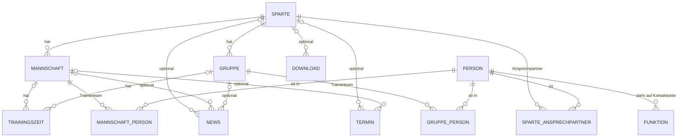
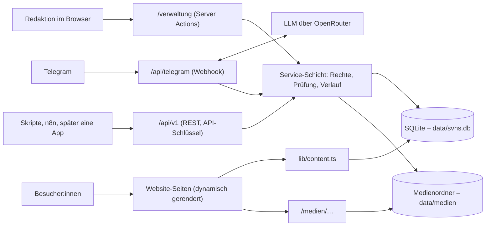
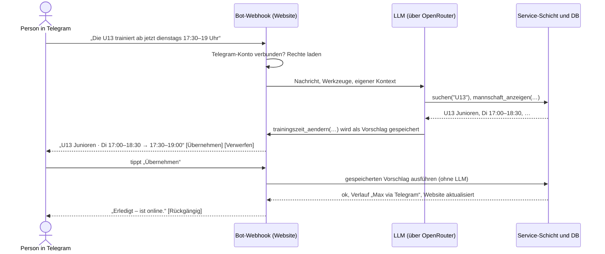

# KONZEPT – Eigene Vereinsverwaltung statt Sanity

Stand: 2026-10-20 (Verwaltung umgesetzt; Anmeldung mit Zwei-Faktor statt Einmal-Code-Login).
Davor 2026-10-03: REST-API und Telegram-Bot ergänzt, Umstellung auf SQLite, eigenen Server und
OpenRouter, Datenübernahme erledigt.  
Status: Die Verwaltung unter `/verwaltung` ist umgesetzt, einschließlich News, Termine und
Downloads. Offen sind REST-API, Telegram-Bot über OpenRouter, „Wiederherstellen“ im Verlauf und
der Betrieb auf dem Hetzner-Server (Abschnitt 14). Teile dieses Konzepts, die anders umgesetzt
wurden, sind als **ersetzt** oder **offen** gekennzeichnet.  
Scope: Mannschaften und Gruppen, Trainingszeiten, Trainer:innen/Ansprechpartner:innen, Sparten,
Kontaktseite, News, Termine und Downloads. Bearbeitet wird über die Verwaltung, später auch über
eine REST-API und einen Telegram-Bot. Die Partner entfallen.

---

## 1) Kurzfassung

- Unter **`/verwaltung`** bekommt die Website eine kleine eigene Verwaltung. Sie wird direkt ins
  bestehende Next.js-Projekt eingebaut und deckt genau unsere Inhalte ab.
- **Leitidee: Alles zu einer Mannschaft auf einer Seite.** Trainingszeiten, Trainerteam, Foto und
  Beschreibung stehen in einem Formular. Ein Klick auf „Speichern“ macht die Änderung sofort live.
- **Anmeldung mit Zwei-Faktor** (seit 20.10.2026, ersetzt den reinen QR-Code-Login): Benutzername +
  Passwort + 6-stelliger Code aus einer Authenticator-App. Ein Admin legt den Zugang an und
  bekommt einen Einladungs-QR-Code. Die Person scannt ihn, legt ihr Passwort fest und koppelt die
  App. Es gibt keine Fremdkonten und keinen Mailversand.
- **Abgestufte Rechte:** Admin, Spartenleitung (eigene Sparte) und Trainer:in (nur die eigene
  Mannschaft bzw. Gruppe).
- **REST-API und Telegram-Bot (offen):** Dieselben Funktionen soll es auch als REST-API geben.
  Darauf baut ein Telegram-Bot auf. Er versteht Nachrichten wie „U13 trainiert ab jetzt dienstags 17:30“ mit einem
  LLM (über OpenRouter, Modell noch offen) und bereitet die Änderung selbst vor. Ein Tipp auf
  „Übernehmen“, und sie ist online.
- **Technik:** SQLite-Datenbank als Datei (`data/svhs.db`), Fotos im lokalen Medienordner
  (`data/medien`), beides auf einem **eigenen Server** (geplant: Hetzner). LLM für den Bot über
  OpenRouter. Es gibt keinen separaten Datenbankdienst.
- Die bestehenden Daten aus Sanity wurden am **03.10.2026 automatisch übernommen** (siehe
  Abschnitt 13). Sanity, `/studio` und das Studio-Handbuch sind entfernt. Seit dem 20.10.2026
  werden die Inhalte über die Verwaltung gepflegt; Drizzle Studio bleibt für Technik und
  Notfälle (es umgeht Rechte und Verlauf).

---

## 2) Warum weg von Sanity – was konkret stört

Stand vor der Umstellung. Die technischen Punkte 7–9 sind mit dem Umzug erledigt.

### Für die Redaktion

1. **Zugang:** Neue Mitglieder kann nur der Projekt-Owner über manage.sanity.io einladen. Jede
   Person braucht ein eigenes Sanity-Konto (Google, GitHub oder E-Mail).
2. **Keine abgestuften Rechte:** Wer eingeloggt ist, darf alles. Das steht so auch im Handbuch.
   Ein:e Trainer:in kann also nicht „nur die eigene Mannschaft“ pflegen.
3. **Entwurf/Publish und die Reihenfolge-Falle:** Eine neue Person muss zuerst separat
   veröffentlicht werden. Sonst meldet das Studio beim Speichern der Mannschaft nur vage
   „Validierungsfehler“.
4. **Verteilte Daten:** Für eine Uhrzeit sucht man in einer Liste mit 93 Trainingszeiten. Ein
   Trainerwechsel läuft über eine andere Liste, eine neue Person über eine dritte.
5. **Halb englische Oberfläche** (Publish, Replace, Add item, Generate). Dazu kommen Altbestands-
   und Fallback-Felder im Formular („Direkte Eingaben für bestehende Einträge“, „Name (Fallback)“).
6. Bis eine Änderung live ist, vergehen **rund 60 Sekunden**.

### Für die Technik

7. Es gibt **doppelte Modelle**: eingebettete `sparte.mannschaften[]` neben zentralen
   `mannschaft`-Dokumenten, dazu `trainingszeiten_spartes` und viele `coalesce`-Fallbacks in
   `sanity/lib/queries.ts`.
8. Die **Spartenseite ordnet Trainingszeiten per Stichwort-Heuristik zu** (`getZeitenForMannschaft`,
   `getTrainerForMannschaft` in `app/sparten/[slug]/page.tsx`). Dabei sind alle 93 Trainingszeiten
   längst fest mit einer Mannschaft verknüpft.
9. Über 20 Patch- und Migrationsskripte lagen im Repo. Das Studio-Bundle (`sanity`,
   `styled-components`) steckte im Website-Projekt. Beides ist seit dem 03.10.2026 entfernt.

---

## 3) Ist-Bestand in Sanity (abgefragt am 03.10.2026)

| Inhalt | Anzahl | Befund |
|---|---|---|
| Sparten | 15 | Boule und Yoga ohne Mannschaften |
| Mannschaften | 49 | 8 ohne Trainer:in, 12 mit Foto |
| Personen | 51 | 22 mit E-Mail, 16 mit Telefon, 3 mit Foto. 13 Personen sind in mehreren Mannschaften, 5 werden nirgends verwendet |
| Trainingszeiten | 93 | **alle** mit Mannschaft verknüpft, **alle** Uhrzeiten im Format `HH:MM - HH:MM`. Der Ort ist Freitext (9 verschiedene Werte) |
| Kontaktseite (`ansprechpartner`) | 16 | alle mit einer Person verknüpft |
| Jahrgänge / Trainingsplätze | 0 / 0 | werden nicht genutzt und entfallen |
| Bilder | 27 | ca. 17 MB |
| Offene Entwürfe | 2 | Sparte Fußball, ein Ansprechpartner. Vor der Übernahme veröffentlichen oder verwerfen |

Zum Vergleich: 177 Termine (138 von fussball.de, 38 von click-tt, 1 manuell), 4 News,
5 Downloads und 4 Partner. News, Termine und Downloads wurden mit übernommen, die Partner entfallen
(sie wurden nirgends angezeigt).

**Fazit:** Die Datenmenge ist klein und gut strukturiert. Eine automatische Übernahme ist
gut machbar, Handarbeit fällt kaum an.

---

## 4) Leitprinzipien

1. **Denken wie der Verein:** Der Einstieg ist „meine Mannschaft“, nicht „Dokumenttyp Trainingszeit“.
2. **Speichern = live.** Es gibt keinen Entwurf/Publish-Schritt und keine Reihenfolge-Regeln.
   Absicherung bietet der Verlauf (die Wiederherstellen-Funktion ist noch offen). Ausnahme: News
   haben einen Schalter „veröffentlicht“.
3. **Einen Zugang einrichten geht schnell:** Admin trägt Name und Rechte ein und zeigt den
   Einladungs-QR-Code. Die Person legt ihr Passwort fest und koppelt die Authenticator-App
   (ersetzt: „Name eintragen, QR-Code zeigen, fertig“ aus dem ersten Entwurf).
4. **Jede:r sieht nur, was sie/er bearbeiten darf.** Das gilt in der Verwaltung, in der API und im Bot.
5. **Komplett deutsch und handytauglich.** Trainer:innen sollen auch vom Sportplatz aus pflegen können.
6. **Einmal pflegen, überall aktuell:** Eine Person existiert einmal, eine Trainingszeit hängt an der Mannschaft.
7. **Der Bot arbeitet zu, der Mensch entscheidet.** Der Bot bereitet Änderungen selbst vor.
   Ausgeführt wird erst nach einem Tipp auf „Übernehmen“, es sei denn, ein Zugang ist für
   „sofort ausführen“ freigeschaltet.
8. **So wenig Technik wie möglich:** Website, Datenbank und Medien laufen auf einem Server, ohne
   separaten Datenbankdienst. Für die Verwaltung braucht niemand ein Fremdkonto, nur eine
   kostenlose Authenticator-App. Telegram ist freiwillig.

---

## 5) Rollen und Rechte

Umgesetzt am 20.10.2026 (`lib/verwaltung/rechte.ts`).

| Stufe | Für wen | Darf |
|---|---|---|
| **Admin** | Vorstand, Webverantwortliche | alles, inklusive Sparten anlegen und löschen, Kontaktseite, Downloads, Zugänge und Verlauf; später API-Schlüssel |
| **Spartenleitung** | z. B. Abteilungsleitung Tischtennis | alle Mannschaften und Gruppen der eigenen Sparte(n) anlegen, bearbeiten und löschen, dazu Spartentext, -foto, -farbe und Ansprechpartner:innen; News und (manuelle) Termine der Sparte |
| **Trainer:in** | Trainerteam einer Mannschaft oder Gruppe | nur die eigene(n) Mannschaft(en) bzw. Gruppe(n) bearbeiten: Trainingszeiten, Beschreibung, Foto, Trainerteam, ausblenden; News der eigenen Teams. Löschen kann sie das Team nicht |

Technisch bleibt das einfach. Ein Zugang ist entweder Admin, oder er hat eine Liste von
**Bereichen** (Tabelle `zugang_bereiche`: Sparten, Mannschaften und/oder Gruppen). Spartenleitung
und Trainer:in sind also keine eigenen Rollen, sondern ergeben sich aus den Bereichen:

- `kannSparte` = Admin **oder** Sparte steht in den Bereichen
- `kannMannschaft` = `kannSparte(sparte der Mannschaft)` **oder** Mannschaft steht in den
  Bereichen (für Gruppen entsprechend `kannGruppe`)
- **Personen** (`kannPerson`): Wer kein Admin ist, darf eine Person nur bearbeiten, wenn sie in
  mindestens einem Trainerteam bzw. als Ansprechpartner:in vorkommt und **alle** diese
  Verwendungen im eigenen Bereich liegen. Personen mit einer Vereinsfunktion (Kontaktseite), mit
  dem Zugang einer anderen Person verknüpfte Personen und Personen in fremden Teams bzw. Sparten
  bearbeiten nur Admins. Die eigene, mit dem Zugang verknüpfte Person darf jede:r bearbeiten. Neue
  Personen darf jede:r anlegen; wer kein Admin ist, ordnet sie dabei gleich einem eigenen Team zu.
  Personen löschen nur Admins.
- **News** (`kannZuordnung`): wer die zugeordnete Sparte, Mannschaft bzw. Gruppe bearbeiten darf,
  beim Ändern die alte und die neue Zuordnung. News ohne Zuordnung (ganzer Verein) nur Admins.
- **Termine**: nur manuelle, und nur mit Recht auf die Sparte des Termins; Termine ohne Sparte nur
  Admins. Synchronisierte Spiele (fussball.de, click-tt) sind schreibgeschützt.
- **Nur Admins**: Kontaktseite, Downloads, Zugänge, Verlauf, Sparten anlegen und löschen, die
  Adresse (Slug) einer Sparte ändern, Personen löschen; später API-Schlüssel.

Diese Rechte prüft **jede Server-Aktion bzw. Speicherfunktion auf dem Server selbst**, bei jedem
Zugriff; die Oberfläche blendet nur aus, was jemand nicht darf. Die Speicherfunktionen hängen
nicht von Next.js ab, damit REST-API und Telegram-Bot sie später genauso nutzen können
(statt der ursprünglich geplanten einen Datei `lib/verwaltung/service.ts`, siehe Abschnitt 9).

---

## 6) Anmeldung mit Zwei-Faktor (Passwort + Authenticator-App)

**Entschieden am 20.10.2026, umgesetzt:** Alle Zugänge melden sich mit **Benutzername + Passwort +
6-stelligem Code aus einer Authenticator-App** an (z. B. Google Authenticator, Microsoft
Authenticator, Aegis). Das ersetzt den Login per Einmal-Code bzw. QR-Code vom 03.10.2026
(Abschnitt 6.6). Der **QR-Code** dient jetzt nur noch zwei Dingen: der **Einladung** (Link zur
Einrichtung) und der **Kopplung der Authenticator-App**. Ein Link oder QR-Code allein meldet
niemanden mehr an; jede Anmeldung braucht das Passwort und das Handy mit der App.

Weiterhin gilt: **keine Fremdkonten, kein Mailversand.** Code: `lib/verwaltung/anmeldung.ts`,
`sitzung.ts`, `passwort.ts`, `totp.ts`, `codes.ts`; Seiten unter `app/verwaltung/anmelden` und
`app/verwaltung/login`.

### 6.1 Zugang anlegen und einladen

1. Admin: „Zugänge“ → „Neuer Zugang“ → Name, Benutzername (Vorschlag aus dem Namen, z. B.
   `max.beispiel`), optional die eigene Person („das bin ich“) und die Rechte: „Alles (Admin)“
   oder „Bestimmte Bereiche“ (Sparten, Mannschaften, Gruppen).
2. Nach dem Speichern erscheint der **Einladungs-Code** (12 Zeichen wie `K7QM-9XTD-2HWP`) mit
   QR-Code und Link `…/verwaltung/anmelden#<code>`. Er gilt **7 Tage** und **einmal** und wird nur
   dieses eine Mal angezeigt.
3. Die Person scannt den QR-Code direkt vom Bildschirm, oder der Admin schickt den Link per
   Direktnachricht. Am PC lässt sich der Code auf `/verwaltung/anmelden` auch eintippen.

```
Zugang hinzufügen
  Name          [ Max Beispiel                 ]
  Benutzername  [ max.beispiel                 ]
  Eigene Person [ Person suchen …               ]   (optional, „das bin ich“)
  Darf bearbeiten
    ( ) Alles (Admin)
    (•) Bestimmte Bereiche   [x] Fußball · U13 Junioren   [ ] Sparte Tischtennis …
                                         [ Zugang anlegen und Einladungs-Code erstellen ]

Einladung für Max Beispiel
  ┌───────────┐
  │           │   K7QM-9XTD-2HWP
  │  QR-Code  │   gültig bis 27.10.2026 · nur einmal verwendbar
  │           │
  └───────────┘
  [ Link kopieren ]  [ Code kopieren ]
  ⓘ Nur persönlich oder per Direktnachricht weitergeben – nicht in Gruppen.
```

### 6.2 Zugang einrichten (einmalig)

Auf `/verwaltung/anmelden` prüft die Seite den Einladungs-Code und zeigt drei Schritte:

1. **Benutzername** zum Merken (wird für Passwort-Manager mitgegeben).
2. **Passwort festlegen** (zweimal eingeben).
3. **Authenticator-App koppeln:** QR-Code mit der App scannen oder, auf demselben Handy, den
   angezeigten Schlüssel abtippen. Zur Kontrolle den aktuellen 6-stelligen Code eingeben.

Dazu „Auf diesem Gerät angemeldet bleiben (30 Tage)“. Mit dem Abschicken ist der Einladungs-Code
verbraucht, Passwort und App sind gespeichert, und das Gerät ist angemeldet.

Das Geheimnis für die App erzeugt der Server beim Öffnen der Einladung und speichert es am
Einladungs-Code (`anmelde_codes.totp_geheimnis`). Der Browser zeigt nur QR-Code und Schlüssel an
und schickt das Geheimnis nicht zurück, sondern nur den 6-stelligen App-Code. Beim Zugang
gespeichert wird es erst, wenn dieser Code passt. Wird die Seite neu geladen, entsteht ein neues
Geheimnis; die App muss dann den neuen QR-Code scannen.

### 6.3 Anmelden

- Auf `/verwaltung/login`: **Benutzername + Passwort + aktueller App-Code.**
- „Angemeldet bleiben“: **30 Tage**, ohne Verlängerung bei Nutzung. Ohne den Haken endet die
  Sitzung mit dem Schließen des Browsers, spätestens nach **12 Stunden**.
- Ein neues Gerät (z. B. erst Handy, dann PC) meldet sich genauso an. Einen eigenen Code zum
  „Gerät hinzufügen“ braucht es nicht mehr.
- Die Fehlermeldung verrät nicht, ob Benutzername, Passwort oder App-Code falsch war.

### 6.4 Mein Zugang, Zurücksetzen, Notfall

- **„Mein Zugang“** (alle): angemeldete Geräte sehen und einzeln abmelden; Passwort ändern
  (aktuelles Passwort + App-Code). Beim Passwortwechsel werden alle anderen Geräte abgemeldet.
- **Passwort vergessen oder Handy verloren:** Ein Admin setzt den Zugang zurück. Passwort und
  App-Kopplung werden ungültig, alle Geräte abgemeldet, offene Codes gelöscht, und es gibt einen
  neuen Einladungs-Code. Danach richtet die Person den Zugang neu ein (6.2).
- **Deaktivieren** (Admin): Der Zugang ist sofort auf allen Geräten abgemeldet, offene Codes sind
  gelöscht. Wieder aktiviert, gelten Passwort und App weiter.
- **Erster Admin und Notfall:** `npm run verwaltung:admin -- "Name"` legt direkt in der Datenbank
  einen Admin an und zeigt Einladungs-Code und QR-Code im Terminal. Gibt es den Namen schon, wird
  dieser Zugang wieder aktiviert, zum Admin gemacht und zurückgesetzt. Das ist auch der Weg, wenn
  alle Admins ausgesperrt sind. Es braucht Zugriff auf den Server (`OPERATIONS.md`, Abschnitt 9).
- Es muss immer **mindestens ein aktiver Admin** übrig bleiben. Niemand kann sich selbst die
  Admin-Rechte entziehen, sich selbst deaktivieren oder löschen.

### 6.5 Sicherheitsregeln

- **Passwörter**: mindestens 10 Zeichen, nicht den Benutzernamen enthaltend, nicht nur ein
  wiederholtes Zeichen. Gespeichert als **scrypt-Hash** mit Salt. Bei unbekanntem Benutzernamen
  rechnet der Server trotzdem einen Hash, damit die Antwortzeit nichts verrät.
- **App-Codes** nach RFC 6238 (TOTP): SHA-1, 6 Ziffern, 30 Sekunden. Akzeptiert werden der
  aktuelle Zeitschritt und je einer davor und danach. **Jeder Code gilt nur einmal**, auch bei zwei
  gleichzeitigen Anmeldungen.
- **Einladungs-Codes**: 12 Zeichen aus einem eindeutigen Alphabet (Crockford: O wird als 0, I/L
  als 1 gelesen), rund 60 Bit Zufall. Gespeichert wird nur der **SHA-256-Hash**. Pro Zugang ist
  immer nur ein Code offen; ein neuer macht den alten ungültig.
- **Der Code steht im Link hinter `#`** (`…/verwaltung/anmelden#K7QM9XTD2HWP`). Dieser Teil wird
  nicht mit dem Seitenaufruf an den Server geschickt; erst die Seite selbst prüft ihn. Er landet
  also nicht in Server-Logs, und Link-Vorschauen in WhatsApp, Signal oder Telegram können ihn
  weder sehen noch verbrauchen. Verbraucht wird er erst mit dem Abschluss der Einrichtung.
- **Fehlversuche** werden begrenzt: 20 pro IP-Adresse und 5 pro Kombination aus Benutzername und
  IP-Adresse in 15 Minuten, danach eine Viertelstunde Pause. Ein Benutzername allein wird nicht
  gesperrt, damit niemand fremde Zugänge gezielt aussperren kann. Gespeichert wird nur ein Hash
  (Tabelle `fehlversuche`).
- **Geräte-Sitzungen** sind ein Zufallstoken (256 Bit) im Cookie `svhs_sitzung` (`httpOnly`,
  `SameSite=Lax`, `Secure` bei HTTPS). In der Datenbank steht nur der Hash. Jedes Gerät lässt
  sich einzeln abmelden.
- **Nachvollziehbar:** Jede Anmeldung und Abmeldung erscheint im Verlauf, z. B. „Max Beispiel ·
  iPhone · Safari · angemeldet bleiben“. Codes, Passwort-Hashes und App-Geheimnisse landen nie im
  Verlauf.
- Das **Geheimnis der App** liegt im Klartext in der Datenbank (anders geht TOTP nicht). Datenbank
  und Backups deshalb schützen (`DATA_MODEL.md`, Abschnitt 3.18).

### 6.6 Was aus dem ersten Entwurf (03.10.2026) ersetzt oder offen ist

| Erster Entwurf | Stand 20.10.2026 |
|---|---|
| Anmeldung nur mit Einmal-Code/QR-Code, ohne Passwort | **ersetzt** durch Zwei-Faktor (6.3) |
| Einladungs-Code 7 Tage, einmal, nur als Hash, Code hinter `#` | **umgesetzt**, führt jetzt zur Einrichtung von Passwort und App |
| „Gerät hinzufügen“: Code für ein weiteres Gerät, 10 Minuten | **ersetzt**: Jedes Gerät meldet sich mit Benutzername, Passwort und App-Code an. Der Zweck `geraet` in `anmelde_codes.zweck` ist ein unbenutzter Rest |
| „Mit dem Handy anmelden“ am PC (wie WhatsApp Web) | **nicht umgesetzt**; mit der Passwort-Anmeldung am PC entbehrlich. Offen, falls doch gewünscht |
| Geräte 180 Tage angemeldet, Verlängerung bei jeder Nutzung | **ersetzt**: 30 Tage mit „angemeldet bleiben“ (ohne Verlängerung), sonst 12 Stunden |
| Begrenzung z. B. 10 Fehlversuche pro IP und Viertelstunde | **ersetzt** durch die Regeln in 6.5 |
| „Telegram verbinden“ per Einmal-Code (10 Minuten) | **offen**, kommt mit dem Bot (Abschnitt 11) |
| Anmeldung im Verlauf, Geräte einzeln abmelden, Deaktivieren sperrt sofort | **umgesetzt** |

### Vergleich

| | Bisher (Sanity) | Neu |
|---|---|---|
| Zugang einrichten | Owner lädt auf manage.sanity.io ein, die Person legt ein Sanity-Konto an und nimmt die Einladung an | Admin legt den Zugang an, die Person scannt den Einladungs-QR-Code, legt ihr Passwort fest und koppelt die Authenticator-App |
| Passwort/Konto/E-Mail | Google-, GitHub- oder Sanity-Konto nötig | eigenes Passwort und eine Authenticator-App; kein Fremdkonto, keine E-Mail |
| Rechte | alle dürfen alles | Admin / Sparte / eigene Mannschaft |
| Neues Gerät | Login bei Sanity | Anmeldung mit Benutzername, Passwort und App-Code |
| Zugang entziehen | auf manage.sanity.io | ein Klick in „Zugänge“, alle Geräte sind sofort abgemeldet |

**Gut zu wissen:** Ohne E-Mail gibt es kein „Passwort vergessen“ zum Selbermachen. Wer das Passwort
vergisst oder das Handy mit der App verliert, bekommt vom Admin über „Zugang zurücksetzen“ eine
neue Einladung. Das dauert eine Minute.

---

## 7) Bedienkonzept

**Umgesetzt am 20.10.2026** unter `app/verwaltung/` (Seiten) und `components/verwaltung/`
(Bausteine). Die Skizzen unten sind der Entwurf; die wichtigsten Abweichungen:

- Die Übersicht zeigt alle bearbeitbaren Mannschaften und Gruppen nach Sparte gruppiert, mit
  Hinweisen „kein Trainerteam“, „keine Trainingszeit“ und „ausgeblendet“, dazu „Zuletzt geändert“
  (Admins: alle Änderungen, sonst die eigenen). Eine direkte Weiterleitung bei nur einem Team und
  ein Suchfeld auf der Übersicht gibt es nicht; gesucht wird in den Listen.
- Mannschaften und Gruppen liegen unter `/verwaltung/teams/<mannschaft|gruppe>/<id>`.
- Wiederherstellen über den Verlauf ist **offen** (7.2, 7.4).

### 7.1 Übersicht (Startseite nach dem Login)

```
Hallo Max
Deine Mannschaften
  ▸ U13 Junioren (Fußball)      2 Trainingszeiten · 2 Personen
  ▸ U15 Junioren (Fußball)      3 Trainingszeiten · 1 Person     ⚠ kein Foto
[ Mannschaft oder Person suchen …                 ]
Zuletzt geändert
  03.10. 14:12   Lea Muster   U13 Junioren – Trainingszeit geändert (Telegram)
```

- Wer nur eine Mannschaft betreut, landet direkt auf deren Seite.
- Admins und Spartenleitungen sehen alle Mannschaften nach Sparte gruppiert. Hinweise wie
  „kein Trainer“ oder „keine Trainingszeit“ zeigen, wo Daten fehlen. Heute betrifft das zum
  Beispiel 8 Mannschaften ohne Trainer:in.

### 7.2 Mannschaft bearbeiten (Kernstück)

```
SV Holm-Seppensen · Verwaltung                        Max B. · Abmelden
──────────────────────────────────────────────────────────────────────
← Fußball
U13 JUNIOREN                                     Auf Website ansehen ↗

ALLGEMEIN
  Name           [ U13 Junioren                      ]
  Bereich        [ Junioren ▾ ]    Altersklasse [ Jg. 2014/15 ]
  Beschreibung   [ Wir suchen noch Verstärkung …     ]
  Foto           [Bild]  Ändern · Entfernen
                 [x] Auf der Website anzeigen

TRAININGSZEITEN
  [ Dienstag ▾ ]     [17:00] – [18:30]   [ Sportanlage Tostedter Weg ▾ ]
                     [ ganzjährig ▾ ]    [ jede Woche ▾ ]   Hinweis [      ]   Löschen
  [ Donnerstag ▾ ]   [17:00] – [18:30]   [ Turnhalle Wiesenschule ▾ ]
                     [ Winter ▾ ]        [ jede Woche ▾ ]   Hinweis [      ]   Löschen
  + Trainingszeit hinzufügen

TRAINERTEAM & ANSPRECHPARTNER
  (MB) Max Beispiel   0171 1234567   [ Trainer:in ▾ ]    ↑ ↓   Entfernen
  (LM) Lea Muster     lea@…          [ Betreuer:in ▾ ]   ↑ ↓   Entfernen
  + Person hinzufügen

Zuletzt geändert am 03.10.2026, 14:12 von Lea Muster · Verlauf
──────────────────────────────────────────────────────────────────────
                                 Ungespeicherte Änderungen  [ Speichern ]
```

- **Ein Speichern-Knopf für alles.** Das Speichern läuft als eine Datenbank-Transaktion: Es
  wird alles übernommen oder nichts.
- **Uhrzeiten über eine Zeitauswahl** (von/bis) statt Freitext. Auf dem Handy erscheint dafür
  die native Zeitauswahl.
- **Ort mit Vorschlägen** aus den bestehenden Orten. Ein neuer Ort lässt sich einfach eintippen.
- **Hinweis-Feld** für Ausnahmen wie „ab Februar“.
- Beim Verlassen der Seite mit ungespeicherten Änderungen erscheint eine Warnung.
- Die Mannschaft lässt sich **ausblenden statt löschen**. Löschen geht nur mit Rückfrage
  (Spartenleitung und Admins). Der alte Stand steht im Verlauf; „Wiederherstellen“ per Knopf ist
  noch **offen**.
- **Gruppen** (Trainings- und Kursgruppen ohne Ligabetrieb, siehe Abschnitt 8) werden mit
  demselben Formular bearbeitet. Das Feld „Bereich“ gibt es dort nicht.

### 7.3 Person hinzufügen (ohne Umweg über eine andere Liste)

```
Person hinzufügen
  [ Beisp|                                       ]
    Max Beispiel        Trainer:in bei U15, U17
    Tom Beispielmann    Kontaktseite · Kassenwart
    + „Beisp…“ als neue Person anlegen
        Name     [ Beisp…             ]
        Telefon  [                    ]   E-Mail [                    ]
        Foto     [ Hochladen ]  (optional)
        ⓘ Diese Angaben erscheinen öffentlich auf der Website.
          Bitte nur mit Einverständnis der Person eintragen.
  Rolle in dieser Mannschaft   [ Trainer:in ▾ ]
                                           [ Abbrechen ]  [ Hinzufügen ]
```

Eine neue Person wird **zusammen mit der Mannschaft gespeichert**. Die Reihenfolge-Falle aus
Sanity gibt es damit nicht mehr.

### 7.4 Weitere Seiten

| Seite | Wer | Inhalt | Stand 20.10.2026 |
|---|---|---|---|
| **Personen** | alle (Rechte siehe Abschnitt 5) | Liste mit Suche. Bearbeiten: Name, Telefon, E-Mail, WhatsApp (abweichende Nummer, optional), Foto, interne Notiz. Die Seite zeigt, wo die Person vorkommt (z. B. „Trainer:in bei U13, Kontaktseite“) | umgesetzt. **Abweichung:** Löschen dürfen nur Admins, auch wenn die Person noch verwendet wird; die Verwendung wird vorher angezeigt |
| **Sparten** | Admin, Spartenleitung | Name, Icon, Farbe, Kurz- und Langtext, Foto, Ansprechpartner:innen der Sparte, Reihenfolge der Mannschaften und Gruppen | umgesetzt; anlegen, löschen und Adresse ändern nur Admins |
| **Kontaktseite** | Admin | Gruppen „Vorstand / Abteilungsleiter / Weitere Ansprechpartner“ (Tabelle `funktionen`). Jede Zeile besteht aus Person und Funktion, sortierbar | umgesetzt |
| **News, Termine, Downloads** | siehe Abschnitt 5 | News mit Markdown-Text und Vorschau, Titelbild und Schalter „veröffentlicht“; manuelle Termine; Downloads als PDF-Upload | umgesetzt (vorgezogen aus Schritt 7) |
| **Mein Zugang** (Entwurf: „Meine Geräte“) | alle | eigene Geräte sehen und abmelden, Passwort ändern | umgesetzt. „Gerät hinzufügen“ **ersetzt** (Abschnitt 6.6), „Telegram verbinden“ **offen** |
| **Zugänge** | Admin | Liste aller Zugänge mit Rechten, Status, Geräten und letzter Anmeldung. Anlegen mit Einladungs-QR, Rechte und eigene Person ändern, zurücksetzen, deaktivieren, löschen, Geräte abmelden | umgesetzt. Telegram-Status, Bot-Modus und API-Schlüssel **offen** |
| **Verlauf** | Admin | Wer hat wann was geändert und über welchen Weg, mit Vorher/Nachher; Filter nach Art und Zugang | umgesetzt als Ansicht. **Offen:** „Wiederherstellen“ und ein Verlauf für Spartenleitungen (eigene Sparte) |
| **Einstellungen** | Admin | optional: „Trainingszeiten gültig ab“ (heute fest im Code: 01.12.2025) und die allgemeinen Kontaktdaten der Kontaktseite | **offen** |

---

## 8) Datenmodell (umgesetzt am 03.10.2026 bzw. 20.10.2026)

Die Inhaltstabellen sind seit dem 03.10.2026 umgesetzt (Schema in `lib/db/schema.ts`, Migration
`drizzle/0000_initial.sql`), die Verwaltungstabellen seit dem 20.10.2026 (Migration
`drizzle/0001_verwaltung.sql`). Ausführliche Beschreibung: `DATA_MODEL.md`.



### Inhaltstabellen

Alle Tabellen mit eigener `id` haben zusätzlich `erstellt_am` und `geaendert_am`. Bild- und
Dateifelder enthalten den relativen Pfad im Medienordner.

| Tabelle | Felder |
|---|---|
| `sparten` | id, **slug**, name, icon, farbe, kurzbeschreibung, beschreibung, foto, sichtbar, reihenfolge |
| `mannschaften` | id, **sparte_id**, name, bereich, altersklasse, beschreibung, foto, sichtbar, reihenfolge. Nur Teams mit Ligabetrieb (Fußball, Tischtennis) |
| `gruppen` | id, **sparte_id**, name, altersklasse, beschreibung, foto, sichtbar, reihenfolge. Trainings- und Kursgruppen ohne Ligabetrieb, z. B. auch Fußball-Torwarttraining |
| `trainingszeiten` | id, **mannschaft_id und/oder gruppe_id** (mindestens eines Pflicht), wochentag (1–7), **beginn**, **ende** (`HH:MM`), ort, saison (ganzjährig/Sommer/Winter), rhythmus (jede Woche/alle 2 Wochen), hinweis, reihenfolge |
| `personen` | id, name, email, telefon, whatsapp, foto, notiz (intern) |
| `mannschaft_personen`, `gruppe_personen` | mannschaft_id bzw. gruppe_id, person_id, **rolle** (Standard Trainer:in; Vorschläge Co-Trainer:in, Torwarttrainer:in, Betreuer:in, Übungsleiter:in), reihenfolge |
| `sparte_ansprechpartner` | sparte_id, person_id, rolle (Standard Ansprechpartner:in, z. B. Abteilungsleitung), reihenfolge |
| `funktionen` | id, person_id, bezeichnung (z. B. „1. Vorsitzender“), gruppe (vorstand/abteilungsleitung/weitere), sparte_id (optional), reihenfolge. Vereinsfunktionen auch ohne Mannschaft oder Sparte |
| `news` | id, **slug**, titel, teaser, inhalt (Markdown), bild, bild_breite, bild_hoehe, kategorie, datum, veroeffentlicht, sparte_id / mannschaft_id / gruppe_id (alle optional; ohne Bezug gehört die News dem Verein) |
| `termine` | id, titel, datum, uhrzeit (Freitext), ort, beschreibung, bild, bereich, tags, sparte_id, mannschaft_id, **quelle** (manuell/fussball-de/click-tt), **externe_id** |
| `downloads` | id, titel, beschreibung, kategorie, datei, datum, sparte_id (optional), reihenfolge |

Geplant waren an den Inhaltstabellen außerdem `version` (an Mannschaft, Gruppe, Trainingszeit
und Person) und `geaendert_von`. **Beides ist ersetzt:** Gleichzeitige Änderungen erkennt die
Verwaltung am Feld `geaendert_am` (`DATA_MODEL.md`, Abschnitt 7.3), und wer etwas geändert hat,
steht im Verlauf.

### Verwaltungstabellen

| Tabelle | Zweck | Stand 20.10.2026 |
|---|---|---|
| `zugaenge` | id, name, **benutzername**, **passwort_hash**, **totp_geheimnis**, totp_letzter_schritt, eingerichtet_am, ist_admin, aktiv, person_id (optional: „das bin ich“), erstellt_von, letzte_anmeldung | umgesetzt (fett: neu für die Zwei-Faktor-Anmeldung). **Offen** mit dem Bot: telegram_user_id, bot_modus (Bestätigung/Sofort) |
| `zugang_bereiche` | zugang_id, sparte_id **oder** mannschaft_id **oder** gruppe_id | umgesetzt |
| `anmelde_codes` | zugang_id, Hash des Codes, Zweck, laeuft_ab, verwendet_am, erstellt_von, dazu das App-Geheimnis während der Einrichtung | umgesetzt für Einladungen. Zweck „Gerät“ **ersetzt** (unbenutzt), „Telegram“ **offen** |
| `geraete` | zugang_id, Hash der Sitzungs-ID, Gerätename (z. B. „iPhone · Safari“), angemeldet_am, zuletzt_aktiv, laeuft_ab | umgesetzt |
| `fehlversuche` | Hash aus IP bzw. Benutzername und IP, Zeitpunkt. Begrenzung der Fehlversuche | umgesetzt |
| `verlauf` | Zeitpunkt, zugang_id, zugang_name, **Quelle** (Verwaltung/API/Telegram/System), Aktion, Objekttyp und -ID, Bezeichnung, Vorher/Nachher (JSON) | umgesetzt. Eine Spalte „Notiz“ (z. B. für die Telegram-Nachricht) **offen** |
| `api_schluessel` | zugang_id, Name, Hash, sichtbarer Anfang (z. B. `svhs_7Kq…`), nur_lesen, laeuft_ab, zuletzt_benutzt | **offen** (REST-API) |
| `bot_vorschlaege` | zugang_id, Chat, Änderungen (JSON), Status (offen/übernommen/verworfen/abgelaufen), laeuft_ab, Originalnachricht | **offen** (Bot) |
| `bot_gespraeche` | Chat, Gesprächsverlauf (JSON), zuletzt_aktiv | **offen** (Bot) |

### Was sich gegenüber Sanity ändert

- **Die Trainingszeit hängt fest an Mannschaft und/oder Gruppe** (per CHECK abgesichert). Damit
  fallen Heuristik, `trainingszeiten_spartes` und Legacy-Felder (`sparte`, `gruppe`, `trainer`,
  `email`, `telefon` an der Trainingszeit) weg.
- **Mannschaften und Gruppen sind getrennt.** Mannschaften haben Ligabetrieb und einen Bereich,
  Gruppen sind Trainings- und Kursgruppen. Beide gehören zu genau einer Sparte.
- **Die Rolle gilt pro Zuordnung** (Trainer:in in U13, Betreuer:in in U15) statt `person.rollen[]`.
  Bisher zeigte die Website immer `rollen[0]`, auch wenn die Person in einer Mannschaft eine andere
  Rolle hatte. Das konnte die 13 Personen treffen, die in mehreren Mannschaften stehen.
- **Die Uhrzeit wird strukturiert** gespeichert (`beginn`/`ende`). Die 93 Bestandswerte wurden
  automatisch umgewandelt, und die Sortierung nach Uhrzeit funktioniert richtig.
- **Der Ort bleibt Text**, in der Verwaltung mit Vorschlägen aus den vorhandenen Orten. Eine eigene Trainingsplatz-Verwaltung gibt
  es nicht (in Sanity 0 Einträge). Ein Klammerzusatz wie „(ab Februar)“ gehört ins Feld `hinweis`.
- **Der Jahrgang-Typ entfällt** (0 Einträge). Stattdessen gibt es ein Freitextfeld „Altersklasse“
  an Mannschaft und Gruppe.
- **Kontaktseite = `funktionen`.** Vereinsfunktionen hängen an der Person, nicht an einer Mannschaft.
- **News, Termine und Downloads haben echte Bezüge** (Fremdschlüssel) statt Sparten als Freitext.
  Der News-Text ist Markdown statt Portable Text.
- **Gleichzeitige Änderungen** überschreiben sich nicht gegenseitig: Die Verwaltung prüft beim
  Speichern `geaendert_am` (ersetzt die geplante Spalte `version`). Für API und Bot ist das noch
  festzulegen.
- **Kein eingebetteter Altbestand und keine Fallback-Felder mehr.**

---

## 9) Technische Architektur

**Eine Service-Schicht, drei Eingänge.** Verwaltung, REST-API und Telegram-Bot nutzen dieselben
Funktionen. Rechte, Prüfung und Verlauf sitzen damit an einer einzigen Stelle. Umgesetzt ist
bisher der Eingang Verwaltung; REST-API und Bot sind **offen**. Die „Service-Schicht“ besteht aus
Speicherfunktionen ohne Next.js-Abhängigkeit (`lib/verwaltung/*.ts`,
`lib/verwaltung/inhalte/*.ts`, `app/verwaltung/(intern)/*/logik.ts`), die Rechte prüfen, in
einer Transaktion speichern und den Verlauf schreiben.



| Baustein | Wahl | Warum |
|---|---|---|
| Datenbank | **SQLite** als Datei (`data/svhs.db`) über `better-sqlite3` ✅ umgesetzt | kein separater Datenbankdienst, Backup = Datei sichern, echte Verknüpfungen, Transaktionen und CHECK-Constraints; für unsere Datenmenge mehr als ausreichend |
| DB-Zugriff | **Drizzle ORM**, Migrationen mit `drizzle-kit` ✅ umgesetzt | typsicher und schlank, das Schema liegt als TypeScript im Repo; Migrationen laufen beim ersten Zugriff automatisch |
| Hosting | **eigener Server** (geplant: Hetzner), `next start` hinter nginx | SQLite und Medienordner brauchen ein dauerhaft beschreibbares Dateisystem; Vercel ist damit nicht nutzbar |
| Service-Schicht | Speicherfunktionen in `lib/verwaltung/` und `app/verwaltung/(intern)/*/logik.ts` ✅ umgesetzt (statt einer Datei `lib/verwaltung/service.ts`) | Rechte, Prüfung und Verlauf in jeder Funktion; ohne Next.js-Abhängigkeit, damit API und Bot sie später nutzen können |
| Schemas | **zod** – **offen** | geplant: ein Schema für Formularprüfung, API-Prüfung, OpenAPI-Beschreibung und Bot-Werkzeuge. Die Verwaltung prüft bisher mit eigenen Hilfsfunktionen (`lib/verwaltung/pruefhilfen.ts`); zod kommt frühestens mit der REST-API |
| Anmeldung | Passwort mit **scrypt**, App-Codes nach **TOTP** (RFC 6238), beides mit `node:crypto` ✅ umgesetzt | keine Fremdbibliothek und kein Fremddienst für den Login (Abschnitt 6) |
| Fotos | **lokaler Medienordner** `data/medien`, ausgeliefert unter `/medien/<pfad>` ✅ umgesetzt | liegt neben der Datenbank auf dem Server, kein Fremddienst. Bilder verkleinert die Verwaltung mit **`sharp`** vor dem Speichern (max. 1600 px, WebP, ohne EXIF/GPS). Hochgeladene Dateien (auch PDFs) bekommen immer einen Inhalts-Hash im Namen (`<name>-<hash8>.<ext>`), weil `/medien` solche Namen ein Jahr lang cacht. Ersetzte Dateien löscht die Verwaltung, wenn nichts mehr darauf verweist; den Bildcache von `next/image` danach von Hand leeren (`OPERATIONS.md`, Abschnitt 7.4) |
| QR-Codes | Paket `qrcode` (erzeugt SVG auf dem Server) ✅ umgesetzt | Die Website braucht keinen eigenen Scanner, die Handykamera reicht |
| Formulare | **Server Actions** ✅ umgesetzt | keine eigene API für die Oberfläche nötig; Uploads bis 16 MB pro Anfrage (`next.config.js`) |
| Aktualität | Seiten rendern dynamisch (`force-dynamic`) ✅ umgesetzt | Änderungen sind **sofort** sichtbar, auch über API und Bot. Ein `revalidateTag` ist nicht mehr nötig |
| Zeitgesteuerte Aufgaben | **crontab** auf dem Server | ruft die Cron-Endpunkte (Spiele-Sync) per `curl` auf und startet das nächtliche Backup |
| LLM | über **OpenRouter**, Modell noch offen | siehe Abschnitt 11 |
| Testen | Kopie der Datenbankdatei (z. B. aus dem nächtlichen Backup) | Testen, ohne Live-Daten zu gefährden |

### Ordnerstruktur (Stand 20.10.2026)

Der ursprüngliche Vorschlag (`lib/auth.ts`, `lib/verwaltung/service.ts`, `schemas.ts`,
`actions.ts`, `mannschaften/[id]`, `scripts/verwaltung-admin.mjs`) ist so umgesetzt:

```
app/verwaltung/
  layout.tsx                 ← eigener Rahmen ohne Website-Navbar/Footer, noindex
  aktionen.ts                ← Server-Aktionen: einrichten, anmelden, abmelden, Passwort ändern
  login/                     ← Anmeldung: Benutzername + Passwort + App-Code
  anmelden/                  ← Ziel des Einladungs-QR-Codes: Passwort festlegen, App koppeln
  (intern)/                  ← alles, was eine Sitzung braucht
    layout.tsx               ← Sitzung prüfen, Navigation nach Rechten
    page.tsx                 ← Übersicht
    teams/[art]/[id]/        ← Mannschaft bzw. Gruppe bearbeiten (Kernstück)
    personen/  sparten/  kontakte/  news/  termine/  downloads/
    zugaenge/  verlauf/  geraete/ („Mein Zugang“)
    */aktionen.ts, */logik.ts ← Server-Aktionen bzw. Speicherlogik je Bereich
components/verwaltung/       ← Formularbausteine, Navigation, Foto- und Personenauswahl
lib/verwaltung/
  anmeldung.ts               ← Einladung, Einrichtung, Anmeldung, Fehlversuche, Sitzungen
  sitzung.ts                 ← Cookie, aktuelle Sitzung, Admin-Prüfung, Client-IP
  rechte.ts                  ← wer darf was
  passwort.ts  totp.ts  codes.ts  qr.ts
  person-bearbeiten.ts  team-bearbeiten.ts  inhalte/ (News, Termine, Downloads)
  medien-upload.ts           ← Bilder (sharp) und PDFs speichern, alte Dateien freigeben
  verlauf.ts                 ← Einträge ins Änderungsprotokoll
scripts/verwaltung-admin.ts  ← ersten Admin anlegen, Notfall-Zugang
app/api/v1/…                 ← REST-API (offen)
app/api/telegram/route.ts    ← Webhook des Telegram-Bots (offen)
lib/bot/                     ← Telegram-Anbindung, Werkzeuge, System-Prompt, Vorschläge (offen)
```

### Auswirkungen auf die Website

Umgesetzt am 03.10.2026:

- `lib/content.ts` behält seine Funktionsnamen (`getSparten`, `getSparteBySlug`,
  `getTrainingszeiten`, `getAnsprechpartner` usw.) und liest aus der Datenbank. Die Seiten
  mussten kaum angepasst werden.
- Die **Spartenseite ist einfacher:** Jede Mannschaft und Gruppe bringt ihre Trainingszeiten und
  ihr Trainerteam direkt mit. Die Stichwort-Heuristik und die Embedded-/Zentral-Logik entfallen.
- Bilder kommen vom eigenen Server (`/medien/…`); eine externe Bild-Domain in `next.config.js`
  ist nicht mehr nötig.

Umgesetzt am 20.10.2026:

- `components/SiteChrome.tsx` blendet Navbar, Footer und Cookie-Banner unter `/verwaltung` aus.

Noch offen:

- Hat eine Mannschaft oder Gruppe keine Personen, zeigt die Spartenseite die
  Ansprechpartner:innen der Sparte (klare Regel statt Heuristik). Mit der neuen Spartenseite prüfen.

---

## 10) REST-API

**Status (20.10.2026): offen.** Die Speicherfunktionen der Verwaltung sind so gebaut, dass die API
sie nutzen kann (Abschnitt 9).

Die REST-API stellt dieselben Funktionen wie die Verwaltung für Programme bereit: für den
Telegram-Bot, für Skripte (statt der früheren Patch-Skripte) und später zum Beispiel für
n8n oder eine App.

### Grundregeln

- **Basis:** `/api/v1`, JSON, Feldnamen wie im Datenmodell.
- **Anmeldung:** `Authorization: Bearer <API-Schlüssel>`. Ein Schlüssel gehört zu einem Zugang
  und hat **genau dessen Rechte**, auf Wunsch nur lesend.
  - Admins erstellen Schlüssel unter „Zugänge“. Ein Schlüssel wird einmal angezeigt und nur als
    Hash gespeichert. Er kann ablaufen und ist jederzeit widerrufbar.
  - Schlüssel beginnen mit `svhs_`. So erkennt man sie in Logs und Code sofort, und
    Secret-Scanner können gezielt danach suchen.
- **Dieselbe Service-Schicht** wie die Verwaltung: gleiche Prüfungen, gleiche Rechte. Jeder
  Schreibzugriff landet im Verlauf (Quelle „API“).
- **Gleichzeitige Änderungen:** Jedes Objekt hat eine `version`. Wer mit einer veralteten Version
  schreibt, bekommt `409 Konflikt` und überschreibt nichts. (Offen: Die Verwaltung nutzt statt
  `version` den Wert `geaendert_am`; ob die API dasselbe Feld nimmt, ist noch festzulegen. Das
  Beispiel unten zeigt den ursprünglichen Entwurf.)
- **Fehler** kommen als JSON mit deutscher Meldung und Feldangaben, mit den üblichen
  Statuscodes (400, 401, 403, 404, 409, 422, 429).
- **Begrenzung:** zum Beispiel 60 Anfragen pro Minute und Schlüssel.
- **Beschreibung:** `/api/v1/openapi.json` wird aus denselben zod-Schemas erzeugt wie die
  Formularprüfung und die Bot-Werkzeuge.

### Endpunkte (v1)

| Methode | Pfad (unter `/api/v1`) | Zweck |
|---|---|---|
| `GET` | `/sparten` | Sparten mit ihren Mannschaften (kompakt) |
| `GET` | `/mannschaften?sparte=…&suche=…` | Mannschaften finden |
| `GET` | `/mannschaften/{id}` | Mannschaft mit Trainingszeiten und Trainerteam |
| `POST` / `PATCH` / `DELETE` | `/mannschaften`, `/mannschaften/{id}` | anlegen, ändern, löschen (Anlegen/Löschen: Spartenleitung, Admin) |
| `POST` | `/mannschaften/{id}/trainingszeiten` | Trainingszeit hinzufügen |
| `PATCH` / `DELETE` | `/trainingszeiten/{id}` | Trainingszeit ändern oder entfernen |
| `PUT` | `/mannschaften/{id}/personen` | Trainerteam setzen (Liste aus Person und Rolle) |
| `GET` / `POST` | `/personen?suche=…`, `/personen` | Personen finden oder anlegen |
| `PATCH` | `/personen/{id}` | Kontaktdaten ändern |
| `PUT` | `/mannschaften/{id}/foto`, `/personen/{id}/foto` | Foto hochladen |
| `GET` | `/verlauf` | Änderungen im eigenen Bereich |
| `POST` | `/verlauf/{id}/rueckgaengig` | Änderung zurücknehmen |

Kontaktseite, Sparten-Stammdaten und Zugänge bleiben zunächst der Oberfläche vorbehalten.

```http
PATCH /api/v1/trainingszeiten/42
Authorization: Bearer svhs_…
Content-Type: application/json

{ "version": 12, "beginn": "17:30", "ende": "19:00" }
```

Die Antwort `200` enthält die geänderte Trainingszeit mit `"version": 13`. Im Verlauf steht
„Max Beispiel · API · Trainingszeit U13 Junioren geändert“.

---

## 11) Telegram-Bot mit LLM

**Status (20.10.2026): offen.** Modell, OpenRouter-Konto und Budget sind noch nicht festgelegt
(Abschnitt 16).

Trainer:innen und Spartenleitungen schreiben dem Vereinsbot in normaler Sprache, und der Bot
pflegt die Website. Er versteht die Nachricht mit einem LLM (über OpenRouter) und sucht die richtige
Mannschaft. Die Änderung erledigt er über dieselben Funktionen wie die REST-API, immer im Namen
und mit den Rechten der verbundenen Person.

### Was der Bot kann (erste Version)

| Beispiel-Nachricht | Was passiert |
|---|---|
| „Wann trainiert die U13?“ | Antwort aus der Datenbank (nur lesen) |
| „Die U13 trainiert ab jetzt dienstags 17:30 bis 19 Uhr.“ | Trainingszeit ändern |
| „Donnerstags kommt bei den Damen noch 19–20:30 Uhr in der Nordheidehalle dazu.“ | Trainingszeit hinzufügen |
| „Tom Beispiel ist neuer Co-Trainer der U15, Tel. 0171 1234567.“ | Person anlegen und zuordnen |
| „Meine neue Handynummer ist 0160 …“ | eigene Kontaktdaten ändern (der Zugang ist mit der eigenen Person verknüpft) |
| Foto mit „Neues Mannschaftsfoto für die U13“ | Foto setzen |
| „Rückgängig“ | letzte eigene Änderung zurücknehmen |

Nicht per Bot (erste Version): Mannschaften oder Personen löschen, Sparten, Kontaktseite, Zugänge.

### Ablauf



### „Selbstständig“ – aber mit Netz

Der Bot erledigt die Arbeit selbst. Er versteht die Nachricht, findet die Mannschaft und
formuliert die Änderung. Ist etwas mehrdeutig, fragt er nach („U13 Junioren oder U13
Juniorinnen?“). Ausgeführt wird in einem von zwei Modi, einstellbar pro Zugang:

| Modus | Ablauf | Empfehlung |
|---|---|---|
| **Mit Bestätigung** | Der Bot zeigt Vorher/Nachher, ein Tipp auf „Übernehmen“ führt aus | Start für alle |
| **Sofort** | Der Bot ändert direkt und meldet „Erledigt“ mit „Rückgängig“-Knopf | später für erfahrene Zugänge, z. B. nur für Trainingszeiten |

Empfohlen ist eine Einführung in drei Stufen:

1. Der Bot beantwortet nur Fragen.
2. Der Bot ändert mit Bestätigung.
3. „Sofort“ wird für einzelne Zugänge freigeschaltet.

### Telegram verbinden

1. In der Verwaltung: „Mein Zugang“ → „Telegram verbinden“. Es erscheint ein QR-Code, 10 Minuten gültig.
2. Der Scan öffnet Telegram mit dem Vereinsbot (`t.me/<Bot>?start=<Einmal-Code>`). Dort „Starten“ tippen.
3. Der Bot antwortet: „Hallo Max, du bist verbunden. Du darfst bearbeiten: U13 Junioren.“

Das funktioniert wie der Einladungs-Code: einmal gültig, nur als Hash gespeichert (Tabelle
`anmelde_codes`, eigener Zweck „Telegram“). Unbekannte Telegram-Konten bekommen nur „Nicht
freigeschaltet“ zurück. Dafür gibt es keinen LLM-Aufruf, also auch keine Kosten. Der Bot
antwortet nur in Einzelchats, nicht in Gruppen.

### Leitplanken

1. **Nie mehr Rechte als in der Verwaltung:** Jedes Werkzeug läuft über die Service-Schicht, mit
   den Rechten der verbundenen Person.
2. **Das LLM schlägt vor, der Server führt aus:** Schreib-Werkzeuge erzeugen einen gespeicherten
   Vorschlag. Beim Tipp auf „Übernehmen“ führt der Server genau diesen Vorschlag aus, ohne
   erneuten LLM-Aufruf. Was angezeigt wurde, wird auch umgesetzt.
3. **Identität und Rechte kommen vom Server**, nicht aus dem Chattext. Inhalte aus der Datenbank
   (z. B. Beschreibungen) gehen als Daten an das LLM, nicht als Anweisungen. Das schützt vor
   untergeschobenen Befehlen (Prompt-Injection).
4. **Begrenzt:**
   - höchstens 10 Änderungen pro Vorschlag
   - Vorschläge verfallen nach einer Stunde
   - Anfragelimit pro Person und Tag
   - Ausgabenlimit bei OpenRouter
5. **Nachvollziehbar:** Der Verlauf zeigt die Quelle „Telegram“ und die Originalnachricht.
   „Rückgängig“ geht im Chat und in der Verwaltung.
6. **Webhook gesichert:** Der geheime Header von Telegram wird geprüft. Doppelte Zustellungen
   (gleiche `update_id`) werden ignoriert.

### Technik

| Baustein | Wahl |
|---|---|
| Telegram-Anbindung | Bot über BotFather anlegen, Webhook-Route `app/api/telegram/route.ts`. Die Route antwortet sofort, die Verarbeitung läuft im Node-Prozess des eigenen Servers weiter (kein `waitUntil` wie bei Vercel nötig) |
| LLM | über **OpenRouter** statt direkt über die Anthropic-API: ein Schlüssel, Modelle verschiedener Anbieter wählbar. **Modellwahl offen.** Der Antwortgrund wird geprüft, damit abgebrochene oder abgelehnte Antworten nicht als Vorschlag durchgehen |
| Werkzeuge | Werkzeug-Aufrufe (Tool Calling) über OpenRouter. Die Werkzeugbeschreibungen entstehen aus denselben zod-Schemas wie die REST-API. Die konkrete Bibliothek ist noch offen |
| Werkzeugliste | Lesen: `suchen`, `mannschaft_anzeigen`, `trainingszeiten_anzeigen`. Vorschlagen: `trainingszeit_aendern`, `trainingszeit_hinzufuegen`, `trainingszeit_entfernen`, `mannschaft_aendern`, `person_anlegen`, `person_aendern`, `person_zuordnen`, `person_entfernen`, `foto_setzen` |
| Gesprächsverlauf | pro Vorgang, bis „Übernehmen“/„Verwerfen“ oder 30 Minuten Pause. Der Verlauf wird nur angehängt und nie nachträglich gekürzt |
| Prompt-Caching | Werkzeuge und System-Prompt stehen unverändert am Anfang, damit sie zwischengespeichert werden können, sofern das gewählte Modell das unterstützt. Persönliches (Name, Rechte, Datum) kommt danach |
| Fotos | Telegram-Datei laden, verkleinern, im Medienordner speichern, als Vorschlag mit Vorschau |

**Kosten:** hängen vom gewählten Modell ab; OpenRouter rechnet pro Token zum Preis des jeweiligen
Modells ab. Eine typische Anfrage hat zwei bis vier Werkzeugschritte. Bei einigen Dutzend Anfragen
im Monat sind die Kosten gering. Ein Ausgabenlimit bei OpenRouter deckelt sie. Eine genaue
Schätzung folgt mit der Modellwahl.

---

## 12) Sicherheit, Datenschutz, Backups

- **Login und Geräte:** Zwei-Faktor mit Passwort und Authenticator-App, siehe Abschnitt 6.
  Betrieb (Cookie hinter nginx, Notfall-Zugang): `OPERATIONS.md`, Abschnitt 9.
- **API-Schlüssel:** siehe Abschnitt 10 (offen).
- **Bot:** siehe die Leitplanken in Abschnitt 11 (offen).
- **Rechte** prüft jede Speicherfunktion bei jedem Zugriff selbst (siehe Abschnitt 5).
- **Gleichzeitiges Bearbeiten:** Hat jemand anderes die Mannschaft inzwischen gespeichert,
  kommt der Hinweis „Bitte neu laden“, statt die Änderung stillschweigend zu überschreiben.
  Umgesetzt in der Verwaltung; für API und Bot noch offen.
- **Verlauf:** Jede Änderung wird mit Person, Quelle, Zeitpunkt, Vorher und Nachher gespeichert.
  „Wiederherstellen“ ist noch **offen**; bis dahin werden alte Werte von Hand übernommen.
- **Backup:** Ein nächtlicher Cronjob (crontab) sichert die SQLite-Datei konsistent (`.backup`)
  und den Medienordner, bewahrt 30 Tage auf und kopiert die Sicherung außer Haus. Einrichtung und
  Wiederherstellung: `OPERATIONS.md`, Abschnitt 4.
- **Datenschutz:**
  - Serverstandort in Deutschland bzw. der EU wählen.
  - Auftragsverarbeitungsvertrag mit Hetzner (Hosting) abschließen. Für den Bot klären, welche
    Vereinbarung mit OpenRouter und dem Anbieter des gewählten Modells nötig und möglich ist.
  - **Bot:** Nachrichten laufen über Telegram, und ihr Inhalt geht zur Verarbeitung an
    OpenRouter (USA) und den Anbieter des gewählten Modells. Das kann Namen und Telefonnummern
    von Trainer:innen betreffen. Deshalb nutzen den Bot nur Vereinsverantwortliche, freiwillig,
    und es gehen keine Mitgliederlisten oder sensiblen Daten darüber.
  - Die Datenschutzerklärung um Hosting (eigener Server), die Verwaltung (Anmelde-Cookie,
    Verlauf), Telegram-Bot und LLM ergänzen. Heute erwähnt `app/datenschutz/page.tsx` das
    Hosting nicht.
  - Für Zugänge werden keine E-Mail-Adressen gebraucht, nur Name, Benutzername und Gerätename.
    IP-Adressen stehen nur gehasht und nur etwa einen Tag lang in `fehlversuche`.
  - Der Verlauf hebt alte Stände dauerhaft auf, bei Personen auch Kontaktdaten und interne
    Notizen. Eine Löschfrist dafür ist **offen** (Abschnitt 16).
  - Hochgeladene Bilder verlieren ihre Metadaten (EXIF, GPS).
  - Im Formular steht der Hinweis, dass Kontaktdaten öffentlich erscheinen.

---

## 13) Datenübernahme aus Sanity – ✅ erledigt (03.10.2026)

Die Übernahme lief in zwei Schritten und hat **alle** Inhalte erfasst, nicht nur Mannschaften,
Personen und Trainingszeiten:

1. **Export** mit `scripts/sanity-export.mjs` (`npm run export:sanity`): alle veröffentlichten
   Dokumente, die offenen Entwürfe und alle referenzierten Bilder und Dateien (32 Assets, ca.
   17 MB) nach `data/import/`. Das Skript nutzt nur `fetch`, kein Sanity-Paket.
2. **Import** mit `scripts/import-aus-sanity.ts` (`npm run import:sanity`):
   - plant und prüft den ganzen Import, bevor etwas gelöscht wird,
   - legt Datenbank und Medienordner neu an und schreibt alle Zeilen in **einer Transaktion**,
   - kopiert die Bilder und Dateien in den Medienordner,
   - schreibt einen **Bericht** nach `data/import/import-bericht.md`.
3. Wesentliche Umwandlungen:
   - `uhrzeit` „17:00 - 18:30“ wird zu `beginn`/`ende`.
   - `ort` „KuRa Platz Wiesenschule (ab Februar)“ wird zu Ort plus Hinweis.
   - Sanity-`mannschaft` wird zu `mannschaften` (Fußball-Teams, Tischtennis-Ligateams) oder
     `gruppen` (alles andere, inkl. Fußball-Torwarttraining und Tischtennis-Trainingsgruppe).
     `trainer[]` wird zu `mannschaft_personen` bzw. `gruppe_personen`.
   - Eingebettete Sparten-Kontakte und Abteilungsleitungen werden zu `sparte_ansprechpartner`,
     `ansprechpartner` wird zu `funktionen`.
   - News: Portable Text wird zu Markdown. Termine: `fussballDeId`/`clickTtId` werden zu
     `quelle` + `externe_id`. Partner entfallen.
4. Grundlage sind die veröffentlichten Dokumente. Der offene Sparten-Entwurf wurde nur für
   Kontaktdaten mit ausgewertet; andere Entwürfe nennt der Bericht.

Eine `sanity_id` wird nicht gespeichert. Die Zuordnung lässt sich über den Bericht und den
Export nachvollziehen.

### Umstellung

Weil die Website noch nicht produktiv ist, wurde **direkt und vollständig** umgestellt: kein
Redaktionsstopp, kein Schalter `CONTENT_SOURCE`, kein Parallelbetrieb. Sanity, `/studio`, das
Studio-Handbuch, die Sanity-Pakete und die alten Skripte sind entfernt. Einen Rückweg zu Sanity
gibt es nicht mehr; Absicherung bieten der Export in `data/import/` und die Backups.

**Achtung:** `npm run import:sanity` löscht und ersetzt Datenbank und Medienordner. Nach dem
Beginn der Pflege in SQLite nur noch für frische Entwicklungsumgebungen verwenden. Seit dem
20.10.2026 bricht der Import ab, sobald es Zugänge der Verwaltung gibt; nur mit
`npm run import:sanity -- --alles-ueberschreiben` verwirft er trotzdem alles, auch Zugänge,
Verlauf und Uploads.

Offen bleibt: im Sanity-Projekt alle Tokens widerrufen (sie stehen in der öffentlichen
Git-Historie) und das Projekt danach löschen (`OPERATIONS.md`, Abschnitt 8.1).

---

## 14) Fahrplan

| Schritt | Inhalt | Umfang | Status (20.10.2026) |
|---|---|---|---|
| **0 – Vorbereitung** | Hetzner-Server einrichten (Node.js, nginx, TLS), Env-Variablen, crontab für die Cronjobs, nächtliches Backup mit Kopie außer Haus, erster Admin (`OPERATIONS.md`) | klein | **offen** (Hetzner-Deployment) |
| **1 – Fundament** | DB-Schema und Migrationen, Übernahmeskript; Service-Schicht (Rechte, Prüfung, Verlauf), Login mit Geräteverwaltung, Skript für den ersten Admin, Grundlayout `/verwaltung` | mittel | ✅ erledigt. Login als Zwei-Faktor mit Passwort und Authenticator-App statt QR-/Anmelde-Code (Abschnitt 6) |
| **2 – Kern** | „Mannschaft bearbeiten“ (auch für Gruppen) mit Trainingszeiten und Trainerteam, Personen, Foto-Upload, Verlauf. Website liest aus der DB, Spartenseite ohne Heuristik | mittel–groß | ✅ erledigt; der Verlauf ist eine Ansicht, **„Wiederherstellen“ offen** |
| **3 – Abrunden** | Sparten, Kontaktseite, Zugänge mit QR-Einladungen, Einstellungen | mittel | ✅ erledigt bis auf die Seite „Einstellungen“ (**offen**) |
| **4 – Umstellung** | Übernahme, Sanity abschalten | klein | ✅ vorgezogen erledigt: direkt und vollständig umgestellt. Die Kurzanleitung steht im `README.md` („Inhalte pflegen“); ein eigenes Handbuch für die Redaktion ist **offen** |
| **5 – REST-API** | Endpunkte v1, API-Schlüssel, OpenAPI-Beschreibung | mittel | **offen** |
| **6 – Telegram-Bot** | Bot bei BotFather anlegen, OpenRouter-Schlüssel mit Ausgabenlimit, Modellwahl, „Telegram verbinden“. Dann Stufe 1 (Fragen), Stufe 2 (Änderungen mit Bestätigung), Stufe 3 („Sofort“ für einzelne Zugänge) | mittel | **offen** |
| **7 – später** | News (Editor mit Fett, Kursiv, Zwischenüberschrift und Bild), Termine (Formular), Downloads (PDF-Upload), „Mit dem Handy anmelden“ am PC | groß | News, Termine und Downloads ✅ vorgezogen (News als Markdown-Textfeld mit Vorschau und Titelbild; Bilder im Text noch ohne Upload). „Mit dem Handy anmelden“ entfällt mit der Passwort-Anmeldung (Abschnitt 6.6). Bereits erledigt: Die Cronjobs schreiben in die DB, und **Sanity ist komplett entfernt** (`/studio`, `sanity.config.ts`, `sanity.cli.ts`, `.sanity/`, Pakete `sanity`, `next-sanity`, `@sanity/image-url`, `styled-components`, alte Skripte). Partner entfallen |

**Offen, kurz zusammengefasst:** REST-API (5), Telegram-Bot über OpenRouter (6), „Wiederherstellen“
im Verlauf (2), Betrieb auf dem Hetzner-Server (0), Seite „Einstellungen“ (3), Handbuch (4).

Inhalte werden seit dem 20.10.2026 über die Verwaltung gepflegt. Drizzle Studio
(`npm run db:studio`) bleibt für Technik und Notfälle; es umgeht Rechte und Verlauf (`README.md`,
`OPERATIONS.md`, Abschnitt 9.5).

---

## 15) Betrachtete Alternativen

| Option | Bewertung |
|---|---|
| **Sanity behalten, nur eigene Oberfläche davor** | Löst Registrierung und Bedienung am schnellsten, weil keine Daten übernommen werden müssen. Sanity bleibt aber als Abhängigkeit samt GROQ und Altlasten. Da die Daten klein und sauber sind, lohnt dieser Umweg nicht. |
| **Payload CMS** (läuft im selben Next.js-Projekt) | Fertige Verwaltung mit Benutzern und Rechten. Erfordert aber das Upgrade auf Next.js 15/React 19 und bringt wieder eine generische CMS-Oberfläche, die man erst lernen muss. |
| **Git-basiert** (JSON im Repo, z. B. Keystatic, Decap, TinaCMS) | Die Versionsgeschichte gibt es gratis. Aber jede Änderung löst ein neues Deployment aus (1–3 Min.), und Redakteur:innen brauchen meist GitHub- oder Cloud-Konten. Das ist genau das Registrierungsproblem. |
| **Supabase** (DB und Login in einem) | Der Login ist fertig eingebaut. Kostenlose Projekte werden aber bei Inaktivität pausiert, und es kommt ein weiteres Dashboard dazu. |
| **Eigenbau mit Neon und Blob** (erster Entwurf) | Passte zum Betrieb auf Vercel. Mit dem eigenen Server entfällt dieser Grund: Neon und Blob wären zusätzliche Fremddienste mit eigenen Konten und Verträgen. Am 03.10.2026 durch SQLite und den lokalen Medienordner ersetzt. |
| **Eigenbau mit JSON-Dateien** | Am einfachsten, aber ohne Beziehungen, Integritätsprüfung und sichere gleichzeitige Schreibzugriffe. Im öffentlichen Repo wären die Kontaktdaten sichtbar. |
| **Eigenbau mit SQLite und lokalem Medienordner** ✅ | Genau auf unsere Abläufe zugeschnitten, keine Fremdkonten für Redakteur:innen, sofort live, wenige Abhängigkeiten. Eine Datei statt eines Datenbankdienstes, Backup durch Kopieren. Dank der Service-Schicht lassen sich REST-API und Bot ohne Doppelarbeit anbauen. Formulare, Login und Verlauf müssen selbst gebaut werden. Bei wenigen Inhaltstypen ist das überschaubar. Begründung im Detail: `ARCHITECTURE_DECISIONS.md`, Abschnitt 0. |

---

## 16) Entscheidungen

### Entschieden (20.10.2026)

- **Login per Zwei-Faktor für alle Zugänge:** Benutzername + Passwort + 6-stelliger Code aus einer
  Authenticator-App (TOTP), statt Anmeldung per Einmal-Code bzw. QR-Code. Der **QR-Code** dient
  jetzt der **Einladung** und der **Kopplung der App**. Mailversand und Fremdkonten bleiben
  überflüssig (Abschnitt 6).
- **Fristen:** Einladungs-Code 7 Tage und einmal; „angemeldet bleiben“ 30 Tage ohne Verlängerung,
  sonst 12 Stunden. „Gerät hinzufügen“ und „Mit dem Handy anmelden“ entfallen (Abschnitt 6.6).
- **Passwort vergessen / Handy verloren:** Ein Admin setzt den Zugang zurück und erstellt eine neue
  Einladung; Notfall für ausgesperrte Admins ist `npm run verwaltung:admin`.
- **Rechte** wie in Abschnitt 5: Admin oder Bereiche (Sparte, Mannschaft, Gruppe). Personen
  bearbeiten Nicht-Admins nur, wenn alle Verwendungen der Person im eigenen Bereich liegen.
- **News, Termine und Downloads** sind in der Verwaltung bearbeitbar (vorgezogen aus Schritt 7).
- **Konfliktprüfung über `geaendert_am`** statt eigener `version`-Spalten; „wer hat geändert“
  steht im Verlauf statt in `geaendert_von`.
- **Adresse `/verwaltung`**, nicht in Suchmaschinen und ohne Link von der Website.

### Entschieden (03.10.2026)

- ~~**Login per QR-Code und Anmelde-Code** (Einmal-Token) statt E-Mail-Link.~~ **Ersetzt am
  20.10.2026** durch die Zwei-Faktor-Anmeldung (siehe oben). Weiterhin gilt: kein E-Mail-Link,
  kein Mailversand, kein Resend, keine DNS-Einträge dafür.
- **REST-API** für alle Kernfunktionen (Abschnitt 10).
- **Telegram-Bot mit LLM**, der Inhalte selbstständig vorbereitet und ändert (Abschnitt 11).
- **SQLite statt Postgres/Neon:** eine Datenbankdatei (`data/svhs.db`) mit Drizzle ORM, Bilder
  und Dateien im lokalen Medienordner (`data/medien`) statt Vercel Blob (Abschnitte 8 und 9).
- **Eigener Server (Hetzner) statt Vercel:** `next start` hinter nginx, Cronjobs per crontab,
  nächtliche Backups der Datenbankdatei und des Medienordners (`OPERATIONS.md`).
- **LLM über OpenRouter** statt direkt über die Anthropic-API. Das Modell ist noch nicht gewählt.
- **Direkt und vollständig umstellen:** kein Parallelbetrieb, kein Umschalter. Alle Inhalte
  (auch News, Termine, Downloads) liegen in der Datenbank; Sanity, `/studio` und das
  Studio-Handbuch sind entfernt, die Partner entfallen (Abschnitt 13).
- **Mannschaften und Gruppen getrennt:** Mannschaften = Fußball-Teams und Tischtennis-Ligateams,
  alles andere sind Gruppen (Abschnitt 8).
- **News-Text als Markdown** statt Portable Text.

### Offen

1. ~~**Fristen:** Einladungs-Code 7 Tage, Geräte-Code 10 Minuten, Anmeldung 180 Tage mit
   Verlängerung bei Nutzung. Passt das?~~ **Entschieden am 20.10.2026** (siehe oben).
2. **Bot-Modus zum Start:** Änderungen mit Bestätigung für alle (empfohlen), oder für manche
   Zugänge gleich „Sofort“?
3. **Bot-Reichweite:** nur Einzelchats (empfohlen), oder auch Gruppen wie eine Trainergruppe?
4. **LLM-Konto, Modell und Budget:** Wer legt das OpenRouter-Konto an, welches Modell nutzen wir,
   und welches Monatslimit setzen wir (z. B. 20 €)?
5. **Trainer:innen-Zugänge** gleich zum Start (nur die eigene Mannschaft bzw. Gruppe) oder
   zunächst nur Admins und Spartenleitungen? Technisch ist beides umgesetzt.
6. Soll man **Telefonnummer und E-Mail pro Person ausblenden** können (öffentlich ja/nein)?
7. ~~**Zeitpunkt für Schritt 7** (Bearbeitung von News, Termine und Downloads in der
   Verwaltung)?~~ **Erledigt am 20.10.2026:** vorgezogen und umgesetzt.
8. Adresse **`/verwaltung`**: umgesetzt, ohne Link von der Website. Offen bleibt, ob es einen Link
   im Footer geben soll („Login für Vereinsmitglieder“).
9. **Server und Backups:** Servergröße, Umzug der Domain und Ziel für die Backups außer Haus
   (z. B. Hetzner Storage Box) festlegen.
10. **Wiederherstellen im Verlauf:** nur eine einzelne Änderung zurücknehmen oder einen ganzen
    alten Stand? Und darf eine Spartenleitung den Verlauf ihrer Sparte sehen?
11. **Löschfrist für den Verlauf:** Er hebt alte Kontaktdaten und Notizen dauerhaft auf. Sollen
    alte Einträge nach einer Frist gelöscht oder Personendaten darin bei einem Löschwunsch
    entfernt werden?
