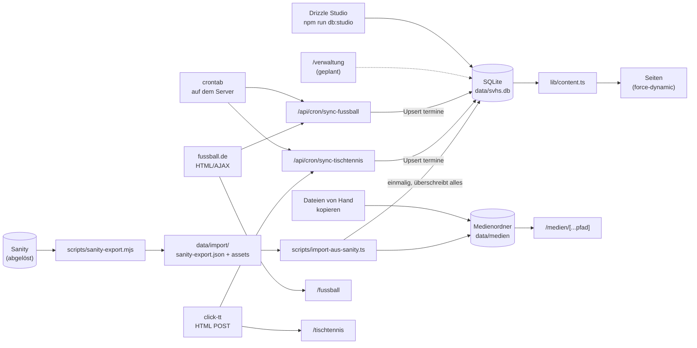
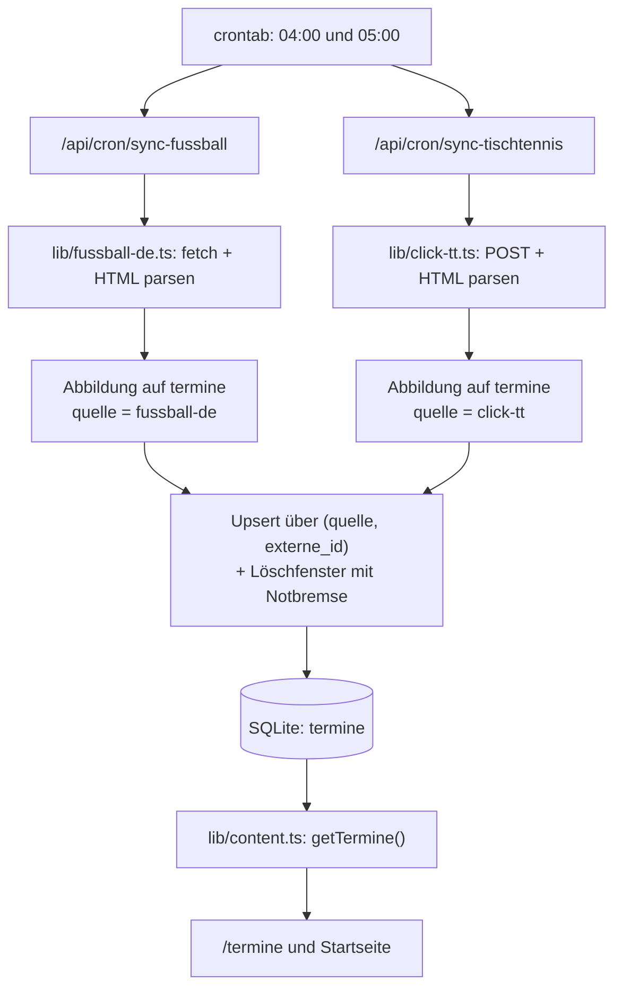

# CONTENT FLOW – SV Holm-Seppensen

Stand: 2026-10-03  
Scope: Datenflüsse nach dem Umzug von Sanity auf SQLite: Wie Inhalte in die Datenbank kommen und
wie sie auf die Website gelangen.

---

## Zielbild (Kurzfassung)

- **Einzige Datenquelle der Website**: SQLite-Datei `data/svhs.db` (Pfad über `DATENBANK_PFAD`),
  Bilder und Dateien im Medienordner `data/medien` (Pfad über `MEDIEN_PFAD`).
- **Wege in die Datenbank**:
  1. manuelle Pflege, aktuell per **Drizzle Studio** (`npm run db:studio`), später über die eigene
     Verwaltung `/verwaltung` (siehe `CMS_KONZEPT.md`),
  2. **Cronjobs** für Spiele von fussball.de und click-tt → Tabelle `termine`,
  3. **einmalige Übernahme** aus Sanity (Export und Import, erledigt am 03.10.2026).
- **Ausgabe**: Die Seiten lesen über `lib/content.ts` und rendern dynamisch (`force-dynamic`).
  Änderungen in der Datenbank sind sofort sichtbar, für die Seiten gibt es kein ISR und keinen Cache mehr.
- **Medien**: werden unter `/medien/<pfad>` ausgeliefert (`app/medien/[...pfad]/route.ts`) und
  anders als die Seiten **gecacht**: Dateinamen mit Hash-Suffix (`…-1a2b3c4d.webp`) dauerhaft, alle
  anderen werden bei jedem Abruf nachgeprüft. Regeln zum Ersetzen und Löschen: Abschnitt 1.
- **Ausnahme**: Die Spielplanseiten `/fussball` und `/tischtennis` lesen weiterhin **direkt**
  bei fussball.de bzw. click-tt (Cache 1 Stunde), nicht aus der Datenbank.

---

## 0) End-to-End-Überblick

---

## 1) Manuelle Datenpflege (aktuell: Drizzle Studio)

### Wie

- `npm run db:studio` startet Drizzle Studio. Die Oberfläche öffnet sich im Browser unter
  `https://local.drizzle.studio` und arbeitet direkt auf der Datenbankdatei.
- Auf dem Server läuft Drizzle Studio nur lokal. Der Zugriff geht über einen SSH-Tunnel
  (siehe `OPERATIONS.md`, Abschnitt 7.2). Drizzle Studio nie öffentlich erreichbar machen.
- Bilder und Dateien werden von Hand in den Medienordner kopiert. In die Tabelle kommt nur der
  relative Pfad (z. B. `personen/max-beispiel.webp`).
- **Neue Fassung = neuer Dateiname**: Ein Bild oder Dokument nie unter gleichem Namen
  überschreiben, sondern mit neuem Namen ablegen (z. B. mit Datum:
  `downloads/beitragsordnung-2026-10.pdf`) und den Pfad in der Tabelle anpassen. Hintergrund:
  Dateinamen mit 8-stelligem Hash-Suffix (`…-1a2b3c4d.webp`, so legt der Import Bilder ab) gelten
  als unveränderlich und werden ein Jahr lang gecacht; eine überschriebene Datei bliebe dann bei
  Besucher:innen alt. Dateien ohne Hash werden zwar bei jedem Abruf nachgeprüft, ein neuer Name ist
  aber auch dort der sichere Weg.
- **Foto gelöscht oder ersetzt**: Der Bildoptimierer (`next/image`, z. B. Fotos auf
  `/ansprechpartner` und in den News) hält eigene verkleinerte Kopien in `.next/cache/images` und
  liefert sie auch dann weiter aus, wenn die Originaldatei fehlt. Nach dem Löschen eines Fotos
  (z. B. bei Widerruf der Einwilligung) deshalb den Bildcache leeren, siehe `OPERATIONS.md`,
  Abschnitt 7.4.

### Typische Aufgaben

| Aufgabe | Tabelle(n) |
|---|---|
| Trainingszeit ändern oder hinzufügen | `trainingszeiten` (mit `mannschaft_id` und/oder `gruppe_id`) |
| Trainer:in einer Mannschaft oder Gruppe zuordnen | ggf. erst `personen`, dann `mannschaft_personen` bzw. `gruppe_personen` |
| Ansprechpartner:in einer Sparte festlegen | `sparte_ansprechpartner` |
| Kontaktseite pflegen (Vorstand usw.) | `funktionen` |
| News veröffentlichen | `news` (Markdown in `inhalt`, `veroeffentlicht = true`) |
| Termin anlegen | `termine` mit `quelle = manuell` |
| Download hinzufügen | Datei nach `data/medien/…`, dann Zeile in `downloads` |
| Bild oder Dokument ersetzen | neue Datei unter **neuem Namen** ablegen, dann Pfad in der jeweiligen Tabelle ändern |
| Mannschaft oder Gruppe ausblenden | `sichtbar = false` |

Regeln und Felder im Detail: `DATA_MODEL.md`.

### Wirkung

- Jede gespeicherte Änderung ist **sofort live**, weil die Seiten bei jedem Aufruf frisch aus der
  Datenbank lesen.

### Grenzen (bis die Verwaltung kommt)

- Nur für technisch Verantwortliche geeignet; keine abgestuften Rechte.
- **Kein Verlauf, kein Rückgängig.** Schutz bieten nur die nächtlichen Backups.
- Prüfung nur über die Datenbank-Constraints (Pflichtfelder, CHECKs, Fremdschlüssel).
- Bilder werden nicht automatisch verkleinert oder umbenannt.

---

## 2) Automatische Datenflüsse

## 2.1 Cronjobs (crontab auf dem eigenen Server)

Die Endpunkte werden per `curl` aus der crontab aufgerufen (Einrichtung: `OPERATIONS.md`, Abschnitt 3):

- `0 4 * * *` → `/api/cron/sync-fussball`
- `0 5 * * *` → `/api/cron/sync-tischtennis`

### A) Fußball-Sync

- Endpunkt: `app/api/cron/sync-fussball/route.ts`
- Externe Quelle: `lib/fussball-de.ts`
  - ruft die AJAX-Endpunkte von fussball.de ab (`next.games`, `prev.games`)
  - parst das HTML per Regex/Heuristik in `FussballSpiel`
- Umwandlung:
  - Dedup nach Spiel-ID
  - Abbildung `FussballSpiel → termine` mit `quelle = fussball-de` und `externe_id` = Spiel-ID
  - Upsert über den eindeutigen Schlüssel (`quelle`, `externe_id`)
- Aufräumen: Termine, die fussball.de nicht mehr listet (verlegt/abgesagt), werden gelöscht.
  Weil die Endpunkte nur je zehn Spiele liefern, gilt das ausschließlich für den Bereich
  *zwischen* ältestem vergangenen und jüngstem kommenden Spieltag. Beide Randtage sind durch die
  Kappung angeschnitten und bleiben ausgenommen.

### B) Tischtennis-Sync

- Endpunkt: `app/api/cron/sync-tischtennis/route.ts`
- Externe Quelle: `lib/click-tt.ts`
  - POST auf click-tt/nuLiga (`clubMeetings`), HTML-Parsing
  - Spiele der kommenden sechs Monate und der letzten sieben Tage kombiniert, dedupliziert
    (nicht die ganze Saison)
- Umwandlung: `TischtennisSpiel → termine` mit `quelle = click-tt`, Upsert wie oben
- Aufräumen: Termine, die click-tt nicht mehr listet, werden gelöscht, begrenzt auf den Bereich
  zwischen erstem und letztem gelieferten Spieltag. Die Abfrage deckt nur die kommenden sechs
  Monate plus die letzten sieben Tage ab. Ältere Spiele (Vorsaison) liegen außerhalb und bleiben
  erhalten.

### Gemeinsame Regeln

- **Notbremse**: Würde mehr als die Hälfte der Termine im Löschfenster gelöscht, löscht der Lauf
  gar nichts und meldet `loeschenUebersprungen: true`. Das schützt vor einem kaputten Parser
  oder einem geänderten ID-Schema.
- **Manuelle Termine** (`quelle = manuell`) fassen die Cronjobs nie an.
- **Synchronisierte Termine** werden bei jedem Lauf neu geschrieben (Titel, Datum, Uhrzeit, Ort,
  Beschreibung, Bereich, Tags und Sparte – die mit dem Slug `fussball` bzw. `tischtennis`). Von
  Hand geänderte Werte in diesen Feldern gehen dabei verloren.
- **Absicherung**: Beide Endpunkte prüfen `Authorization: Bearer <CRON_SECRET>`, sofern
  `CRON_SECRET` gesetzt ist. Ein Sanity-Token wird nicht mehr gebraucht.

## 2.2 Scraper-Charakter

- fussball.de und click-tt werden über HTML- bzw. AJAX-Antworten ausgelesen, nicht über eine
  versionierte JSON-API.
- Das Parsing hängt an Regex und Seitenstruktur (`lib/fussball-de.ts`, `lib/click-tt.ts`).

## 2.3 Spielplanseiten (ohne Datenbank)

- `/fussball` und `/tischtennis` laden Spiele direkt bei der Quelle (`revalidate = 3600`).
- Dieselben Spiele stehen nach dem nächtlichen Lauf zusätzlich in `termine` und erscheinen auf
  `/termine` und der Startseite.

---

## 3) Einmalige Übernahme aus Sanity (erledigt am 03.10.2026)

## 3.1 Export

- Skript: `scripts/sanity-export.mjs` (`npm run export:sanity`). Es nutzt kein Sanity-Paket, nur
  `fetch`.
- Benötigt `NEXT_PUBLIC_SANITY_PROJECT_ID` und `SANITY_API_READ_TOKEN` (oder
  `SANITY_API_WRITE_TOKEN`) in `.env.local`.
- Ergebnis in `data/import/` (nicht im Git):
  - `sanity-export.json` mit `dokumente` (alle veröffentlichten Dokumente, roh), `entwuerfe`
    (offene Entwürfe) und `assets` (Metadaten inkl. `lokaleDatei`)
  - `assets/` mit allen referenzierten Bildern und Dateien
- Umfang beim Export am 03.10.2026: 15 Sparten, 49 Mannschafts-Dokumente, 51 Personen,
  93 Trainingszeiten, 16 Kontaktseiten-Einträge, 4 News, 177 Termine, 5 Downloads, 4 Partner;
  32 Assets (27 Bilder, 5 Dateien, ca. 17 MB); 2 offene Entwürfe.

## 3.2 Import

- Skript: `scripts/import-aus-sanity.ts` (`npm run import:sanity`). Arbeitet nur mit dem Export,
  ohne Netzwerk und ohne Sanity-Paket.
- Ablauf:
  1. Export lesen und den ganzen Import im Speicher planen und prüfen, bevor etwas gelöscht wird.
  2. `data/svhs.db` und den **Medienordner löschen**, Datenbank neu anlegen.
  3. Alle Zeilen in **einer Transaktion** einfügen.
  4. Bilder und Dateien in den Medienordner kopieren.
  5. Bericht nach `data/import/import-bericht.md` schreiben (Zuordnungen, Auffälligkeiten).
  Schlägt Schritt 3 oder 4 fehl, werden Datenbank und Medienordner wieder entfernt.
- Grundlage sind die veröffentlichten Dokumente. Offene Entwürfe von Sparten werden nur für die
  Kontaktdaten mit ausgewertet; andere Entwürfe nennt der Bericht, übernommen werden sie nicht.
- Wesentliche Umwandlungen (Übersicht in `DATA_MODEL.md`, Abschnitt 10):
  - Sanity-`mannschaft` → `mannschaften` (Fußball-Teams, Tischtennis-Ligateams) oder `gruppen`
    (alles andere, inkl. Fußball-Torwarttraining und Tischtennis-Trainingsgruppe)
  - Uhrzeit-Text → `beginn`/`ende`; Klammerzusatz am Ort → `hinweis`
  - `ansprechpartner` → `funktionen`, Abteilungsleitungen zusätzlich → `sparte_ansprechpartner`
  - News-Text: Portable Text → Markdown
  - Termine: `fussballDeId` bzw. `clickTtId` → `quelle` + `externe_id`
  - Partner entfallen

> **Achtung:** `npm run import:sanity` **löscht und ersetzt Datenbank und Medienordner**. Seit die
> Pflege in SQLite läuft, gingen dabei alle späteren Änderungen verloren. Den Import nur noch
> für eine frische Entwicklungsumgebung nutzen, nie auf dem Server mit Live-Daten.

## 3.3 Danach

- Sanity wird nicht mehr gebraucht: `/studio`, das Studio-Handbuch, die Sanity-Pakete und die
  alten Patch- und Migrationsskripte sind entfernt.
- Im Sanity-Projekt alle Tokens widerrufen und das Projekt nach dem Umzug löschen (siehe
  `OPERATIONS.md`, Abschnitt 8.1).

---

## 4) Risiken

## 4.1 Datenverlust / Überschreiben

- **`npm run import:sanity`** ersetzt Datenbank und Medienordner durch den Stand vom 03.10.2026.
- **Drizzle Studio** hat kein Rückgängig. Löschen wirkt sofort und teils kaskadierend:
  - Eine Person löschen entfernt sie aus allen Trainerteams, Sparten und Funktionen.
  - Eine Mannschaft oder Gruppe löschen löscht ihre Trainingszeiten.
- **Cron-Upserts** überschreiben Handänderungen an synchronisierten Terminen.
- Gegenmittel: nächtliche Backups von Datenbank und Medienordner (`OPERATIONS.md`, Abschnitt 4),
  Ausblenden statt Löschen.

## 4.2 Kritische Upstream-Abhängigkeiten

- **HTML-Änderungen bei fussball.de oder click-tt** können die Parser brechen
  (`lib/fussball-de.ts`, `lib/click-tt.ts`).
- Ändert sich die Spiel-ID einer Quelle, entstehen neue Zeilen statt Updates (Duplikatrisiko). Die
  Notbremse verhindert dann das Leerräumen des Kalenders, alte Einträge bleiben aber stehen.

## 4.3 Konsistenzrisiken

- Die Datenbank prüft nicht, ob Mannschaft und Gruppe einer Trainingszeit (oder Sparte und
  Mannschaft einer News) zur selben Sparte gehören (`DATA_MODEL.md`, Abschnitt 5.4).
- **Medienpfade** können ins Leere zeigen, wenn eine Datei fehlt oder falsch benannt ist.
  Ungenutzte Dateien im Medienordner räumt niemand automatisch auf.
- **Freitextfelder** (`trainingszeiten.ort`, `news.kategorie`, `termine.bereich`) können in
  Schreibvarianten auseinanderlaufen.

## 4.4 Betriebs- und Datenschutzrisiken

- Datenbank und Medien liegen auf **einem** Server. Ohne Backup außer Haus ist ein Server-Ausfall
  ein Datenverlust.
- `data/` enthält personenbezogene Daten und darf **nie** ins öffentliche Git-Repo.
- Ohne gesetztes `CRON_SECRET` sind die Cron-Endpunkte für alle aufrufbar.

---

## 5) Detailfluss: Termine-Automation

---

## 6) Relevante Dateien (Index)

- **Datenbank**: `lib/db/schema.ts`, `lib/db/index.ts`, `drizzle/`, `drizzle.config.ts`
- **Datenzugriff Frontend**: `lib/content.ts`
- **Medien**: `lib/medien.ts`, `app/medien/[...pfad]/route.ts`
- **Cron-Automation**: `app/api/cron/sync-fussball/route.ts`, `app/api/cron/sync-tischtennis/route.ts`,
  crontab auf dem Server (`OPERATIONS.md`)
- **Externe Parser/Scraper**: `lib/fussball-de.ts`, `lib/click-tt.ts`
- **Übernahme aus Sanity**: `scripts/sanity-export.mjs`, `scripts/import-aus-sanity.ts`
- **Pflege**: Drizzle Studio (`npm run db:studio`), später `/verwaltung`

---

## 7) Fazit

Die Website hat jetzt **eine** Datenquelle: die SQLite-Datei. Von Hand gepflegte Inhalte und
synchronisierte Spiele landen in denselben Tabellen, und die Seiten zeigen Änderungen sofort an.
Die größten Risiken liegen in:

1. **fehlendem Verlauf und Rückgängig**, solange per Drizzle Studio gepflegt wird (→ Backups),
2. **Scraper-Fragilität** gegenüber HTML-Änderungen bei fussball.de und click-tt,
3. **dem Import-Skript**, das bei versehentlichem Aufruf alle Änderungen seit dem 03.10.2026 verwirft,
4. **dem Betrieb auf einem einzelnen Server** (→ Backups außer Haus).
