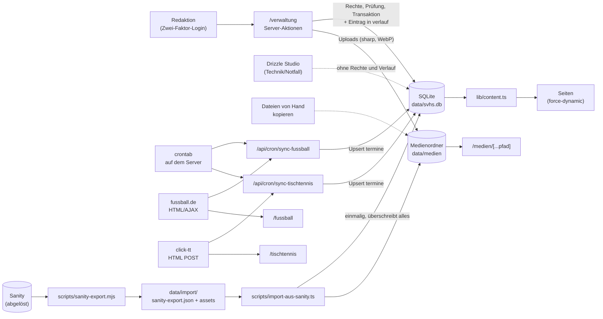
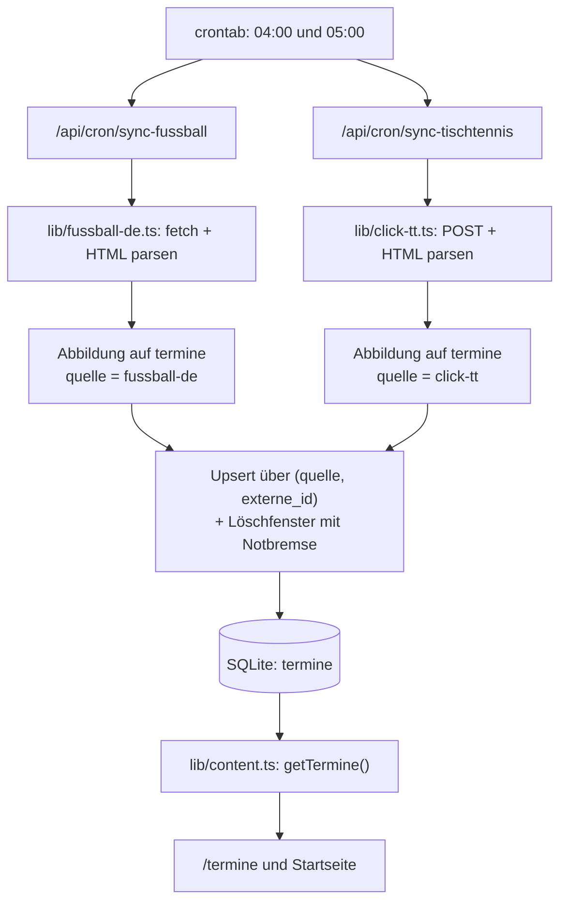

# CONTENT FLOW – SV Holm-Seppensen

Stand: 2026-10-20 (Pflege über die Verwaltung `/verwaltung`)  
Scope: Datenflüsse nach dem Umzug von Sanity auf SQLite: Wie Inhalte in die Datenbank kommen und
wie sie auf die Website gelangen.

---

## Zielbild (Kurzfassung)

- **Einzige Datenquelle der Website**: SQLite-Datei `data/svhs.db` (Pfad über `DATENBANK_PFAD`),
  Bilder und Dateien im Medienordner `data/medien` (Pfad über `MEDIEN_PFAD`).
- **Wege in die Datenbank**:
  1. manuelle Pflege über die eigene **Verwaltung `/verwaltung`** (seit 20.10.2026, mit Rechten
     und Verlauf); **Drizzle Studio** (`npm run db:studio`) nur noch für Technik und Notfälle,
  2. **Cronjobs** für Spiele von fussball.de und click-tt → Tabelle `termine`,
  3. **einmalige Übernahme** aus Sanity (Export und Import, erledigt am 03.10.2026).
- **Ausgabe**: Die Seiten lesen über `lib/content.ts` und rendern dynamisch (`force-dynamic`).
  Änderungen in der Datenbank sind sofort sichtbar, für die Seiten gibt es kein ISR und keinen Cache mehr.
- **Medien**: werden unter `/medien/<pfad>` ausgeliefert (`app/medien/[...pfad]/route.ts`) und
  anders als die Seiten **gecacht**: Dateinamen mit Hash-Suffix (`…-1a2b3c4d.webp`) dauerhaft, alle
  anderen werden bei jedem Abruf nachgeprüft. Regeln zum Ersetzen und Löschen: Abschnitt 1.
- **Ausnahme**: Die Spielplanseiten `/fussball` und `/tischtennis` lesen weiterhin **direkt**
  bei fussball.de bzw. click-tt (Cache 1 Stunde), nicht aus der Datenbank.

---

## 0) End-to-End-Überblick

---

## 1) Manuelle Datenpflege (Verwaltung `/verwaltung`)

### Wie

- Seit dem 20.10.2026 werden alle Inhalte über die eigene Verwaltung unter **`/verwaltung`**
  gepflegt. Sie läuft in derselben Next.js-Anwendung und schreibt direkt in `data/svhs.db`.
- **Anmeldung** mit Zwei-Faktor: Benutzername + Passwort + 6-stelliger Code aus einer
  Authenticator-App. Neue Zugänge bekommen vom Admin einen Einladungs-QR-Code (Ablauf:
  `CMS_KONZEPT.md`, Abschnitt 6; Betrieb: `OPERATIONS.md`, Abschnitt 9).
- **Rechte:** Admins dürfen alles. Alle anderen Zugänge bearbeiten nur ihre Bereiche (Sparten,
  Mannschaften, Gruppen). Jede Server-Aktion prüft das selbst (`CMS_KONZEPT.md`, Abschnitt 5).
- **Ablauf beim Speichern:** Formular (Server-Aktion) → Rechte prüfen → Eingaben prüfen →
  Konfliktprüfung über `geaendert_am` → Speichern in **einer Transaktion** → Eintrag im
  **Verlauf** (Tabelle `verlauf`, mit Stand vorher und nachher).
- **Bilder und PDFs** werden im Formular hochgeladen. Bilder verkleinert die Verwaltung auf
  höchstens 1600 px und speichert sie als WebP ohne Metadaten (EXIF, GPS); PDFs legt sie
  unverändert ab. Dateinamen bekommen einen Inhalts-Hash (`…-1a2b3c4d.webp`). Ersetzte oder
  entfernte Dateien löscht sie, sobald kein Datensatz mehr darauf verweist (`DATA_MODEL.md`,
  Abschnitt 7.1).

### Typische Aufgaben

| Aufgabe | Seite in der Verwaltung | Tabelle(n) |
|---|---|---|
| Trainingszeit ändern oder hinzufügen | „Mannschaften & Gruppen“ → Team | `trainingszeiten` |
| Trainer:in einer Mannschaft oder Gruppe zuordnen | „Mannschaften & Gruppen“ → Team → Trainerteam (neue Personen werden mitgespeichert) | `personen`, `mannschaft_personen` bzw. `gruppe_personen` |
| Kontaktdaten oder Foto einer Person ändern | „Personen“ | `personen` |
| Spartentext, -foto, Ansprechpartner:innen | „Sparten“ | `sparten`, `sparte_ansprechpartner` |
| Kontaktseite pflegen (Vorstand usw.) | „Kontaktseite“ (nur Admins) | `funktionen` |
| News schreiben und veröffentlichen | „News“ (Markdown-Text mit Vorschau, Schalter „veröffentlicht“) | `news` |
| Termin anlegen | „Termine“ (nur manuelle Termine) | `termine` mit `quelle = manuell` |
| Download hinzufügen oder ersetzen | „Downloads“ (PDF hochladen, nur Admins) | `downloads` |
| Mannschaft oder Gruppe ausblenden | Team → Haken „Auf der Website anzeigen“ entfernen | `sichtbar = false` |
| Zugang anlegen, zurücksetzen, deaktivieren | „Zugänge“ (nur Admins) | `zugaenge`, `zugang_bereiche`, `anmelde_codes`, `geraete` |
| Nachsehen, wer was geändert hat | „Verlauf“ (nur Admins) | `verlauf` |

Regeln und Felder im Detail: `DATA_MODEL.md`.

### Wirkung

- Jede gespeicherte Änderung ist **sofort live**, weil die Seiten bei jedem Aufruf frisch aus der
  Datenbank lesen. Ausnahme: News erscheinen erst mit „veröffentlicht“.

### Grenzen

- **Kein „Wiederherstellen“-Knopf** im Verlauf. Alte Werte stehen dort und lassen sich von Hand
  wieder eintragen; sonst helfen die nächtlichen Backups (`OPERATIONS.md`, Abschnitt 4.4).
- Termine von fussball.de und click-tt sind in der Verwaltung schreibgeschützt (Abschnitt 2).
- Bilder im Markdown-Text einer News lassen sich nicht hochladen, nur das Titelbild.
- Den Bildcache von `next/image` leert die Verwaltung nicht (siehe unten).

### Drizzle Studio (Technik und Notfälle)

- `npm run db:studio` startet Drizzle Studio. Die Oberfläche öffnet sich im Browser unter
  `https://local.drizzle.studio` und arbeitet direkt auf der Datenbankdatei.
- Auf dem Server läuft Drizzle Studio nur lokal. Der Zugriff geht über einen SSH-Tunnel
  (siehe `OPERATIONS.md`, Abschnitt 7.2). Drizzle Studio nie öffentlich erreichbar machen.
- Drizzle Studio **umgeht Rechte, Prüfungen, Konfliktprüfung und Verlauf** der Verwaltung.
  Änderungen hier stehen nirgends im Verlauf, und es gibt kein Rückgängig. Nur für Technik und
  Notfälle verwenden (`OPERATIONS.md`, Abschnitt 9.5).
- Bilder und Dateien müssen dabei von Hand in den Medienordner kopiert werden. In die Tabelle
  kommt nur der relative Pfad (z. B. `personen/max-beispiel.webp`). Bilder werden dann nicht
  verkleinert, und ersetzte Dateien bleiben liegen.

### Medien von Hand ersetzen oder löschen

- **Neue Fassung = neuer Dateiname**: Ein Bild oder Dokument nie unter gleichem Namen
  überschreiben, sondern mit neuem Namen ablegen (z. B. mit Datum:
  `downloads/beitragsordnung-2026-10.pdf`) und den Pfad in der Tabelle anpassen. Hintergrund:
  Dateinamen mit 8-stelligem Hash-Suffix (`…-1a2b3c4d.webp`, so legen Import und Verwaltung
  Dateien ab) gelten als unveränderlich und werden ein Jahr lang gecacht; eine überschriebene Datei
  bliebe dann bei Besucher:innen alt. Dateien ohne Hash werden zwar bei jedem Abruf nachgeprüft,
  ein neuer Name ist aber auch dort der sichere Weg. Die Verwaltung hält diese Regel automatisch ein.
- **Foto gelöscht oder ersetzt**: Der Bildoptimierer (`next/image`, z. B. Fotos auf
  `/ansprechpartner` und in den News) hält eigene verkleinerte Kopien in `.next/cache/images` und
  liefert sie auch dann weiter aus, wenn die Originaldatei fehlt. Nach dem Löschen eines Fotos
  (z. B. bei Widerruf der Einwilligung) deshalb den Bildcache leeren, siehe `OPERATIONS.md`,
  Abschnitt 7.4. Das gilt auch, wenn das Foto in der Verwaltung entfernt wurde.

---

## 2) Automatische Datenflüsse

## 2.1 Cronjobs (crontab auf dem eigenen Server)

Die Endpunkte werden per `curl` aus der crontab aufgerufen (Einrichtung: `OPERATIONS.md`, Abschnitt 3):

- `0 4 * * *` → `/api/cron/sync-fussball`
- `0 5 * * *` → `/api/cron/sync-tischtennis`

### A) Fußball-Sync

- Endpunkt: `app/api/cron/sync-fussball/route.ts`
- Externe Quelle: `lib/fussball-de.ts`
  - ruft die AJAX-Endpunkte von fussball.de ab (`next.games`, `prev.games`)
  - parst das HTML per Regex/Heuristik in `FussballSpiel`
- Umwandlung:
  - Dedup nach Spiel-ID
  - Abbildung `FussballSpiel → termine` mit `quelle = fussball-de` und `externe_id` = Spiel-ID
  - Upsert über den eindeutigen Schlüssel (`quelle`, `externe_id`)
- Aufräumen: Termine, die fussball.de nicht mehr listet (verlegt/abgesagt), werden gelöscht.
  Weil die Endpunkte nur je zehn Spiele liefern, gilt das ausschließlich für den Bereich
  *zwischen* ältestem vergangenen und jüngstem kommenden Spieltag. Beide Randtage sind durch die
  Kappung angeschnitten und bleiben ausgenommen.

### B) Tischtennis-Sync

- Endpunkt: `app/api/cron/sync-tischtennis/route.ts`
- Externe Quelle: `lib/click-tt.ts`
  - POST auf click-tt/nuLiga (`clubMeetings`), HTML-Parsing
  - Spiele der kommenden sechs Monate und der letzten sieben Tage kombiniert, dedupliziert
    (nicht die ganze Saison)
- Umwandlung: `TischtennisSpiel → termine` mit `quelle = click-tt`, Upsert wie oben
- Aufräumen: Termine, die click-tt nicht mehr listet, werden gelöscht, begrenzt auf den Bereich
  zwischen erstem und letztem gelieferten Spieltag. Die Abfrage deckt nur die kommenden sechs
  Monate plus die letzten sieben Tage ab. Ältere Spiele (Vorsaison) liegen außerhalb und bleiben
  erhalten.

### Gemeinsame Regeln

- **Notbremse**: Würde mehr als die Hälfte der Termine im Löschfenster gelöscht, löscht der Lauf
  gar nichts und meldet `loeschenUebersprungen: true`. Das schützt vor einem kaputten Parser
  oder einem geänderten ID-Schema.
- **Manuelle Termine** (`quelle = manuell`) fassen die Cronjobs nie an.
- **Synchronisierte Termine** werden bei jedem Lauf neu geschrieben (Titel, Datum, Uhrzeit, Ort,
  Beschreibung, Bereich, Tags und Sparte – die mit dem Slug `fussball` bzw. `tischtennis`). Von
  Hand geänderte Werte in diesen Feldern gehen dabei verloren.
- **Absicherung**: Beide Endpunkte prüfen `Authorization: Bearer <CRON_SECRET>`, sofern
  `CRON_SECRET` gesetzt ist. Ein Sanity-Token wird nicht mehr gebraucht.

## 2.2 Scraper-Charakter

- fussball.de und click-tt werden über HTML- bzw. AJAX-Antworten ausgelesen, nicht über eine
  versionierte JSON-API.
- Das Parsing hängt an Regex und Seitenstruktur (`lib/fussball-de.ts`, `lib/click-tt.ts`).

## 2.3 Spielplanseiten (ohne Datenbank)

- `/fussball` und `/tischtennis` laden Spiele direkt bei der Quelle (`revalidate = 3600`).
- Dieselben Spiele stehen nach dem nächtlichen Lauf zusätzlich in `termine` und erscheinen auf
  `/termine` und der Startseite.

---

## 3) Einmalige Übernahme aus Sanity (erledigt am 03.10.2026)

## 3.1 Export

- Skript: `scripts/sanity-export.mjs` (`npm run export:sanity`). Es nutzt kein Sanity-Paket, nur
  `fetch`.
- Benötigt `NEXT_PUBLIC_SANITY_PROJECT_ID` und `SANITY_API_READ_TOKEN` (oder
  `SANITY_API_WRITE_TOKEN`) in `.env.local`.
- Ergebnis in `data/import/` (nicht im Git):
  - `sanity-export.json` mit `dokumente` (alle veröffentlichten Dokumente, roh), `entwuerfe`
    (offene Entwürfe) und `assets` (Metadaten inkl. `lokaleDatei`)
  - `assets/` mit allen referenzierten Bildern und Dateien
- Umfang beim Export am 03.10.2026: 15 Sparten, 49 Mannschafts-Dokumente, 51 Personen,
  93 Trainingszeiten, 16 Kontaktseiten-Einträge, 4 News, 177 Termine, 5 Downloads, 4 Partner;
  32 Assets (27 Bilder, 5 Dateien, ca. 17 MB); 2 offene Entwürfe.

## 3.2 Import

- Skript: `scripts/import-aus-sanity.ts` (`npm run import:sanity`). Arbeitet nur mit dem Export,
  ohne Netzwerk und ohne Sanity-Paket.
- Ablauf:
  1. Export lesen und den ganzen Import im Speicher planen und prüfen, bevor etwas gelöscht wird.
  2. `data/svhs.db` und den **Medienordner löschen**, Datenbank neu anlegen.
  3. Alle Zeilen in **einer Transaktion** einfügen.
  4. Bilder und Dateien in den Medienordner kopieren.
  5. Bericht nach `data/import/import-bericht.md` schreiben (Zuordnungen, Auffälligkeiten).
  Schlägt Schritt 3 oder 4 fehl, werden Datenbank und Medienordner wieder entfernt.
- Grundlage sind die veröffentlichten Dokumente. Offene Entwürfe von Sparten werden nur für die
  Kontaktdaten mit ausgewertet; andere Entwürfe nennt der Bericht, übernommen werden sie nicht.
- Wesentliche Umwandlungen (Übersicht in `DATA_MODEL.md`, Abschnitt 10):
  - Sanity-`mannschaft` → `mannschaften` (Fußball-Teams, Tischtennis-Ligateams) oder `gruppen`
    (alles andere, inkl. Fußball-Torwarttraining und Tischtennis-Trainingsgruppe)
  - Uhrzeit-Text → `beginn`/`ende`; Klammerzusatz am Ort → `hinweis`
  - `ansprechpartner` → `funktionen`, Abteilungsleitungen zusätzlich → `sparte_ansprechpartner`
  - News-Text: Portable Text → Markdown
  - Termine: `fussballDeId` bzw. `clickTtId` → `quelle` + `externe_id`
  - Partner entfallen

> **Achtung:** `npm run import:sanity` **löscht und ersetzt Datenbank und Medienordner**. Seit die
> Pflege in SQLite läuft, gingen dabei alle späteren Änderungen verloren. Den Import nur noch
> für eine frische Entwicklungsumgebung nutzen, nie auf dem Server mit Live-Daten.
> Als Schutz bricht er ab, sobald die Datenbank Zugänge der Verwaltung enthält. Nur mit
> `npm run import:sanity -- --alles-ueberschreiben` läuft er dann trotzdem und verwirft alles,
> auch Zugänge, Verlauf und hochgeladene Medien.

## 3.3 News von der alten WordPress-Seite

- Skript: `scripts/import-wordpress-news.ts` (`npm run import:wordpress`). Liest die Beiträge über die
  öffentliche WordPress-Schnittstelle von www.sv-holm-seppensen.de (`/wp-json/wp/v2/posts`).
- Ergänzt nur: Vorhandene News (gleiche Überschrift oder ein gemeinsamer längerer Satz) werden
  übersprungen, nichts wird geändert oder gelöscht. Erneut ausführen holt nur neue Beiträge.
- Umwandlung: HTML → Markdown; Titelbild und Bilder im Text werden wie ein Upload gespeichert (WebP,
  höchstens 1600 px). Sport-Kategorien werden zur Sparte, sonst Vereins-News. Die News sind sofort
  veröffentlicht und stehen im Verlauf als „angelegt“ mit Quelle System.
- Erst übernommen am 23.10.2026: alle Beiträge seit 01.01.2026 (27 neue; 3 waren schon da).
- `-- --probelauf` schreibt nichts, sondern legt die umgewandelten Texte zur Kontrolle unter
  `data/import/wordpress-probelauf/` ab.

## 3.4 Danach

- Sanity wird nicht mehr gebraucht: `/studio`, das Studio-Handbuch, die Sanity-Pakete und die
  alten Patch- und Migrationsskripte sind entfernt.
- Im Sanity-Projekt alle Tokens widerrufen und das Projekt nach dem Umzug löschen (siehe
  `OPERATIONS.md`, Abschnitt 8.1).

---

## 4) Risiken

## 4.1 Datenverlust / Überschreiben

- **`npm run import:sanity`** ersetzt Datenbank und Medienordner durch den Stand vom 03.10.2026,
  samt Verlust aller Zugänge und des Verlaufs. Er bricht ab, sobald es Zugänge gibt, außer mit
  `--alles-ueberschreiben`.
- **Löschen wirkt sofort und teils kaskadierend**, in der Verwaltung wie in Drizzle Studio:
  - Eine Person löschen (in der Verwaltung nur Admins, mit Anzeige, wo sie vorkommt) entfernt sie
    aus allen Trainerteams, Sparten und Funktionen.
  - Eine Mannschaft oder Gruppe löschen löscht ihre Trainingszeiten und die Rechte von Zugängen
    auf dieses Team.
- **Verwaltung:** Jede Änderung steht im Verlauf, aber „Wiederherstellen“ gibt es noch nicht.
  Ein ersetztes Foto ist dann schon aus dem Medienordner gelöscht.
- **Drizzle Studio** hat weder Verlauf noch Rückgängig.
- **Cron-Upserts** überschreiben Handänderungen an synchronisierten Terminen (die Verwaltung lässt
  solche Termine deshalb gar nicht bearbeiten).
- Gegenmittel: Verlauf, nächtliche Backups von Datenbank und Medienordner (`OPERATIONS.md`,
  Abschnitt 4), Ausblenden statt Löschen.

## 4.2 Kritische Upstream-Abhängigkeiten

- **HTML-Änderungen bei fussball.de oder click-tt** können die Parser brechen
  (`lib/fussball-de.ts`, `lib/click-tt.ts`).
- Ändert sich die Spiel-ID einer Quelle, entstehen neue Zeilen statt Updates (Duplikatrisiko). Die
  Notbremse verhindert dann das Leerräumen des Kalenders, alte Einträge bleiben aber stehen.

## 4.3 Konsistenzrisiken

- Die Datenbank prüft nicht, ob Mannschaft und Gruppe einer Trainingszeit (oder Sparte und
  Mannschaft einer News) zur selben Sparte gehören (`DATA_MODEL.md`, Abschnitt 5.4).
- **Medienpfade** können ins Leere zeigen, wenn eine Datei fehlt oder falsch benannt ist (vor
  allem bei Pflege in Drizzle Studio). Die Verwaltung löscht ersetzte Dateien, sobald kein
  Datensatz mehr darauf verweist; Bilder, die nur im Markdown-Text einer News stehen, prüft sie
  dabei nicht. Dateien, die in Drizzle Studio ersetzt wurden, bleiben liegen.
- **Freitextfelder** (`trainingszeiten.ort`, `news.kategorie`, `termine.bereich`) können in
  Schreibvarianten auseinanderlaufen.

## 4.4 Betriebs- und Datenschutzrisiken

- Datenbank und Medien liegen auf **einem** Server. Ohne Backup außer Haus ist ein Server-Ausfall
  ein Datenverlust.
- `data/` enthält personenbezogene Daten und darf **nie** ins öffentliche Git-Repo. Dazu gehören
  jetzt auch Passwort-Hashes und App-Geheimnisse der Zugänge.
- Der **Verlauf** hebt alte Kontaktdaten und Notizen dauerhaft auf, auch von gelöschten Personen
  (`OPERATIONS.md`, Abschnitt 8.2).
- Sind **alle Admins ausgesperrt**, hilft nur der Notfall-Zugang per Skript auf dem Server
  (`OPERATIONS.md`, Abschnitt 9.4).
- Ohne gesetztes `CRON_SECRET` sind die Cron-Endpunkte für alle aufrufbar.

---

## 5) Detailfluss: Termine-Automation

---

## 6) Relevante Dateien (Index)

- **Datenbank**: `lib/db/schema.ts`, `lib/db/index.ts`, `drizzle/`, `drizzle.config.ts`
- **Datenzugriff Frontend**: `lib/content.ts`
- **Medien**: `lib/medien.ts`, `app/medien/[...pfad]/route.ts`
- **Cron-Automation**: `app/api/cron/sync-fussball/route.ts`, `app/api/cron/sync-tischtennis/route.ts`,
  crontab auf dem Server (`OPERATIONS.md`)
- **Externe Parser/Scraper**: `lib/fussball-de.ts`, `lib/click-tt.ts`
- **Übernahme aus Sanity**: `scripts/sanity-export.mjs`, `scripts/import-aus-sanity.ts`
- **Pflege**: Verwaltung `app/verwaltung/`, `lib/verwaltung/` (Rechte, Anmeldung, Uploads,
  Verlauf), `components/verwaltung/`; Admin-Skript `scripts/verwaltung-admin.ts`; für Technik
  Drizzle Studio (`npm run db:studio`)

---

## 7) Fazit

Die Website hat jetzt **eine** Datenquelle: die SQLite-Datei. Von Hand gepflegte Inhalte und
synchronisierte Spiele landen in denselben Tabellen, und die Seiten zeigen Änderungen sofort an.
Die größten Risiken liegen in:

1. **fehlendem Wiederherstellen**: Die Verwaltung protokolliert jede Änderung, kann sie aber noch
   nicht per Knopf zurücknehmen; Änderungen in Drizzle Studio stehen gar nicht im Verlauf
   (→ Verlauf, Backups),
2. **Scraper-Fragilität** gegenüber HTML-Änderungen bei fussball.de und click-tt,
3. **dem Import-Skript**, das mit `--alles-ueberschreiben` alle Änderungen seit dem 03.10.2026
   samt Zugängen verwirft,
4. **dem Betrieb auf einem einzelnen Server** (→ Backups außer Haus).
