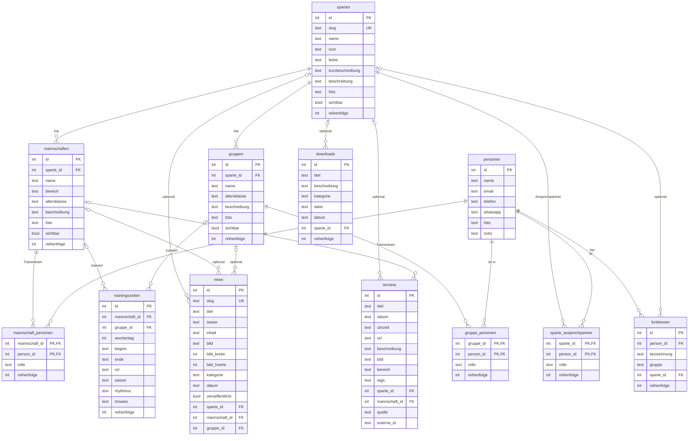
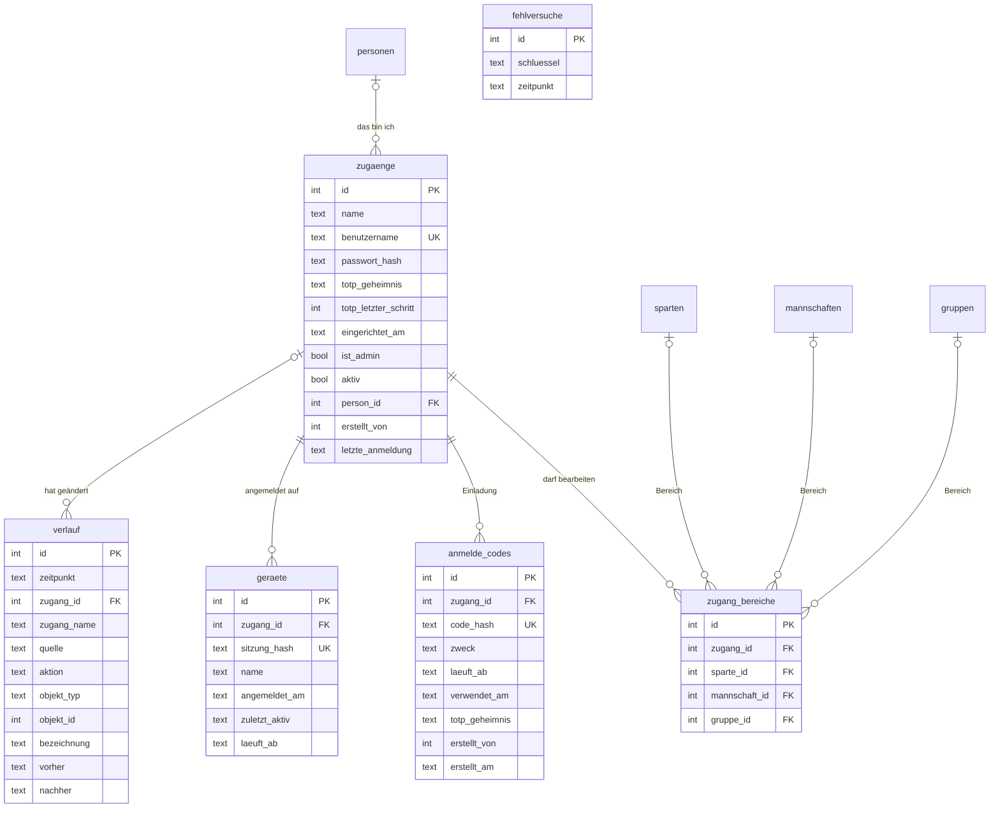

# DATA MODEL – SV Holm-Seppensen (SQLite)

Stand: 2026-10-20 (Verwaltungstabellen ergänzt; Inhaltstabellen unverändert seit 2026-10-03)  
Scope: Datenmodell der Vereinswebsite nach dem Umzug von Sanity auf eine eigene SQLite-Datenbank,
einschließlich der Tabellen der Verwaltung unter `/verwaltung`.  
Quelle der Wahrheit: `lib/db/schema.ts` (Drizzle ORM). Die SQL-Fassung steht in den Migrationen
`drizzle/0000_initial.sql` (Inhaltstabellen) und `drizzle/0001_verwaltung.sql` (Verwaltung, siehe
Abschnitt 9).

---

## Zielbild dieser Dokumentation

- **Fachliche Übersicht**: Welche Tabellen gibt es, und wofür sind sie gedacht?
- **Technische Übersicht**: Felder, Beziehungen, Constraints und das Verhalten beim Löschen.
- **Regeln für die Pflege**: Was gehört wozu (Trainingszeit, News, Vereinsfunktion)?
- **Konventionen**: Medienpfade, Datums- und Zeitformate, Sortierung.

Die Daten liegen in **einer Datei**: `data/svhs.db` (anpassbar über `DATENBANK_PFAD`). Dazu
gehören seit dem 20.10.2026 auch die Zugänge der Verwaltung, die angemeldeten Geräte und der
Verlauf. Bilder und Dateien liegen im Medienordner `data/medien` (anpassbar über `MEDIEN_PFAD`).
Beides ist nicht im Git, weil es personenbezogene Daten enthält.

---

## 1) Überblick

| Gruppe | Tabellen | Zweck |
|---|---|---|
| **Stammdaten** | `personen`, `sparten`, `mannschaften`, `gruppen` | Menschen im Verein und die Struktur aus Sparten, Mannschaften und Gruppen |
| **Zuordnungen** | `mannschaft_personen`, `gruppe_personen`, `sparte_ansprechpartner`, `funktionen` | Wer ist Trainer:in wo, wer ist Ansprechpartner:in einer Sparte, wer hat welche Vereinsfunktion |
| **Inhalte** | `trainingszeiten`, `news`, `termine`, `downloads` | Was auf der Website erscheint |
| **Verwaltung** | `zugaenge`, `zugang_bereiche`, `anmelde_codes`, `geraete`, `fehlversuche`, `verlauf` | Wer die Verwaltung unter `/verwaltung` benutzen darf, Anmeldung und Sitzungen, Änderungsprotokoll. Erscheint nie auf der Website |

Kernbeziehungen in einem Satz: Eine **Sparte** hat **Mannschaften** und **Gruppen**. An Mannschaften
und Gruppen hängen **Trainingszeiten** und ein **Trainerteam** aus **Personen**. Personen können
außerdem **Ansprechpartner:innen einer Sparte** sein oder eine **Vereinsfunktion** haben. **News**,
**Termine** und **Downloads** können sich auf eine Sparte, Mannschaft oder Gruppe beziehen.

Für die Verwaltung: Ein **Zugang** ist entweder Admin oder hat **Bereiche** (Sparten, Mannschaften,
Gruppen), die er bearbeiten darf. Eingerichtet wird er über einen **Einladungs-Code**, danach meldet
er sich mit Passwort und Authenticator-App an; jede Anmeldung ist ein **Gerät** (Sitzung). Jede
Änderung landet im **Verlauf**.

---

## 2) Beziehungen (ER-Diagramm)

Die Zeitstempel `erstellt_am` und `geaendert_am` sind der Übersicht halber weggelassen.

Die Verwaltungstabellen (seit 20.10.2026, Abschnitte 3.12–3.18) hängen so an den Inhaltstabellen.
Deren Felder stehen im Diagramm oben; `fehlversuche` hat keine Beziehungen.

---

## 3) Tabellen im Detail

Spaltennamen stehen hier so, wie sie in der Datenbank heißen (`snake_case`). Im TypeScript-Code
heißen sie in `camelCase` (`sparte_id` → `sparteId`, `bild_breite` → `bildBreite`).
„Pflicht“ bedeutet `NOT NULL`. Alle Inhaltstabellen mit eigener `id` (3.1–3.11) haben zusätzlich
`erstellt_am` und `geaendert_am` (siehe Abschnitt 7.3). Von den Verwaltungstabellen (3.12–3.17)
hat nur `zugaenge` beide; die übrigen haben eigene Zeitspalten, die jeweils dort stehen.

## 3.1 personen

- **Zweck**: Alle Menschen im Verein, einmal angelegt und überall wiederverwendet: Trainer:innen,
  Betreuer:innen, Ansprechpartner:innen von Sparten und Vereinsfunktionär:innen.
- **Beziehungen**: wird verwendet von `mannschaft_personen`, `gruppe_personen`,
  `sparte_ansprechpartner` und `funktionen`.

| Feld | Typ | Pflicht | Standard | Bedeutung |
|---|---|---|---|---|
| `id` | integer | ja | automatisch | Primärschlüssel |
| `name` | text | ja | – | Anzeigename, z. B. „Max Beispiel“ |
| `email` | text | nein | – | erscheint öffentlich auf der Website |
| `telefon` | text | nein | – | erscheint öffentlich auf der Website |
| `whatsapp` | text | nein | – | nur nötig, wenn WhatsApp über eine andere Nummer läuft als `telefon` |
| `foto` | text | nein | – | relativer Medienpfad (siehe Abschnitt 7.1) |
| `notiz` | text | nein | – | interne Notiz, wird **nie** auf der Website angezeigt |

- **Besonderheiten**:
  - Eine Person braucht keine Zuordnung. Sie kann zum Beispiel nur eine Vereinsfunktion haben
    oder (vorübergehend) gar nirgends vorkommen. Dann erscheint sie nirgends auf der Website.
  - Kontaktdaten sind öffentlich. Bitte nur mit Einverständnis der Person eintragen.

## 3.2 sparten

- **Zweck**: Abteilungen des Vereins (Fußball, Tischtennis, Judo, Yoga …) mit ihrer Darstellung auf
  `/sparten` und `/sparten/<slug>`.
- **Beziehungen**: hat `mannschaften`, `gruppen` und Ansprechpartner:innen (`sparte_ansprechpartner`);
  wird optional referenziert von `funktionen`, `news`, `termine` und `downloads`.

| Feld | Typ | Pflicht | Standard | Bedeutung |
|---|---|---|---|---|
| `id` | integer | ja | automatisch | Primärschlüssel |
| `slug` | text | ja, **eindeutig** | – | URL-Teil, z. B. `tischtennis` → `/sparten/tischtennis` |
| `name` | text | ja | – | Anzeigename |
| `icon` | text | nein | – | Emoji für Übersichten |
| `farbe` | text | nein | – | Akzentfarbe als Hex-Wert, z. B. `#0369a1` |
| `kurzbeschreibung` | text | nein | – | Text für die Übersicht |
| `beschreibung` | text | nein | – | ausführlicher Text für die Spartenseite |
| `foto` | text | nein | – | relativer Medienpfad |
| `sichtbar` | boolean | ja | `true` | ausgeblendete Sparten erscheinen nirgends auf der Website |
| `reihenfolge` | integer | ja | `0` | Sortierung (aufsteigend) |

## 3.3 mannschaften

- **Zweck**: Mannschaften **mit Ligabetrieb**: die Fußball-Teams und die Tischtennis-Ligateams.
- **Beziehungen**: gehört zu genau einer Sparte; hat ein Trainerteam (`mannschaft_personen`) und
  Trainingszeiten; wird optional referenziert von `news` und `termine`.

| Feld | Typ | Pflicht | Standard | Bedeutung |
|---|---|---|---|---|
| `id` | integer | ja | automatisch | Primärschlüssel |
| `sparte_id` | integer | ja | – | → `sparten.id` |
| `name` | text | ja | – | z. B. „U13 Junioren“, eindeutig innerhalb der Sparte |
| `bereich` | text | nein | – | Werteliste `MANNSCHAFT_BEREICHE` (siehe Abschnitt 4) |
| `altersklasse` | text | nein | – | Jahrgang oder Altersklasse als Freitext, z. B. „Jg. 2013“ |
| `beschreibung` | text | nein | – | Text auf der Spartenseite |
| `foto` | text | nein | – | relativer Medienpfad (Mannschaftsfoto) |
| `sichtbar` | boolean | ja | `true` | ausgeblendete Mannschaften erscheinen nirgends auf der Website |
| `reihenfolge` | integer | ja | `0` | Sortierung innerhalb der Sparte |

## 3.4 gruppen

- **Zweck**: Trainings- und Kursgruppen **ohne Ligabetrieb**, also alles, was keine Mannschaft ist:
  Kinderturnen, Yoga, Akrobatik usw., aber auch das Fußball-Torwarttraining und die
  Tischtennis-Trainingsgruppe.
- **Beziehungen**: wie `mannschaften`, nur ohne `bereich` und ohne Bezug zu `termine`.

| Feld | Typ | Pflicht | Standard | Bedeutung |
|---|---|---|---|---|
| `id` | integer | ja | automatisch | Primärschlüssel |
| `sparte_id` | integer | ja | – | → `sparten.id` |
| `name` | text | ja | – | eindeutig innerhalb der Sparte |
| `altersklasse` | text | nein | – | für wen die Gruppe gedacht ist, z. B. „5–7 Jahre“ oder „Erwachsene“ |
| `beschreibung` | text | nein | – | Text auf der Spartenseite |
| `foto` | text | nein | – | relativer Medienpfad |
| `sichtbar` | boolean | ja | `true` | ausgeblendete Gruppen erscheinen nirgends auf der Website |
| `reihenfolge` | integer | ja | `0` | Sortierung innerhalb der Sparte |

## 3.5 mannschaft_personen und gruppe_personen (Trainerteams)

- **Zweck**: n:m-Verknüpfung Person ↔ Mannschaft bzw. Person ↔ Gruppe, jeweils **mit Rolle**.
  Eine Person kann in mehreren Teams stehen, mit unterschiedlicher Rolle (z. B. Trainer:in in der
  U13, Betreuer:in in der U15).
- **Primärschlüssel**: (`mannschaft_id`, `person_id`) bzw. (`gruppe_id`, `person_id`). Dieselbe
  Person kann also pro Team nur einmal eingetragen werden.

| Feld | Typ | Pflicht | Standard | Bedeutung |
|---|---|---|---|---|
| `mannschaft_id` bzw. `gruppe_id` | integer | ja | – | → `mannschaften.id` bzw. `gruppen.id` |
| `person_id` | integer | ja | – | → `personen.id` |
| `rolle` | text | ja | `Trainer:in` | freier Text; Vorschläge in `TRAINER_ROLLEN` (siehe Abschnitt 4) |
| `reihenfolge` | integer | ja | `0` | Reihenfolge im Trainerteam |

## 3.6 sparte_ansprechpartner

- **Zweck**: Eine oder mehrere Personen als Ansprechpartner:innen einer Sparte (z. B. Abteilungsleitung).
  Sie erscheinen auf der Spartenseite.
- **Primärschlüssel**: (`sparte_id`, `person_id`).

| Feld | Typ | Pflicht | Standard | Bedeutung |
|---|---|---|---|---|
| `sparte_id` | integer | ja | – | → `sparten.id` |
| `person_id` | integer | ja | – | → `personen.id` |
| `rolle` | text | ja | `Ansprechpartner:in` | z. B. „Abteilungsleitung“ |
| `reihenfolge` | integer | ja | `0` | Reihenfolge auf der Spartenseite |

## 3.7 funktionen (Vereinsfunktionen, Kontaktseite)

- **Zweck**: Funktionen im Verein, **unabhängig von Mannschaften und Gruppen**: Vorstand,
  Abteilungsleitungen, Mitgliederverwaltung usw. Daraus entsteht die Kontaktseite `/ansprechpartner`.
- **Beziehungen**: gehört zu genau einer Person; optional bezogen auf eine Sparte.
  Eine Person kann mehrere Funktionen haben.

| Feld | Typ | Pflicht | Standard | Bedeutung |
|---|---|---|---|---|
| `id` | integer | ja | automatisch | Primärschlüssel |
| `person_id` | integer | ja | – | → `personen.id` |
| `bezeichnung` | text | ja | – | z. B. „1. Vorsitzender“ oder „Abteilungsleitung Judo“ |
| `gruppe` | text | ja | `weitere` | Werteliste `FUNKTIONS_GRUPPEN` (siehe Abschnitt 4) |
| `sparte_id` | integer | nein | – | → `sparten.id`, z. B. bei Abteilungsleitungen |
| `reihenfolge` | integer | ja | `0` | Reihenfolge innerhalb der Gruppe |

- **Besonderheit**: `funktionen` hat kein Feld `sichtbar`. Jede Zeile erscheint auf der Kontaktseite.

## 3.8 trainingszeiten

- **Zweck**: Ein wöchentlicher Trainingstermin. Er gehört **immer zu einer Mannschaft und/oder
  einer Gruppe** (CHECK, siehe Abschnitt 5.1) und erscheint auf `/trainingszeiten` sowie auf der
  Spartenseite beim jeweiligen Team.
- **Beziehungen**: → `mannschaften` und/oder → `gruppen`. Eine eigene Spalte für die Sparte gibt es
  nicht; die Sparte ergibt sich aus der Mannschaft bzw. Gruppe.

| Feld | Typ | Pflicht | Standard | Bedeutung |
|---|---|---|---|---|
| `id` | integer | ja | automatisch | Primärschlüssel |
| `mannschaft_id` | integer | nein* | – | → `mannschaften.id` |
| `gruppe_id` | integer | nein* | – | → `gruppen.id` |
| `wochentag` | integer | ja | – | 1 = Montag … 7 = Sonntag |
| `beginn` | text | ja | – | Uhrzeit `HH:MM`, z. B. `17:00` |
| `ende` | text | nein | – | Uhrzeit `HH:MM`, muss nach `beginn` liegen |
| `ort` | text | nein | – | Freitext, z. B. „Turnhalle Wiesenschule“ |
| `saison` | text | ja | `ganzjährig` | Werteliste `SAISONS` |
| `rhythmus` | text | ja | `jede Woche` | Werteliste `RHYTHMEN` |
| `hinweis` | text | nein | – | Ausnahmen und Zusätze, z. B. „ab Februar“ |
| `reihenfolge` | integer | ja | `0` | nur zur Feinsortierung bei gleichem Tag und Beginn |

\* Mindestens eines der beiden Felder muss gesetzt sein.

## 3.9 news

- **Zweck**: News-Beiträge auf `/news` und `/news/<slug>` sowie auf der Startseite.
- **Beziehungen**: optional → `sparten`, `mannschaften`, `gruppen`. Ist nichts davon gesetzt, gehört
  die News dem ganzen Verein (siehe Abschnitt 6.6).

| Feld | Typ | Pflicht | Standard | Bedeutung |
|---|---|---|---|---|
| `id` | integer | ja | automatisch | Primärschlüssel |
| `slug` | text | ja, **eindeutig** | – | URL-Teil: `/news/<slug>` |
| `titel` | text | ja | – | Überschrift |
| `teaser` | text | nein | – | Kurztext für Übersichten |
| `inhalt` | text | ja | `''` | Fließtext als **Markdown** (gerendert mit `react-markdown`) |
| `bild` | text | nein | – | relativer Medienpfad (Titelbild) |
| `bild_breite`, `bild_hoehe` | integer | nein | – | Pixelmaße des Titelbilds |
| `kategorie` | text | nein | – | Freitext, z. B. „Fußball“, „Aktionen“, „Verein“ (Anzeige-Fallback: „News“) |
| `datum` | text | ja | – | Veröffentlichungsdatum `YYYY-MM-DD` |
| `veroeffentlicht` | boolean | ja | **`false`** | nur veröffentlichte News erscheinen auf der Website |
| `sparte_id` | integer | nein | – | → `sparten.id` |
| `mannschaft_id` | integer | nein | – | → `mannschaften.id` |
| `gruppe_id` | integer | nein | – | → `gruppen.id` |

- **Besonderheit**: Neu angelegte News sind standardmäßig **unveröffentlicht**. Erst
  `veroeffentlicht = true` macht sie sichtbar.

## 3.10 termine

- **Zweck**: Vereinstermine (von Hand gepflegt) und automatisch synchronisierte Spiele von
  fussball.de und click-tt. Sie erscheinen auf `/termine` und auf der Startseite.
- **Beziehungen**: optional → `sparten` und → `mannschaften`.

| Feld | Typ | Pflicht | Standard | Bedeutung |
|---|---|---|---|---|
| `id` | integer | ja | automatisch | Primärschlüssel |
| `titel` | text | ja | – | z. B. „Heimspiel: SV Holm-Seppensen – …“ |
| `datum` | text | ja | – | `YYYY-MM-DD` |
| `uhrzeit` | text | nein | – | Freitext, z. B. „18:30“, „10:00–13:00“ oder „ganztägig“ |
| `ort` | text | nein | – | Freitext |
| `beschreibung` | text | nein | – | Freitext |
| `bild` | text | nein | – | relativer Medienpfad |
| `bereich` | text | nein | – | Anzeige- und Filterbegriff, z. B. „Herren“, „A-Junioren“ oder „Gesamtverein“ |
| `tags` | text (JSON) | ja | `'[]'` | JSON-Array aus Strings |
| `sparte_id` | integer | nein | – | → `sparten.id` |
| `mannschaft_id` | integer | nein | – | → `mannschaften.id` |
| `quelle` | text | ja | `manuell` | Werteliste `TERMIN_QUELLEN` |
| `externe_id` | text | bei `quelle ≠ manuell` | – | Spiel-ID der Quelle; macht den nächtlichen Abgleich eindeutig |

- **Besonderheiten**:
  - Die Cronjobs schreiben per Upsert über (`quelle`, `externe_id`). Termine mit `quelle = manuell`
    fassen sie nie an.
  - Bei synchronisierten Terminen überschreibt jeder Lauf die Felder, die der Sync setzt (Titel,
    Datum, Uhrzeit, Ort, Beschreibung, Bereich, Tags, Sparte). Handänderungen daran gehen verloren.
  - Als Sparte setzen die Cronjobs bei jedem Lauf die Sparte mit dem Slug `fussball` bzw.
    `tischtennis`. Wird der Slug geändert, verlieren beim nächsten Lauf alle synchronisierten Spiele,
    die noch in der Antwort von fussball.de bzw. click-tt stehen, ihren Spartenbezug
    (`sparte_id = NULL`). Neue Spiele bekommen dann gar keinen. Abhilfe: die Konstante `SPARTE_SLUG`
    in der jeweiligen Cron-Route anpassen. Auf `/termine` fällt das kaum auf, weil dort `bereich`
    vor dem Spartennamen angezeigt wird.

## 3.11 downloads

- **Zweck**: Dokumente wie Satzung, Beitragsordnung und Formulare auf `/downloads`. Downloads mit
  Sparte erscheinen zusätzlich auf der Spartenseite.
- **Beziehungen**: optional → `sparten`.

| Feld | Typ | Pflicht | Standard | Bedeutung |
|---|---|---|---|---|
| `id` | integer | ja | automatisch | Primärschlüssel |
| `titel` | text | ja | – | Anzeigename |
| `beschreibung` | text | nein | – | Freitext |
| `kategorie` | text | nein | – | Freitext, z. B. „Mitgliedschaft“, „Formulare“, „Kinderschutz“ |
| `datei` | text | ja | – | Pfad im Medienordner, z. B. `downloads/satzung.pdf`; ein vollständiger `http(s)://`-Link wird unverändert übernommen |
| `datum` | text | nein | – | `YYYY-MM-DD` |
| `sparte_id` | integer | nein | – | → `sparten.id` |
| `reihenfolge` | integer | ja | `0` | Sortierung bei gleichem Datum |

**Verwaltungstabellen (seit 20.10.2026):** Die folgenden Tabellen gehören zur Verwaltung unter `/verwaltung` (Migration `0001_verwaltung`).
Die Website liest sie nie. Wie Anmeldung und Rechte fachlich ablaufen,
beschreibt `CMS_KONZEPT.md` (Abschnitte 5 und 6); der Code steht in `lib/verwaltung/`.

## 3.12 zugaenge

- **Zweck**: Wer die Verwaltung benutzen darf. Angemeldet wird mit Zwei-Faktor: Benutzername +
  Passwort + 6-stelliger Code aus einer Authenticator-App. Passwort und App richtet die Person
  einmalig über einen Einladungs-Code ein (`anmelde_codes`).
- **Beziehungen**: optional → `personen` („das bin ich“); hat `zugang_bereiche`, `anmelde_codes`
  und `geraete`; wird von `verlauf` referenziert.

| Feld | Typ | Pflicht | Standard | Bedeutung |
|---|---|---|---|---|
| `id` | integer | ja | automatisch | Primärschlüssel |
| `name` | text | ja | – | Anzeigename, z. B. „Max Beispiel“ |
| `benutzername` | text | nein*, **eindeutig** | – | Anmeldename: klein geschrieben, 2–40 Zeichen aus a–z, 0–9, `.`, `-`, `_`; Vorschlag aus dem Namen, z. B. `max.beispiel` |
| `passwort_hash` | text | nein | – | scrypt-Hash im Format `scrypt$N$r$p$salt$hash`; leer = noch nicht eingerichtet oder zurückgesetzt |
| `totp_geheimnis` | text | nein | – | Base32-Geheimnis der Authenticator-App (160 Bit), **im Klartext** (siehe 3.18); leer = keine App gekoppelt |
| `totp_letzter_schritt` | integer | nein | – | zuletzt akzeptierter 30-Sekunden-Schritt; damit gilt jeder App-Code nur einmal |
| `eingerichtet_am` | text | nein | – | wann Passwort und App zuletzt eingerichtet wurden; leer = Einrichtung ausstehend |
| `ist_admin` | boolean | ja | `false` | Admins dürfen alles, alle anderen nur ihre Bereiche |
| `aktiv` | boolean | ja | `true` | deaktivierte Zugänge sind sofort auf allen Geräten abgemeldet |
| `person_id` | integer | nein | – | → `personen.id`, die eigene Person (optional) |
| `erstellt_von` | integer | nein | – | ID des Zugangs, der diesen angelegt hat; bewusst **ohne** Fremdschlüssel, damit Löschen nie blockiert |
| `letzte_anmeldung` | text | nein | – | Zeitstempel der letzten erfolgreichen Anmeldung |

\* In der Datenbank optional (kein `NOT NULL`), in der Verwaltung und im Skript
`verwaltung:admin` bei jedem Zugang Pflicht. Ein Zugang ohne Benutzername kann keine Einladung
einlösen.

- **Besonderheiten** (von der Verwaltung geprüft, nicht von der Datenbank):
  - Der Name ist eindeutig, ohne Rücksicht auf Groß- und Kleinschreibung.
  - Es bleibt immer mindestens ein aktiver Admin. Niemand kann sich selbst die Admin-Rechte
    entziehen, sich selbst deaktivieren oder löschen.
  - **Zurücksetzen** leert `passwort_hash`, `totp_geheimnis`, `totp_letzter_schritt` und
    `eingerichtet_am`, löscht alle `geraete` und offenen `anmelde_codes` des Zugangs und erstellt
    einen neuen Einladungs-Code.
  - **Deaktivieren** löscht alle `geraete` und offenen `anmelde_codes`. Wieder aktiviert, gelten
    Passwort und App weiter.

## 3.13 zugang_bereiche

- **Zweck**: Was ein Zugang ohne Adminrechte bearbeiten darf. Jede Zeile ist **genau eine**
  Sparte, Mannschaft oder Gruppe (CHECK). Eine Sparte umfasst alle ihre Mannschaften und Gruppen.

| Feld | Typ | Pflicht | Standard | Bedeutung |
|---|---|---|---|---|
| `id` | integer | ja | automatisch | Primärschlüssel |
| `zugang_id` | integer | ja | – | → `zugaenge.id` |
| `sparte_id` | integer | nein* | – | → `sparten.id` |
| `mannschaft_id` | integer | nein* | – | → `mannschaften.id` |
| `gruppe_id` | integer | nein* | – | → `gruppen.id` |

\* Genau eines der drei Felder ist gesetzt.

- **Besonderheiten**:
  - Admins haben keine Bereiche. Wird ein Zugang zum Admin, löscht die Verwaltung seine Bereiche.
  - Mannschaften und Gruppen einer ganz ausgewählten Sparte speichert die Verwaltung nicht extra.
  - Wird eine Sparte, Mannschaft oder Gruppe gelöscht, verschwindet der Bereich mit (CASCADE).
    Der Zugang bleibt bestehen, notfalls ganz ohne Bereiche.

## 3.14 anmelde_codes

- **Zweck**: Einladungs-Codes. Mit einem Code legt die Person einmalig ihr Passwort fest und
  koppelt die Authenticator-App. Gespeichert wird **nur der Hash**, nie der Code selbst.

| Feld | Typ | Pflicht | Standard | Bedeutung |
|---|---|---|---|---|
| `id` | integer | ja | automatisch | Primärschlüssel |
| `zugang_id` | integer | ja | – | → `zugaenge.id` |
| `code_hash` | text | ja, **eindeutig** | – | SHA-256 (hex) des 12-stelligen Codes |
| `zweck` | text | ja | – | Werteliste `CODE_ZWECKE`; genutzt wird nur `einladung` |
| `laeuft_ab` | text | ja | – | Ablaufzeitpunkt (Einladung: 7 Tage nach dem Erstellen) |
| `verwendet_am` | text | nein | – | gesetzt, sobald der Code eingelöst ist; danach ist er ungültig |
| `totp_geheimnis` | text | nein | – | App-Geheimnis für die Einrichtung (Base32, **Klartext**): erzeugt beim Öffnen der Einladung, beim erfolgreichen Abschluss in `zugaenge.totp_geheimnis` übernommen. Neu laden erzeugt ein neues |
| `erstellt_von` | integer | nein | – | ID des erstellenden Zugangs, ohne Fremdschlüssel; leer beim Skript `verwaltung:admin` |
| `erstellt_am` | text | ja | jetzt | Zeitstempel |

- **Besonderheiten**:
  - Pro Zugang ist immer nur ein Code offen: Ein neuer Code löscht den alten, unbenutzten.
  - Der Browser schickt das App-Geheimnis bei der Einrichtung nie zurück, nur den 6-stelligen
    App-Code. Eingelöst wird nur mit dem zuletzt erzeugten Geheimnis.
  - Beim Erstellen eines Codes werden (für alle Zugänge) Codes gelöscht, die seit mehr als 30
    Tagen abgelaufen oder benutzt sind. Bis dahin bleibt an einem benutzten Code auch
    `totp_geheimnis` stehen.
  - `geraet` in `CODE_ZWECKE` stammt aus dem ersten Entwurf („Gerät hinzufügen“) und wird nicht
    benutzt (siehe `CMS_KONZEPT.md`, Abschnitt 6).

## 3.15 geraete

- **Zweck**: Angemeldete Geräte, also Sitzungen. Das Cookie `svhs_sitzung` enthält ein
  Zufallstoken (256 Bit); in der Tabelle steht nur dessen Hash.

| Feld | Typ | Pflicht | Standard | Bedeutung |
|---|---|---|---|---|
| `id` | integer | ja | automatisch | Primärschlüssel |
| `zugang_id` | integer | ja | – | → `zugaenge.id` |
| `sitzung_hash` | text | ja, **eindeutig** | – | SHA-256 (hex) des Cookie-Tokens |
| `name` | text | ja | – | lesbarer Gerätename aus dem User-Agent, z. B. „iPhone · Safari“ |
| `angemeldet_am` | text | ja | jetzt | Zeitpunkt der Anmeldung |
| `zuletzt_aktiv` | text | ja | jetzt | wird höchstens einmal pro Stunde aktualisiert |
| `laeuft_ab` | text | ja | – | Ende der Sitzung: 30 Tage mit „angemeldet bleiben“, sonst 12 Stunden; keine Verlängerung bei Nutzung |

- **Besonderheiten**:
  - Eine Sitzung gilt nur, solange ihre Zeile existiert, `laeuft_ab` in der Zukunft liegt und der
    Zugang aktiv ist. Abmelden heißt: Zeile löschen.
  - Abgelaufene Zeilen werden nicht automatisch gelöscht; sie verschwinden beim Zurücksetzen,
    Deaktivieren oder Abmelden.
  - IP-Adressen werden hier nicht gespeichert.

## 3.16 fehlversuche

- **Zweck**: Begrenzung von Fehlversuchen bei Anmeldung und Einladung. Gespeichert wird nur ein
  Hash, keine IP-Adresse und kein Benutzername im Klartext.

| Feld | Typ | Pflicht | Standard | Bedeutung |
|---|---|---|---|---|
| `id` | integer | ja | automatisch | Primärschlüssel |
| `schluessel` | text | ja | – | SHA-256 eines Schlüssels aus der IP-Adresse bzw. aus Benutzername und IP-Adresse |
| `zeitpunkt` | text | ja | jetzt | Zeitpunkt des Fehlversuchs |

- **Besonderheiten**:
  - Gezählt wird in einem Fenster von 15 Minuten: ab **20** Fehlversuchen pro IP-Adresse oder
    **5** pro Kombination aus Benutzername und IP-Adresse ist eine Viertelstunde Pause. Einen
    Benutzernamen allein sperrt die Anwendung bewusst nicht, damit niemand fremde Zugänge
    gezielt aussperren kann.
  - Als Fehlversuch zählen eine fehlgeschlagene Anmeldung (Benutzername, Passwort oder App-Code
    falsch), ein ungültiger Einladungs-Code und ein falscher App-Code bei der Einrichtung.
  - Einträge, die älter als einen Tag sind, löscht der nächste Fehlversuch.
  - Der Hash ist nicht gesalzen. Er verbirgt die IP-Adresse vor einem flüchtigen Blick, ist aber
    nur eine Pseudonymisierung.
  - Keine Beziehungen zu anderen Tabellen.

## 3.17 verlauf

- **Zweck**: Änderungsprotokoll. Wer hat wann was über welchen Weg geändert, mit Stand vorher und
  nachher. Dazu kommen An- und Abmeldungen.

| Feld | Typ | Pflicht | Standard | Bedeutung |
|---|---|---|---|---|
| `id` | integer | ja | automatisch | Primärschlüssel |
| `zeitpunkt` | text | ja | jetzt | Zeitpunkt der Änderung |
| `zugang_id` | integer | nein | – | → `zugaenge.id`; leer bei Änderungen durch das System (Skript) |
| `zugang_name` | text | nein | – | Name zum Zeitpunkt der Änderung; bleibt lesbar, auch wenn der Zugang gelöscht wird |
| `quelle` | text | ja | `verwaltung` | Werteliste `VERLAUF_QUELLEN`; heute genutzt: `verwaltung` und `system` (`npm run verwaltung:admin`, `npm run import:wordpress`) |
| `aktion` | text | ja | – | Werteliste `VERLAUF_AKTIONEN` |
| `objekt_typ` | text | ja | – | Tabellenname, z. B. `mannschaften`, `personen`, `zugaenge` oder `geraete` (An- und Abmeldungen) |
| `objekt_id` | integer | nein | – | ID des Datensatzes, **ohne** Fremdschlüssel (der Eintrag bleibt nach dem Löschen stehen) |
| `bezeichnung` | text | ja | – | lesbare Beschreibung, z. B. „Fußball · U13“ |
| `vorher`, `nachher` | text (JSON) | nein | – | Stand vor bzw. nach der Änderung |

- **Besonderheiten**:
  - Im Verlauf stehen **nie** Einladungs-Codes, Passwort-Hashes, App-Geheimnisse oder
    Sitzungstoken. Bei Zugängen werden nur Name, Benutzername, eigene Person, Rechte, Status und
    Einrichtungszeitpunkt festgehalten.
  - Inhaltsdaten stehen dagegen vollständig drin, bei Personen also auch Kontaktdaten und die
    interne Notiz, und zwar auch nach dem Löschen der Person. Der Verlauf wird nie automatisch
    gekürzt.
  - Ansehen können ihn Admins unter „Verlauf“; die Übersicht zeigt die letzten Änderungen.
    **Wiederherstellen** gibt es noch nicht; alte Werte lassen sich aus `vorher` von Hand
    übernehmen.
  - Änderungen in Drizzle Studio oder per SQL landen **nicht** im Verlauf.

## 3.18 Was nur als Hash gespeichert wird (und was nicht)

| Geheimnis | Gespeichert als | Spalte |
|---|---|---|
| Einladungs-Code (12 Zeichen) | SHA-256-Hash | `anmelde_codes.code_hash` |
| Sitzungstoken im Cookie `svhs_sitzung` | SHA-256-Hash | `geraete.sitzung_hash` |
| Passwort | scrypt-Hash mit Salt (N = 16384, r = 8, p = 1) | `zugaenge.passwort_hash` |
| IP-Adresse bzw. Benutzername + IP-Adresse bei Fehlversuchen | SHA-256-Hash | `fehlversuche.schluessel` |
| Geheimnis der Authenticator-App | **Klartext** (Base32) | `zugaenge.totp_geheimnis`, während der Einrichtung `anmelde_codes.totp_geheimnis` |

Das App-Geheimnis lässt sich nicht hashen: Der Server braucht es, um die erwarteten Codes zu
berechnen. Wer die Datenbankdatei oder ein Backup in die Hände bekommt, kann damit App-Codes
erzeugen, braucht für eine Anmeldung aber weiterhin das Passwort. Datenbank und Backups deshalb
genauso schützen wie Passwörter (`OPERATIONS.md`, Abschnitt 4).

---

## 4) Wertelisten

Die Listen stehen als Konstanten in `lib/db/schema.ts`. Außer bei `TRAINER_ROLLEN` sichert ein
CHECK-Constraint sie in der Datenbank ab. Eine neue Option braucht dort also eine Migration.

| Konstante | Spalte | Werte |
|---|---|---|
| `MANNSCHAFT_BEREICHE` | `mannschaften.bereich` | `Herren`, `Damen`, `Junioren`, `Juniorinnen`, `Senioren`, `Freizeit` (oder leer) |
| `SAISONS` | `trainingszeiten.saison` | `ganzjährig`, `Sommer`, `Winter` |
| `RHYTHMEN` | `trainingszeiten.rhythmus` | `jede Woche`, `alle 2 Wochen` |
| `FUNKTIONS_GRUPPEN` | `funktionen.gruppe` | `vorstand`, `abteilungsleitung`, `weitere` |
| `TERMIN_QUELLEN` | `termine.quelle` | `manuell`, `fussball-de`, `click-tt` |
| `TRAINER_ROLLEN` (nur Vorschläge) | `mannschaft_personen.rolle`, `gruppe_personen.rolle` | `Trainer:in`, `Co-Trainer:in`, `Torwarttrainer:in`, `Betreuer:in`, `Übungsleiter:in` |
| `CODE_ZWECKE` | `anmelde_codes.zweck` | `einladung`, `geraet` (unbenutzt, siehe 3.14) |
| `VERLAUF_QUELLEN` | `verlauf.quelle` | `verwaltung`, `api`, `telegram`, `system` (`api` und `telegram` für die geplante REST-API und den Bot) |
| `VERLAUF_AKTIONEN` | `verlauf.aktion` | `angelegt`, `geaendert`, `geloescht`, `anmeldung`, `abmeldung` |

`TRAINER_ROLLEN` ist bewusst **kein** Constraint, damit neue Rollen ohne Migration möglich sind.

Anzeige der Funktionsgruppen auf der Kontaktseite (in dieser Reihenfolge):

| `funktionen.gruppe` | Überschrift auf `/ansprechpartner` |
|---|---|
| `vorstand` | Vorstand |
| `abteilungsleitung` | Abteilungsleiter |
| `weitere` | Weitere Ansprechpartner |

---

## 5) Constraints

## 5.1 CHECK-Constraints

| Name | Tabelle | Regel |
|---|---|---|
| `mannschaften_bereich_check` | `mannschaften` | `bereich` ist leer oder einer der `MANNSCHAFT_BEREICHE` |
| `funktionen_gruppe_check` | `funktionen` | `gruppe` ist einer der `FUNKTIONS_GRUPPEN` |
| `trainingszeiten_zuordnung_check` | `trainingszeiten` | `mannschaft_id` **oder** `gruppe_id` ist gesetzt (oder beide) |
| `trainingszeiten_wochentag_check` | `trainingszeiten` | `wochentag` zwischen 1 und 7 |
| `trainingszeiten_beginn_check` | `trainingszeiten` | `beginn` hat die Form `HH:MM` (zweistellig, z. B. `09:30`) |
| `trainingszeiten_ende_check` | `trainingszeiten` | `ende` ist leer oder hat die Form `HH:MM` und liegt **nach** `beginn` |
| `trainingszeiten_saison_check` | `trainingszeiten` | `saison` ist einer der `SAISONS` |
| `trainingszeiten_rhythmus_check` | `trainingszeiten` | `rhythmus` ist einer der `RHYTHMEN` |
| `termine_quelle_check` | `termine` | `quelle` ist eine der `TERMIN_QUELLEN` |
| `termine_externe_id_check` | `termine` | bei `quelle ≠ manuell` muss `externe_id` gesetzt sein |
| `zugang_bereiche_genau_einer_check` | `zugang_bereiche` | **genau eines** von `sparte_id`, `mannschaft_id`, `gruppe_id` ist gesetzt |
| `anmelde_codes_zweck_check` | `anmelde_codes` | `zweck` ist einer der `CODE_ZWECKE` |
| `verlauf_quelle_check` | `verlauf` | `quelle` ist eine der `VERLAUF_QUELLEN` |
| `verlauf_aktion_check` | `verlauf` | `aktion` ist eine der `VERLAUF_AKTIONEN` |

Hinweise:

- Das Format `HH:MM` wird per `GLOB '[0-2][0-9]:[0-5][0-9]'` geprüft. `9:30` (einstellig) wird also
  abgelehnt, `29:00` würde formal durchgehen.
- Ein Training über Mitternacht (Ende vor Beginn) ist nicht vorgesehen.

## 5.2 Eindeutigkeit

| Tabelle | Eindeutig |
|---|---|
| `sparten` | `slug` |
| `news` | `slug` |
| `mannschaften` | (`sparte_id`, `name`): kein Name doppelt innerhalb einer Sparte |
| `gruppen` | (`sparte_id`, `name`) |
| `termine` | (`quelle`, `externe_id`). Manuelle Termine haben `externe_id = NULL`; mehrere `NULL` sind in SQLite erlaubt |
| `mannschaft_personen`, `gruppe_personen`, `sparte_ansprechpartner` | zusammengesetzter Primärschlüssel aus Team bzw. Sparte und Person |
| `zugaenge` | `benutzername` (Index `zugaenge_benutzername_unique`). Leere Werte (`NULL`) dürfen mehrfach vorkommen |
| `anmelde_codes` | `code_hash` |
| `geraete` | `sitzung_hash` |

Der Name eines Zugangs ist nur in der Verwaltung eindeutig (ohne Rücksicht auf Groß- und
Kleinschreibung), nicht in der Datenbank.

## 5.3 Fremdschlüssel und Verhalten beim Löschen

Alle Fremdschlüssel haben `ON UPDATE NO ACTION` (IDs ändern sich nicht). Beim Löschen gilt:

| Fremdschlüssel | Ziel | `ON DELETE` | Folge beim Löschen des Ziels |
|---|---|---|---|
| `mannschaften.sparte_id` | `sparten` | **RESTRICT** | Sparte lässt sich nicht löschen, solange sie Mannschaften hat |
| `gruppen.sparte_id` | `sparten` | **RESTRICT** | Sparte lässt sich nicht löschen, solange sie Gruppen hat |
| `mannschaft_personen.mannschaft_id` | `mannschaften` | CASCADE | Trainerteam-Zuordnungen verschwinden (die Personen bleiben) |
| `mannschaft_personen.person_id` | `personen` | CASCADE | Person verschwindet aus allen Trainerteams |
| `gruppe_personen.gruppe_id` | `gruppen` | CASCADE | wie bei Mannschaften |
| `gruppe_personen.person_id` | `personen` | CASCADE | wie bei Mannschaften |
| `sparte_ansprechpartner.sparte_id` | `sparten` | CASCADE | Ansprechpartner-Zuordnungen verschwinden |
| `sparte_ansprechpartner.person_id` | `personen` | CASCADE | Person ist nirgends mehr Ansprechpartner:in |
| `funktionen.person_id` | `personen` | CASCADE | alle Vereinsfunktionen der Person verschwinden (auch von der Kontaktseite) |
| `funktionen.sparte_id` | `sparten` | SET NULL | Funktion bleibt, ohne Spartenbezug |
| `trainingszeiten.mannschaft_id` | `mannschaften` | **CASCADE** | Trainingszeiten der Mannschaft werden **gelöscht** |
| `trainingszeiten.gruppe_id` | `gruppen` | **CASCADE** | Trainingszeiten der Gruppe werden **gelöscht** |
| `news.sparte_id`, `news.mannschaft_id`, `news.gruppe_id` | jeweiliges Ziel | SET NULL | News bleibt; ohne jeden Bezug gehört sie dem Verein |
| `termine.sparte_id`, `termine.mannschaft_id` | jeweiliges Ziel | SET NULL | Termin bleibt |
| `downloads.sparte_id` | `sparten` | SET NULL | Download bleibt, erscheint nur noch auf `/downloads` |
| `zugaenge.person_id` | `personen` | SET NULL | Zugang bleibt, ohne eigene Person |
| `zugang_bereiche.zugang_id` | `zugaenge` | CASCADE | Bereiche des Zugangs verschwinden |
| `zugang_bereiche.sparte_id`, `.mannschaft_id`, `.gruppe_id` | jeweiliges Ziel | **CASCADE** | das Recht auf diese Sparte, Mannschaft bzw. Gruppe verschwindet |
| `anmelde_codes.zugang_id` | `zugaenge` | CASCADE | Codes des Zugangs verschwinden |
| `geraete.zugang_id` | `zugaenge` | CASCADE | alle Sitzungen des Zugangs enden |
| `verlauf.zugang_id` | `zugaenge` | SET NULL | Eintrag bleibt; `zugang_name` zeigt weiter, wer es war |

Ohne Fremdschlüssel sind bewusst `zugaenge.erstellt_von`, `anmelde_codes.erstellt_von` und
`verlauf.objekt_id`: Sie sollen ein Löschen nie blockieren und auch danach stehen bleiben.

Wichtig für die Pflege:

- **Person löschen** entfernt sie ohne Rückfrage aus allen Trainerteams, Sparten und Funktionen.
  Vorher prüfen, wo die Person vorkommt.
- **Mannschaft oder Gruppe löschen** löscht deren Trainingszeiten mit. Das gilt auch für eine
  Trainingszeit, die an Mannschaft **und** Gruppe hängt: Die ganze Zeile wird gelöscht.
  Meist ist **Ausblenden** (`sichtbar = false`) die bessere Wahl.
- **Mannschaft, Gruppe oder Sparte löschen** nimmt auch die Rechte darauf mit
  (`zugang_bereiche`). Wer nur dieses Team bearbeiten durfte, sieht danach nichts mehr.
- **Zugang löschen** entfernt seine Bereiche, Codes und Geräte. Seine Einträge im Verlauf bleiben
  mit Namen erhalten.
- Fremdschlüssel greifen nur, wenn die Verbindung sie einschaltet. `lib/db/index.ts` setzt
  `PRAGMA foreign_keys = ON`, und `better-sqlite3` (auch in Drizzle Studio) schaltet sie
  standardmäßig ein. Im `sqlite3`-Kommandozeilenwerkzeug sind sie **aus** – dort zuerst
  `PRAGMA foreign_keys = ON;` ausführen.

## 5.4 Was die Datenbank nicht prüft

- Ob bei einer Trainingszeit mit Mannschaft **und** Gruppe beide zur selben Sparte gehören.
- Ob bei einer News oder einem Termin die Mannschaft bzw. Gruppe zur angegebenen Sparte gehört.
- Ob ein Medienpfad auf eine vorhandene Datei im Medienordner zeigt.
- Ob E-Mail-Adressen, Telefonnummern, Farbwerte oder Slugs sinnvoll formatiert sind.

Die Verwaltung prüft das Wichtigste davon vor dem Speichern selbst: Pflichtfelder, E-Mail-Adressen,
Farbwerte (`#12ab56`) und Slugs. Bei News setzt sie zur gewählten Mannschaft bzw. Gruppe
automatisch deren Sparte, Trainingszeiten legt sie immer für genau ein Team an, und Medienpfade
vergibt sie beim Hochladen selbst. Wer in Drizzle Studio oder per SQL pflegt, muss diese Regeln
weiterhin selbst einhalten.

---

## 6) Zuordnungsregeln (fachlich)

## 6.1 Mannschaft oder Gruppe?

- **Mannschaft** = Team mit Ligabetrieb: die Fußball-Teams und die Tischtennis-Ligateams. Nur
  Mannschaften haben einen `bereich` und können Termine (Spiele) zugeordnet bekommen.
- **Gruppe** = alles andere: Trainings- und Kursgruppen in allen übrigen Sparten, außerdem das
  Fußball-Torwarttraining und die Tischtennis-Trainingsgruppe.
- Beide gehören zu **genau einer Sparte**. Eine Sparte kann nur Mannschaften, nur Gruppen, beides
  oder (vorübergehend) nichts davon haben.

## 6.2 Trainerteam einer Mannschaft oder Gruppe

- Personen werden über `mannschaft_personen` bzw. `gruppe_personen` zugeordnet, jeweils mit
  **Rolle** und **Reihenfolge**.
- Die Rolle gilt pro Zuordnung. Dieselbe Person kann in der U13 „Trainer:in“ und in der U15
  „Betreuer:in“ sein.

## 6.3 Ansprechpartner:innen einer Sparte

- Eine Sparte hat **eine oder mehrere** Personen als Ansprechpartner:innen (`sparte_ansprechpartner`).
  Mannschaften und Gruppen der Sparte hängen über `sparte_id` an ihr.

## 6.4 Vereinsfunktionen ohne Mannschaft oder Sparte

- Vorstand, Kassenwart:in, Mitgliederverwaltung usw. stehen in `funktionen`. Die Person braucht
  dafür **keine** Mannschaft, Gruppe oder Sparte.
- `funktionen.sparte_id` ist optional und dient nur als Bezug, z. B. bei „Abteilungsleitung Judo“.
  Damit die Person auch auf der Spartenseite erscheint, braucht es zusätzlich einen Eintrag in
  `sparte_ansprechpartner`.

## 6.5 Trainingszeit → Mannschaft und/oder Gruppe

- Eine Trainingszeit gehört **immer** zu einer Mannschaft, einer Gruppe oder beiden (CHECK).
  Eine Trainingszeit nur für eine Sparte gibt es nicht.
- Der Normalfall ist **genau ein** Bezug. Beide Bezüge sind für gemeinsames Training gedacht.
  Dann gilt auf `/trainingszeiten`:
  - Die **Mannschaft** bestimmt Sparte und Einsortierung.
  - Als Name erscheint „Mannschaft / Gruppe“.
  - Das Trainerteam beider Teams wird zusammengeführt, ohne doppelte Personen.
- Auf der Spartenseite erscheint die Zeit dagegen bei der Mannschaft **und** bei der Gruppe, jeweils
  mit deren eigenem Trainerteam. Gehören beide zu verschiedenen Sparten, erscheint sie auf beiden
  Spartenseiten (vgl. Abschnitt 5.4).
- Trainer:innen und Kontaktdaten stehen **nicht** an der Trainingszeit. Sie kommen aus dem
  Trainerteam der Mannschaft bzw. Gruppe.

## 6.6 News → Sparte, Mannschaft, Gruppe oder Verein

- Eine News kann sich auf eine Sparte und/oder eine Mannschaft bzw. Gruppe beziehen. Ist **nichts**
  gesetzt, gehört sie dem **ganzen Verein**.
- Angezeigt wird der genaueste Bezug: der Name der **Mannschaft**, sonst der **Gruppe**, sonst der
  **Sparte**, sonst „**Verein**“.
- Empfehlung: Bei einer Mannschafts- oder Gruppen-News auch die Sparte setzen. Dann bleibt der
  Spartenbezug erhalten, falls das Team später gelöscht wird.

## 6.7 Termine

- Manuelle Termine: `quelle = manuell`, `externe_id` leer.
- Synchronisierte Spiele: `quelle = fussball-de` bzw. `click-tt`, `externe_id` = Spiel-ID der Quelle.
- Anzeige- und Filterlabel auf `/termine`: `bereich`, sonst der Spartenname (direkt oder über die
  Mannschaft), sonst „Allgemein“.

## 6.8 Sichtbarkeit

- Die Website zeigt nur Sparten, Mannschaften und Gruppen mit `sichtbar = true` und nur News mit
  `veroeffentlicht = true`.
- Trainingszeiten erscheinen nur, wenn ihre Mannschaft bzw. Gruppe **und** deren Sparte sichtbar sind.
- Ausblenden ist der empfohlene Weg statt Löschen: Es lässt sich jederzeit rückgängig machen und
  behält Trainingszeiten und Trainerteam.

---

## 7) Konventionen

## 7.1 Medienpfade

- In der Datenbank steht nur der **relative Pfad** im Medienordner, z. B.
  `personen/max-beispiel-1a2b3c4d.webp` oder `downloads/satzung.pdf`. Keine absoluten Pfade,
  keine `/medien/`-Präfixe.
- Ausgeliefert wird die Datei unter `/medien/<pfad>` (Route `app/medien/[...pfad]/route.ts`).
  `medienUrl(pfad)` in `lib/medien.ts` baut die URL. `medienDatei(relativ)` löst den Pfad sicher
  auf und lehnt Pfade ab, die aus dem Medienordner herausführen.
- Alles im Medienordner ist über die URL **öffentlich abrufbar**. Keine internen Dokumente dort ablegen.
- Ausnahme: `downloads.datei` darf auch ein vollständiger `http(s)://`-Link sein.
- **Neue Fassung = neuer Dateiname**: Eine Datei nie unter gleichem Namen überschreiben, sondern
  unter neuem Namen ablegen (z. B. mit Datum: `downloads/beitragsordnung-2026-10.pdf`) und den Pfad
  in der Datenbank anpassen. Die Route cacht Dateinamen mit 8-stelligem Hash-Suffix
  (`…-1a2b3c4d.webp`, mindestens ein Buchstabe a–f) ein Jahr lang als unveränderlich; alle anderen
  werden bei jedem Abruf per ETag/Last-Modified nachgeprüft.
- **Uploads über die Verwaltung** (`lib/verwaltung/medien-upload.ts`) halten diese Regeln
  automatisch ein:
  - Bilder werden gedreht, auf höchstens 1600 px Kantenlänge verkleinert und als WebP gespeichert.
    Dabei fallen Metadaten wie EXIF und GPS-Koordinaten weg. Ablage unter
    `<kategorie>/<name>-<hash8>.webp`, Kategorie `personen`, `sparten`, `mannschaften`, `gruppen`,
    `news` oder `termine`.
  - PDFs werden geprüft (Dateianfang `%PDF-`) und unverändert unter
    `downloads/<titel>-<hash8>.pdf` abgelegt.
  - Höchstens 15 MB pro Datei. `<hash8>` sind die ersten 8 Hex-Zeichen eines Hashes über den
    Inhalt; eine neue Fassung bekommt damit automatisch einen neuen Namen.
  - Eine ersetzte oder entfernte Datei löscht die Verwaltung aus dem Medienordner, sobald keine der
    Spalten `personen.foto`, `sparten.foto`, `mannschaften.foto`, `gruppen.foto`, `news.bild`,
    `termine.bild` oder `downloads.datei` mehr darauf verweist. Bilder, die nur im Markdown-Text
    einer News eingebunden sind, prüft sie dabei nicht.
- Nach dem Löschen oder Ersetzen eines Fotos den Bildcache von `next/image` leeren
  (`OPERATIONS.md`, Abschnitt 7.4), sonst liefert er verkleinerte Kopien weiter aus. Das gilt auch
  für Änderungen über die Verwaltung.

## 7.2 Datum und Uhrzeit

- Kalenderdaten als Text `YYYY-MM-DD` (`news.datum`, `termine.datum`, `downloads.datum`). Das Format
  ist lexikografisch sortierbar.
- Trainingszeiten als Text `HH:MM` im 24-Stunden-Format (durch CHECK abgesichert).
- `termine.uhrzeit` ist bewusst Freitext („ganztägig“, „10:00–13:00“).

## 7.3 Zeitstempel

- `erstellt_am` und `geaendert_am` als ISO-8601 in UTC mit Millisekunden, z. B.
  `2026-10-03T12:34:56.789Z`. Den Standardwert setzt die Datenbank
  (`strftime('%Y-%m-%dT%H:%M:%fZ', 'now')`).
- `geaendert_am` aktualisiert Drizzle bei Updates aus der Anwendung (`$onUpdate`). Es gibt keinen
  Datenbank-Trigger: Bei direkten SQL-Änderungen bleibt der alte Wert stehen.
- Die Verknüpfungstabellen (`*_personen`, `sparte_ansprechpartner`) haben keine Zeitstempel.
- **Konfliktprüfung in der Verwaltung:** Die Formulare für Mannschaften, Gruppen, Personen,
  Sparten, News, Termine und Downloads merken sich beim Öffnen `geaendert_am` (die Kontaktseite
  eine Prüfsumme über alle Funktionen; Zugänge haben keine Konfliktprüfung). Hat sich der Wert beim Speichern
  geändert, lehnt die Verwaltung ab („Bitte Seite neu laden“), statt fremde Änderungen zu
  überschreiben. Ändert sich das Trainerteam einer Mannschaft oder Gruppe über eine Person, setzt
  die Verwaltung deshalb auch `geaendert_am` des Teams neu. Eine eigene `version`-Spalte gibt es
  nicht. Änderungen, die `geaendert_am` nicht setzen (z. B. per SQL), erkennt die Prüfung nicht.

## 7.4 Sortierung

- `reihenfolge` (aufsteigend, Standard `0`) ist die redaktionelle Sortierung. Bei gleichem Wert
  wird nach Name sortiert, deutsch und mit natürlicher Zahlenfolge („U9“ vor „U10“).
- Trainingszeiten: Wochentag, dann Beginn.
- `/trainingszeiten`: Sparte, dann Mannschaften vor Gruppen, dann Team, dann Wochentag und Beginn.
- Kontaktseite: Vorstand, Abteilungsleitung, Weitere; innerhalb der Gruppe nach `reihenfolge`.
- News: Datum absteigend. Termine: Datum und Uhrzeit aufsteigend. Downloads: Datum absteigend
  (ohne Datum am Ende), dann `reihenfolge`.

## 7.5 Sonstiges

- Booleans sind `integer` 0/1 (Drizzle `mode: 'boolean'`).
- `termine.tags` ist ein JSON-Array als Text.
- Leere oder nur aus Leerzeichen bestehende Texte behandelt die Datenschicht wie „nicht gesetzt“.
- Tabellen- und Spaltennamen sind deutsch, ohne Umlaute (`geaendert_am`, `veroeffentlicht`).

---

## 8) Lesen: Datenschicht `lib/content.ts`

Die Seiten greifen nie direkt auf Tabellen zu, sondern über `lib/content.ts`. Die Funktionen
liefern nur Sichtbares bzw. Veröffentlichtes und geben Bild- und Dateifelder als fertige URLs zurück.

| Funktion | Liest aus | Genutzt von |
|---|---|---|
| `getSparten`, `getSpartenSlugs` | `sparten` | `/sparten`, Startseite |
| `getSparteBySlug` | `sparten` + `mannschaften`/`gruppen` (mit Trainerteam und Trainingszeiten) + `sparte_ansprechpartner` + `downloads` | `/sparten/<slug>` |
| `getTrainingszeiten` | `trainingszeiten` + Mannschaft/Gruppe + Sparte + Trainerteam | `/trainingszeiten` |
| `getAnsprechpartner` | `funktionen` + `personen` | `/ansprechpartner` |
| `getTermine` | `termine` (+ Sparte/Mannschaft für das Label) | `/termine`, Startseite |
| `getDownloads` | `downloads` | `/downloads` |
| `getAllNews`, `getNewsBySlug`, `getNewsSlugs` | `news` (+ Namen von Sparte/Mannschaft/Gruppe) | `/news`, `/news/<slug>`, Startseite |

`personen.notiz` wird nie gelesen. Die Seiten rendern dynamisch (`force-dynamic`), Änderungen in der
Datenbank sind also sofort sichtbar.

Geschrieben wird über die Verwaltung: Die Server-Aktionen unter `app/verwaltung/` rufen Funktionen
in `lib/verwaltung/` bzw. `app/verwaltung/(intern)/*/logik.ts` auf. Diese prüfen die Rechte selbst,
speichern in einer Transaktion und schreiben den Eintrag in `verlauf`. Die Verwaltungstabellen
(3.12–3.17) liest die Website nie.

---

## 9) Schema ändern

1. `lib/db/schema.ts` anpassen.
2. `npm run db:generate` erzeugt eine neue SQL-Migration in `drizzle/`.
3. Die Migration prüfen und mit dem Code committen. Bestehende Migrationen (z. B.
   `drizzle/0000_initial.sql`) **nie** nachträglich ändern.
4. Die Anwendung spielt ausstehende Migrationen beim ersten Datenbankzugriff automatisch ein.
   Alternativ: `npm run db:migrate`. Auch `npm run verwaltung:admin` öffnet die Datenbank über
   `lib/db/index.ts` und spielt fehlende Migrationen dabei ein.

Bisherige Migrationen:

| Migration | Datum | Inhalt |
|---|---|---|
| `0000_initial.sql` | 03.10.2026 | alle Inhaltstabellen (Abschnitte 3.1–3.11) |
| `0001_verwaltung.sql` | 20.10.2026 | neue Tabellen `zugaenge` (mit Benutzername, Passwort-Hash und App-Geheimnis), `zugang_bereiche`, `anmelde_codes`, `geraete`, `fehlversuche`, `verlauf` samt Indizes und CHECKs (Abschnitte 3.12–3.17). Die Inhaltstabellen ändert sie nicht |

Während der Entwicklung gab es kurz eine zweite Migration `0002_zwei_faktor`. Sie wurde vor dem
ersten Deployment in `0001_verwaltung` zusammengeführt. Eine lokale Entwicklungsdatenbank, auf
der die alten Fassungen schon eingespielt waren, passt nicht mehr zum Migrationsverlauf und muss
neu aufgebaut werden, z. B. mit `npm run import:sanity` (bei vorhandenen Zugängen mit
`-- --alles-ueberschreiben`).

SQLite kann manche Änderungen (z. B. neue Constraints) nur über eine neue Tabelle mit
Datenübernahme abbilden. `drizzle-kit` erzeugt das selbst. Vor solchen Migrationen auf dem Server
immer ein Backup ziehen (siehe `OPERATIONS.md`).

---

## 10) Herkunft: Sanity → SQLite

Die Daten wurden am 03.10.2026 einmalig aus Sanity übernommen (`scripts/sanity-export.mjs`, dann
`npm run import:sanity`). Grob gilt:

| Sanity-Typ | SQLite |
|---|---|
| `sparte` | `sparten`; eingebettete Kontakte und die Abteilungsleitungen der Kontaktseite → `sparte_ansprechpartner` |
| `mannschaft` | `mannschaften` oder `gruppen` (nach der Regel in Abschnitt 6.1); `trainer[]` → `mannschaft_personen` bzw. `gruppe_personen` |
| `person` | `personen` |
| `trainingszeit` | `trainingszeiten` (`uhrzeit` „17:00 - 18:30“ → `beginn`/`ende`; Klammerzusatz am Ort → `hinweis`) |
| `ansprechpartner` | `funktionen` |
| `newsPost` | `news` (Portable Text → Markdown) |
| `termin` | `termine` (`fussballDeId` bzw. `clickTtId` → `quelle` + `externe_id`) |
| `download` | `downloads` |
| `partner` | entfällt (wurde nirgends angezeigt) |
| `jahrgang`, `trainingsplatz` | entfallen (keine Einträge) |

Weggefallen sind damit auch alle Altlasten des Sanity-Modells: eingebettete Mannschaften in Sparten,
`trainingszeiten_spartes`, Fallback-Felder an Trainingszeiten, Sparten als Freitext in Terminen und
News sowie die Zuordnung von Trainingszeiten per Stichwort-Heuristik.

Details zur Umwandlung stehen im Importskript `scripts/import-aus-sanity.ts`. Jeder Lauf schreibt
außerdem einen Bericht nach `data/import/import-bericht.md` (nicht im Git).

Die Verwaltungstabellen füllt der Import nicht. Weil er Datenbank und Medienordner komplett neu
aufbaut, bricht er ab, sobald es in der Datenbank Zugänge gibt. Nur mit
`npm run import:sanity -- --alles-ueberschreiben` läuft er trotzdem und verwirft dann alles,
auch Zugänge, Verlauf und hochgeladene Medien.

---

## Quellen

- Schema: `lib/db/schema.ts`, Migrationen `drizzle/0000_initial.sql`, `drizzle/0001_verwaltung.sql`
- Verbindung: `lib/db/index.ts`
- Medien: `lib/medien.ts`, `app/medien/[...pfad]/route.ts`, Uploads: `lib/verwaltung/medien-upload.ts`
- Datenschicht: `lib/content.ts`
- Verwaltung: `lib/verwaltung/` (u. a. `anmeldung.ts`, `sitzung.ts`, `rechte.ts`, `passwort.ts`,
  `totp.ts`, `codes.ts`, `verlauf.ts`), `app/verwaltung/`, `scripts/verwaltung-admin.ts`
- Übernahme: `scripts/sanity-export.mjs`, `scripts/import-aus-sanity.ts`
