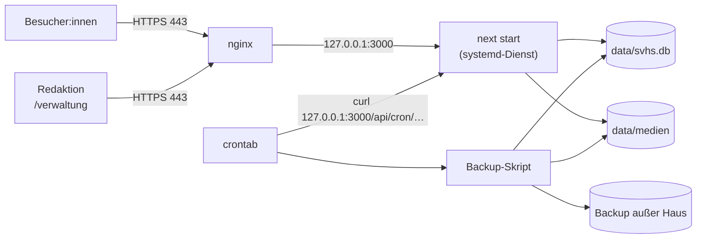

# OPERATIONS.md

Technische Betriebs- und Wartungsdokumentation für das Projekt **sv-holm-seppensen**.

---

## Ziel / Scope

Dieses Dokument beschreibt den Betrieb auf einem **eigenen Server** (geplant: Hetzner): Aufbau,
Umgebungsvariablen, Cronjobs, Backups und Wiederherstellung, Deployment, Recovery und Sicherheit,
dazu den Betrieb der Verwaltung unter `/verwaltung` (Abschnitt 9).

Stand: 2026-10-20 (Verwaltung ergänzt). Die Website ist noch **nicht produktiv**; der Server ist
noch nicht eingerichtet.
Pfade, Dienst- und Benutzernamen in den Beispielen (`/srv/sv-holm-seppensen`, `svhs`) sind
Vorschläge und bei der Einrichtung festzulegen.

---

## 1) Hosting

### 1.1 Zielbild

- **Ein Linux-Server** (z. B. Hetzner Cloud mit Ubuntu LTS) für Website, Datenbank, Medien und Cronjobs.
- **Node.js 22 oder neuer.** `better-sqlite3` 13 setzt Node ≥ 22 voraus.
- **Next.js im Produktionsmodus**: `npm run build` und `npm run start` (= `next start`), als
  systemd-Dienst, nur auf `127.0.0.1:3000` erreichbar.
- **nginx** davor als Reverse Proxy mit TLS (Let's Encrypt).
- **Eine** Instanz der Anwendung (kein Cluster-Modus): SQLite verträgt viele Leser, aber
  Schreibzugriffe und das automatische Einspielen der Migrationen sollen aus einem Prozess kommen.



### 1.2 Warum nicht mehr Vercel

- SQLite braucht ein **dauerhaft beschreibbares Dateisystem**. Vercel-Funktionen haben das nicht:
  Ihr Dateisystem ist schreibgeschützt bzw. flüchtig, und jede Instanz hätte ihre eigene Kopie.
- Dasselbe gilt für den Medienordner.
- Die Cronjobs aus `vercel.json` laufen auf dem eigenen Server per crontab (Abschnitt 3).

### 1.3 Rendering und Aktualität

- Alle Seiten, die aus der Datenbank lesen, rendern dynamisch (`export const dynamic = 'force-dynamic'`).
  Es gibt kein ISR und kein Revalidate-Fenster mehr: Eine Änderung in der Datenbank ist beim
  nächsten Seitenaufruf sichtbar.
- Ausnahme: `/fussball` und `/tischtennis` laden Spiele direkt bei fussball.de bzw. click-tt und
  werden höchstens stündlich neu erzeugt (`revalidate = 3600`).

### 1.4 Arbeitsverzeichnis und persistente Daten

- Die Anwendung muss **im Projektverzeichnis** gestartet werden. Der Migrationsordner `drizzle/`
  und die Standardpfade `data/svhs.db` und `data/medien` werden relativ zum Arbeitsverzeichnis
  aufgelöst (`lib/db/index.ts`, `lib/medien.ts`). Im systemd-Dienst also `WorkingDirectory` setzen.
- Persistent und zu sichern ist der Ordner `data/`:

| Pfad | Inhalt | Hinweis |
|---|---|---|
| `data/svhs.db` | die Datenbank: Inhalte, Zugänge der Verwaltung, angemeldete Geräte und Verlauf | dazu im Betrieb `svhs.db-wal` und `svhs.db-shm` (WAL-Modus) |
| `data/medien/` | Bilder und Dateien, ausgeliefert unter `/medien/<pfad>` | auch alle Uploads aus der Verwaltung |
| `data/backup/` | nächtliche Datenbank-Kopien (Vorschlag) | zusätzlich außer Haus sichern |
| `data/import/` | Kontrollausgaben von `npm run import:wordpress -- --probelauf` (ggf. alte Importdaten) | personenbezogen, nicht nötig für den Betrieb; nicht auf den Server kopieren |

- `data/` steht in `.gitignore`. `git pull` fasst den Ordner nicht an.
- Wer die Daten außerhalb des Checkouts ablegen will (z. B. `/var/lib/svhs`), setzt
  `DATENBANK_PFAD` und `MEDIEN_PFAD` (Abschnitt 2).

---

## 2) Umgebungsvariablen

### 2.1 Übersicht

| Variable | Pflicht | Standard | Zweck | Sensibilität |
|---|---|---|---|---|
| `CRON_SECRET` | **ja (Produktion)** | – | Absicherung von `/api/cron/*` per `Authorization: Bearer <secret>` | **hoch** |
| `DATENBANK_PFAD` | nein | `data/svhs.db` | Pfad der SQLite-Datei; auch von `drizzle.config.ts` genutzt | niedrig |
| `MEDIEN_PFAD` | nein | `data/medien` | Medienordner | niedrig |
| `SEITEN_URL` | **ja (Produktion)** | – | öffentliche Adresse der Website (z. B. `https://www.<vereinsdomain>.de`); daraus werden absolute Vorschaubild-URLs (`og:image`) beim Teilen von News gebaut. Ohne sie zeigen sie auf `http://localhost:<port>`. Außerdem die Adresse in den Einladungs-Links und -QR-Codes der Verwaltung: Ohne sie nimmt die Verwaltung die Adresse der aktuellen Anfrage, das Skript `npm run verwaltung:admin` dagegen `http://localhost:3000` | niedrig |

Für den späteren Telegram-Bot kommen Schlüssel für Telegram und OpenRouter hinzu (siehe
`CMS_KONZEPT.md`). Die Namen der Variablen sind noch offen.

### 2.2 Wo die Variablen stehen

- **Next.js** liest `.env` und `.env.local` aus dem Projektverzeichnis, auch im Produktionsmodus.
- **drizzle-kit** (`npm run db:studio`, `db:migrate`, `db:generate`) liest nur `.env`, nicht
  `.env.local`. Abweichende Pfade deshalb in `.env` eintragen oder beim Aufruf mitgeben:
  `DATENBANK_PFAD=/var/lib/svhs/svhs.db npm run db:studio`.
- `npm run import:wordpress` (tsx) liest **keine** Env-Datei. Abweichende Pfade beim Aufruf
  mitgeben:
  `DATENBANK_PFAD=/var/lib/svhs/svhs.db MEDIEN_PFAD=/var/lib/svhs/medien npm run import:wordpress`.
  Sonst schreibt das Skript in `./data/svhs.db` und `./data/medien`, während die Website den
  konfigurierten Pfad liest.
- `npm run verwaltung:admin` (tsx) liest ebenfalls **keine** Env-Datei. `SEITEN_URL` und einen
  abweichenden `DATENBANK_PFAD` deshalb beim Aufruf mitgeben (Abschnitt 9.1). Sonst landet der
  Admin-Zugang in `./data/svhs.db`, und der Link im QR-Code zeigt auf `http://localhost:3000`.
- `.env` und `.env*.local` sind gitignored. Geheimnisse gehören **nie** in versionierte Dateien.
- Die crontab braucht `CRON_SECRET` ebenfalls (Abschnitt 3.1). Bei einem Wechsel des Secrets
  beide Stellen gleichzeitig ändern.

---

## 3) Cronjobs

### 3.1 crontab einrichten

Die Cron-Endpunkte werden lokal per `curl` aufgerufen. Beispiel für die crontab des Dienstbenutzers
(`crontab -e`):

```cron
CRON_SECRET=hier-das-secret-aus-der-env-datei
0 4 * * * curl -fsS -H "Authorization: Bearer $CRON_SECRET" http://127.0.0.1:3000/api/cron/sync-fussball
0 5 * * * curl -fsS -H "Authorization: Bearer $CRON_SECRET" http://127.0.0.1:3000/api/cron/sync-tischtennis
30 3 * * * /usr/local/bin/svhs-backup.sh
```

- Die Zeiten gelten in der **Zeitzone des Servers**. Empfohlen:
  `timedatectl set-timezone Europe/Berlin`.
- `curl -fsS` meldet HTTP-Fehler auf stderr. Mit `MAILTO=…` in der crontab oder einer Umleitung in
  eine Logdatei (`>> /var/log/svhs-cron.log 2>&1`) bleiben Fehler sichtbar.
- In der crontab hat `%` eine Sonderbedeutung. Befehle mit `date +%F` deshalb in ein Skript
  auslagern (wie beim Backup in Abschnitt 4.2).

### 3.2 Was die Jobs tun

1. `GET /api/cron/sync-fussball` (täglich 04:00)
   - lädt kommende und vergangene Spiele von fussball.de, dedupliziert
   - schreibt sie per Upsert über (`quelle`, `externe_id`) in die Tabelle `termine`
   - löscht verlegte oder abgesagte Spiele, aber nur im verlässlich abgedeckten Datumsfenster
     (`findeVeralteteTermine`)

2. `GET /api/cron/sync-tischtennis` (täglich 05:00)
   - lädt die Spiele der kommenden sechs Monate und der letzten sieben Tage aus click-tt, dedupliziert
   - Upsert in `termine` wie oben
   - löscht verlegte oder abgesagte Spiele im gelieferten Datumsbereich

Beide Jobs löschen gar nichts, wenn mehr als die Hälfte der Termine im Fenster verschwinden würde.
Die JSON-Antwort enthält dann `loeschenUebersprungen: true`, und das Log zeigt eine Warnung.
Details: `CONTENT_FLOW.md`, Abschnitt 2.

### 3.3 Authentifizierung

- Bei gesetztem `CRON_SECRET` wird ein exakter Bearer-Vergleich erzwungen. Falscher oder fehlender
  Header ⇒ `401 Unauthorized`.
- **Ohne** `CRON_SECRET` sind die Endpunkte offen. In Produktion daher immer setzen.
- Optional zusätzlich in nginx sperren, da crontab ohnehin über `127.0.0.1:3000` aufruft:

```nginx
location /api/cron/ {
  deny all;
}
```

### 3.4 Manuell auslösen

```bash
curl -fsS -H "Authorization: Bearer $CRON_SECRET" http://127.0.0.1:3000/api/cron/sync-fussball
```

---

## 4) Backups und Wiederherstellung

### 4.1 Was gesichert wird

| Was | Wie | Warum |
|---|---|---|
| `data/svhs.db` | täglich konsistente Kopie per SQLite-Backup (nicht per `cp`) | alle Inhalte, dazu Zugänge, Geräte und Verlauf der Verwaltung |
| `data/medien/` | täglich per `rsync` | Bilder und Dateien, auch alle Uploads aus der Verwaltung |
| `.env` / `.env.local` | einmalig und nach Änderungen, getrennt und zugriffsgeschützt | Secrets |
| Code | liegt im Git | – |

Die Datenbank läuft im WAL-Modus. Ein einfaches `cp` während des Betriebs kann eine inkonsistente
Kopie erzeugen. Deshalb die Backup-Funktion von SQLite nutzen.

Die Verwaltung braucht kein eigenes Backup: Zugänge, Geräte und Verlauf stehen in derselben
Datenbankdatei und sind im nächtlichen Backup enthalten. Damit enthält jedes Backup aber auch die
Passwort-Hashes und die Geheimnisse der Authenticator-Apps im Klartext (`DATA_MODEL.md`,
Abschnitt 3.18). Backups deshalb so schützen wie Passwörter.

### 4.2 Nächtliches Backup (Beispiel)

`/usr/local/bin/svhs-backup.sh`:

```sh
#!/bin/sh
set -eu
cd /srv/sv-holm-seppensen
mkdir -p data/backup

# Konsistente Kopie der Datenbank
sqlite3 data/svhs.db ".backup data/backup/svhs-$(date +%F).db"

# 30 Tage aufbewahren
find data/backup -name 'svhs-*.db' -mtime +30 -delete

# Außer Haus kopieren, z. B. auf eine Hetzner Storage Box (Ziel anpassen)
# rsync -a data/backup data/medien <benutzer>@<storage-box>:svhs/
```

Ohne das `sqlite3`-Kommandozeilenwerkzeug geht dasselbe mit Node und `better-sqlite3`:

```sh
node -e "require('better-sqlite3')('data/svhs.db').backup('data/backup/svhs-' + new Date().toISOString().slice(0, 10) + '.db').then(() => console.log('Backup ok'))"
```

Empfehlungen:

- Backups **außer Haus** halten (anderer Server oder Storage Box). Ein Backup auf demselben Server
  hilft nicht, wenn der Server ausfällt.
- Backups enthalten personenbezogene Daten: Zugriff beschränken, außer Haus möglichst verschlüsselt.
- Die Wiederherstellung regelmäßig testen (z. B. vierteljährlich lokal).

### 4.3 Wiederherstellung (komplett)

```sh
sudo systemctl stop svhs
cd /srv/sv-holm-seppensen
mv data/svhs.db data/svhs.db.defekt          # aktuellen Stand aufheben …
if [ -f data/svhs.db-wal ]; then mv data/svhs.db-wal data/svhs.db.defekt-wal; fi   # … samt WAL (enthält die letzten Änderungen)
rm -f data/svhs.db-shm                        # Index-Datei wird neu angelegt
cp data/backup/svhs-2026-10-02.db data/svhs.db
sudo systemctl start svhs
```

- Die WAL-Datei **nicht löschen**: Beim Stoppen schließt die Anwendung die Datenbank nicht
  ausdrücklich, die letzten bestätigten Änderungen können deshalb noch in `svhs.db-wal` stehen.
  Nur zusammen mit `svhs.db.defekt-wal` ist die aufgehobene Kopie vollständig.

- Ist das Backup älter als die aktuelle Code-Version, spielt die Anwendung fehlende Migrationen
  beim ersten Zugriff automatisch ein.
- Danach Startseite, Sparten, Trainingszeiten, Kontaktseite und News prüfen.
- Medien bei Bedarf per `rsync` aus der Sicherung zurückholen.
- **Auch die Zugänge springen auf den Stand des Backups zurück:** Später angelegte Zugänge fehlen,
  spätere Passwortänderungen und Zurücksetzungen sind rückgängig gemacht, und Geräte, die damals
  angemeldet und noch nicht abgelaufen waren, sind wieder angemeldet. Der Verlauf endet mit dem
  Backup. Nach der Wiederherstellung deshalb unter „Zugänge“ prüfen und betroffene Zugänge erneut
  zurücksetzen oder ihre Geräte abmelden (Abschnitt 9.3).

### 4.4 Einzelne Daten zurückholen

Für einen versehentlich gelöschten oder falsch geänderten Eintrag nicht die ganze Datenbank
zurückspielen.

Erster Weg ist der **Verlauf** der Verwaltung („Verlauf“, nur für Admins): Er zeigt jede Änderung
mit Stand vorher und nachher, auch bei gelöschten Einträgen. Die alten Werte von dort in der
Verwaltung wieder eintragen. Einen Knopf „Wiederherstellen“ gibt es noch nicht. Ein ersetztes oder
entferntes Foto hat die Verwaltung meist schon aus dem Medienordner gelöscht; die Datei dann aus
der Medien-Sicherung holen oder neu hochladen.

Hilft das nicht (z. B. bei Änderungen in Drizzle Studio, die nicht im Verlauf stehen), das Backup
getrennt öffnen und die Werte von Hand übertragen:

```sh
DATENBANK_PFAD=data/backup/svhs-2026-10-02.db npm run db:studio
```

Die bei einer Wiederherstellung aufgehobene Kopie (Abschnitt 4.3) lässt sich genauso öffnen:
`DATENBANK_PFAD=data/svhs.db.defekt npm run db:studio`. SQLite liest `svhs.db.defekt-wal` dabei
automatisch mit ein.

---

## 5) Deployment

### 5.1 Ersteinrichtung (grob)

1. **Server anlegen** (z. B. Hetzner Cloud, Ubuntu LTS). Firewall nur für SSH, HTTP und HTTPS
   öffnen, SSH nur mit Schlüssel, Zeitzone `Europe/Berlin`, automatische Sicherheitsupdates.
2. **Pakete installieren**: Node.js 22 LTS (oder neuer), git, nginx, certbot, sqlite3.
   Build-Werkzeuge (`build-essential`, `python3`) nur, falls `better-sqlite3` kein fertiges
   Binary für die Plattform findet. `sharp` bringt seine Binaries als optionale Pakete mit
   (Abschnitt 9.6).
3. **Dienstbenutzer** anlegen (z. B. `svhs`) und das Repository nach `/srv/sv-holm-seppensen` klonen.
4. **Umgebung**: `.env` bzw. `.env.local` anlegen (mindestens `CRON_SECRET` und `SEITEN_URL`,
   siehe Abschnitt 2).
5. **Abhängigkeiten und Build**: `npm ci` und `npm run build`.
6. **Daten**: den bisherigen Datenbestand, also eine konsistente Kopie der Datenbank (per
   SQLite-Backup, Abschnitt 4.2) als `data/svhs.db` und den Ordner `data/medien/`, per
   `scp`/`rsync` auf den Server kopieren. Bei abweichenden Pfaden die Dateien dort ablegen, wohin
   `DATENBANK_PFAD` und `MEDIEN_PFAD` zeigen. Anschließend müssen die Dateien dem Dienstbenutzer
   gehören (Abschnitt 8.3), sonst kann der Dienst weder in die Datenbank noch in den
   Medienordner schreiben: `sudo chown -R svhs: data && sudo chmod -R o-rwx data` (bzw. die Pfade
   aus `DATENBANK_PFAD` und `MEDIEN_PFAD`), oder gleich als `svhs` kopieren. Die Kopie bringt
   alle Zugänge, angemeldeten Geräte und offenen Einladungs-Codes mit (z. B. vom Vereins-PC,
   `README.md`, „Vorerst: auf dem eigenen Rechner“); Aufräumen siehe Schritt 11. Gibt es noch
   keinen Datenbestand, entfällt dieser Schritt: Die leere Datenbank legt die Anwendung beim
   ersten Zugriff selbst an, die Inhalte werden nach dem ersten Admin (Schritt 11) in der
   Verwaltung eingetragen. Ab dann wird **nur noch auf dem Server** gepflegt, über die Verwaltung.
7. **systemd-Dienst** einrichten (Beispiel unten), aktivieren und starten.
8. **nginx** als Reverse Proxy einrichten (Beispiel unten) und TLS mit `certbot --nginx` holen.
9. **crontab** und Backup-Skript einrichten (Abschnitte 3 und 4).
10. **Domain** auf den Server zeigen lassen, `SEITEN_URL` in der Env-Datei auf die öffentliche
    Adresse setzen (Abschnitt 2.1; mit oder ohne „www“ vorher klären), Dienst neu starten und alle
    Seiten prüfen (ohne Datenbestand erst nach Schritt 11 sinnvoll).
11. **Zugänge der Verwaltung**:
    - *Mit kopierter Datenbank*: keinen neuen ersten Admin anlegen. Mit einem vorhandenen
      Admin-Zugang über `https://…/verwaltung` anmelden und unter „Zugänge“ Test- und nicht mehr
      benötigte Zugänge deaktivieren, unbekannte oder nicht mehr genutzte Geräte abmelden und
      offene Einladungs-Codes ungültig machen (Zugang deaktivieren oder neuen Code erstellen; alte
      Links zeigen sonst noch auf `localhost` oder die Adresse des PCs). Sicherstellen, dass es
      mindestens zwei Admins gibt.
    - *Mit leerer Datenbank*: ersten Admin anlegen (Abschnitt 9.1), sich über
      `https://…/verwaltung` anmelden und mindestens einen zweiten Admin einrichten.

systemd-Dienst `/etc/systemd/system/svhs.service` (Beispiel):

```ini
[Unit]
Description=SV Holm-Seppensen Website
After=network.target

[Service]
User=svhs
WorkingDirectory=/srv/sv-holm-seppensen
Environment=NODE_ENV=production
ExecStart=/usr/bin/npm run start -- -H 127.0.0.1 -p 3000
Restart=on-failure

[Install]
WantedBy=multi-user.target
```

nginx (Beispiel, TLS-Teil ergänzt certbot):

```nginx
# Im http-Block (z. B. /etc/nginx/conf.d/svhs-limit.conf): nur POST-Anfragen zählen
map $request_method $svhs_post_ip {
  POST    $binary_remote_addr;
  default "";
}
limit_req_zone $svhs_post_ip zone=svhs_verwaltung:10m rate=30r/m;

server {
  server_name www.example.de;

  # Uploads in der Verwaltung: bis 15 MB pro Datei (nginx-Standard wäre 1 MB)
  client_max_body_size 16m;

  # auf Server-Ebene, damit beide location-Blöcke sie erben
  proxy_set_header Host $host;
  # Pflicht: echte Client-IP für die Begrenzung der Fehlversuche (Abschnitt 9.2)
  proxy_set_header X-Real-IP $remote_addr;
  proxy_set_header X-Forwarded-For $proxy_add_x_forwarded_for;
  # Pflicht: daran erkennt die Verwaltung HTTPS und setzt das Cookie als Secure
  proxy_set_header X-Forwarded-Proto $scheme;

  location / {
    proxy_pass http://127.0.0.1:3000;
  }

  # Empfohlen: POST-Anfragen (Anmeldung, Speichern) in der Verwaltung pro IP drosseln
  location /verwaltung {
    limit_req zone=svhs_verwaltung burst=20 nodelay;
    proxy_pass http://127.0.0.1:3000;
  }
}
```

Die kommentierten Einstellungen braucht bzw. empfiehlt die Verwaltung; Begründung in Abschnitt 9.2.
Die Werte für `limit_req` sind ein Vorschlag (30 POST-Anfragen pro Minute und IP, kurzzeitig 20
mehr) und bei Bedarf anzupassen.

### 5.2 Update einspielen

```sh
cd /srv/sv-holm-seppensen
git pull
npm ci
npm run build
sudo systemctl restart svhs
```

- **Vorher ein Backup ziehen**, wenn neue Dateien in `drizzle/` dabei sind (Schemaänderung).
  Migrationen werden beim ersten Datenbankzugriff nach dem Neustart automatisch eingespielt.
  Das gilt auch für das erste Update mit der Verwaltung (Migration `0001_verwaltung`, siehe
  `DATA_MODEL.md`, Abschnitt 9). Danach den ersten Admin anlegen (Abschnitt 9.1).
- Ein Neustart beendet keine Anmeldungen: Die Sitzungen stehen in der Datenbank (`geraete`).
- `next build` überschreibt `.next/`, während die alte Instanz noch läuft. In dieser Zeit können
  einzelne Seiten kurz fehlschlagen. Updates daher zu ruhigen Zeiten einspielen.
- **Zurückrollen**: vorherigen Commit auschecken, `npm ci`, `npm run build`, neu starten. Wurde
  dabei schon eine Migration eingespielt, zusätzlich das Backup von vor dem Update zurückspielen
  (Drizzle-Migrationen haben keinen Rückwärtsschritt).

---

## 6) Externe Abhängigkeiten

### 6.1 fussball.de

- Modul: `lib/fussball-de.ts`
- Zugriff auf öffentliche AJAX-Endpunkte:
  - `https://www.fussball.de/ajax.club.next.games/...`
  - `https://www.fussball.de/ajax.club.prev.games/...`
- Parsing über HTML/Regex (struktursensitiv)
- Risiko: HTML-Strukturänderungen brechen die Extraktion.

### 6.2 click-tt (nuLiga/TTVN)

- Modul: `lib/click-tt.ts`
- Zugriff per POST auf:
  - `https://ttvn.click-tt.de/cgi-bin/WebObjects/nuLigaTTDE.woa/wa/clubMeetings`
- Parsing aus der HTML-Tabelle (`result-set`)
- Risiko: Markup- oder Formularänderungen brechen das Parsing.

### 6.3 Keine weiteren Laufzeitdienste

- Sanity wird nicht mehr genutzt. Die Website braucht zur Laufzeit außer fussball.de und click-tt
  keinen externen Dienst.
- Auch die Verwaltung kommt ohne externen Dienst aus: kein Mailversand, kein Login-Anbieter.
  QR-Codes (Paket `qrcode`), Passwort-Hashes (scrypt) und App-Codes (TOTP) berechnet der Server
  selbst; die Authenticator-Apps auf den Handys arbeiten offline.
- Später kommen Telegram und OpenRouter für den Bot dazu (`CMS_KONZEPT.md`).

---

## 7) Recovery / Wartung

### 7.1 Typische Störungen

| Symptom | Mögliche Ursache | Vorgehen |
|---|---|---|
| Website liefert 500 | Datenbankdatei fehlt, ist nicht lesbar oder falsches Arbeitsverzeichnis | `journalctl -u svhs -n 100`; Pfad und Rechte von `data/` prüfen; `WorkingDirectory` prüfen |
| Fehler beim ersten Seitenaufruf nach einem Update | Migration schlägt fehl (sie läuft beim ersten Datenbankzugriff) | Log lesen; Backup zurückspielen (Abschnitt 4.3); Migration korrigieren |
| `database is locked` | lange Schreibtransaktion (z. B. offenes Drizzle Studio mit großem Vorgang) | kurz warten (Timeout 5 s), Drizzle Studio schließen, ggf. Dienst neu starten |
| Cron liefert `401` | `CRON_SECRET` in crontab und Env-Datei unterschiedlich | beide angleichen |
| Cron liefert 0 Spiele oder `loeschenUebersprungen: true` | Parser passt nicht mehr zur Quelle | `lib/fussball-de.ts` bzw. `lib/click-tt.ts` prüfen; Bestand bleibt erhalten |
| Bild oder Download liefert 404 | Datei fehlt im Medienordner oder Pfad in der Datenbank falsch | Datei unter `data/medien/<pfad>` prüfen; Pfad ohne `/medien/`-Präfix eintragen |
| Inhalt versehentlich gelöscht oder geändert | Pflegefehler | alte Werte aus dem Verlauf der Verwaltung oder aus dem Backup übertragen (Abschnitt 4.4) |
| Platte voll | Backups, Logs, WAL-Datei | alte Backups und Logs löschen; Dienst neu starten |
| Upload in der Verwaltung bricht mit `413` ab | `client_max_body_size` in nginx zu klein | auf `16m` setzen (Abschnitt 5.1), nginx neu laden |
| „Das Bild konnte nicht gelesen werden“ bei jedem Bild | `sharp` ohne passendes Binary installiert | `npm ci` ohne `--omit=optional` wiederholen, Log prüfen (Abschnitt 9.6) |
| App-Code wird immer abgelehnt, Passwort stimmt | Uhr des Servers oder des Handys geht falsch (die Codes sind zeitbasiert) | `timedatectl` prüfen, Zeitabgleich (NTP) einschalten; am Handy automatische Uhrzeit einschalten |
| „Zu viele falsche Versuche“ | 5 Fehlversuche mit diesem Benutzernamen von dieser IP oder 20 von dieser IP insgesamt in 15 Minuten | eine Viertelstunde warten |
| Alle Nutzer:innen sind gleichzeitig wegen Fehlversuchen gesperrt | nginx gibt die Client-IP nicht weiter (weder `X-Real-IP` noch `X-Forwarded-For`), alle Anfragen zählen für dieselbe Adresse | Header in nginx setzen (Abschnitt 5.1), nginx neu laden |
| `503` beim Speichern oder Anmelden | `limit_req` in nginx greift | Werte in `limit_req_zone`/`burst` erhöhen (Abschnitt 5.1) |
| Einladungs-Link zeigt auf `localhost` | `SEITEN_URL` beim Skript nicht gesetzt bzw. nicht in der Env-Datei | Code von Hand auf `/verwaltung/anmelden` eingeben oder Skript mit `SEITEN_URL` neu aufrufen (Abschnitt 9.1) |
| Niemand kann sich als Admin anmelden | alle Admins ausgesperrt (Handy verloren, Passwort vergessen) | Notfall-Zugang per Skript (Abschnitt 9.4) |

### 7.2 Inhalte auf dem Server pflegen (Drizzle Studio per SSH-Tunnel)

Inhalte werden über die Verwaltung unter `/verwaltung` gepflegt (Abschnitt 9, `README.md`).
Drizzle Studio bleibt für Technik und Notfälle. Es **umgeht Rechte, Prüfungen, Konfliktprüfung
und Verlauf** der Verwaltung (Abschnitt 9.5): Änderungen hier erscheinen nirgends im Verlauf und
lassen sich dort nicht nachvollziehen.
Drizzle Studio lauscht nur lokal (Port 4983) und darf **nie** öffentlich erreichbar sein.

1. Vom eigenen Rechner einen Tunnel öffnen: `ssh -L 4983:127.0.0.1:4983 svhs@<server>`
2. In dieser SSH-Sitzung: `cd /srv/sv-holm-seppensen && npm run db:studio`
3. Im lokalen Browser `https://local.drizzle.studio` öffnen.
4. Nach der Arbeit Drizzle Studio beenden (`Strg+C`) und den Tunnel schließen.

Alternative für Einzelkorrekturen: `sqlite3 data/svhs.db`, dann zuerst
`PRAGMA foreign_keys = ON;`. Sonst greifen die Lösch- und Fremdschlüsselregeln nicht.

### 7.3 Medien ersetzen oder löschen (Cache)

`/medien/<pfad>` wird gecacht (`app/medien/[...pfad]/route.ts`):

- Dateinamen mit 8-stelligem Hash-Suffix (`…-1a2b3c4d.webp`, so legen Verwaltung und
  WordPress-Import Dateien ab; die übernommenen Altdaten heißen ebenso) gelten als unveränderlich:
  `Cache-Control: public, max-age=31536000, immutable`.
- Alle anderen Dateien (z. B. `downloads/satzung.pdf`) werden bei jedem Abruf nachgeprüft
  (`max-age=0, must-revalidate` mit ETag und Last-Modified, unverändert ⇒ `304`).

Daraus folgt:

- **Ersetzen**: neue Fassung immer unter **neuem Dateinamen** ablegen (z. B. mit Datum oder Hash im
  Namen) und den Pfad in der Tabelle anpassen. Eine unter gleichem Namen überschriebene Datei mit
  Hash-Suffix bliebe bei Besucher:innen bis zu ein Jahr alt. Die Verwaltung macht das beim
  Hochladen automatisch und löscht die alte Datei, sobald nichts mehr auf sie verweist
  (`DATA_MODEL.md`, Abschnitt 7.1).
- **Foto löschen oder ersetzen** (z. B. Widerruf einer Einwilligung): `next/image` hält verkleinerte
  Kopien in `.next/cache/images` (der Ordner übersteht auch `npm run build`) und liefert einen
  abgelaufenen Eintrag weiter aus, selbst wenn das Original fehlt. Das gilt auch, wenn das Foto in
  der Verwaltung entfernt oder ersetzt wurde: Sie löscht das Original, aber nicht den Bildcache.
  Deshalb danach den Bildcache leeren:

  ```sh
  cd /srv/sv-holm-seppensen
  rm -rf .next/cache/images
  sudo systemctl restart svhs
  ```

  Kopien in den Browsern der Besucher:innen lassen sich serverseitig nicht zurückholen.

---

## 8) Sicherheit

### 8.1 Sofortmaßnahme: Sanity-Tokens widerrufen

- In der **Git-Historie dieses öffentlichen Repositorys** stehen Sanity-Schreibtokens. Sie waren
  früher in `scripts/patch-*.mjs` hart kodiert. Das Löschen der Skripte entfernt sie **nicht** aus
  der Historie, und vorhandene Klone oder Forks behalten sie.
- Deshalb in der Sanity-Verwaltung (sanity.io/manage) im Projekt **alle API-Tokens widerrufen**,
  auch die aus `.env.local` und Vercel.
- Danach das **Sanity-Projekt löschen**; der Umzug ist abgeschlossen, es wird nicht mehr
  gebraucht. Dann sind auch unbekannte Kopien der Tokens wertlos.
- Die Sanity-Variablen werden nirgends mehr gelesen: aus `.env.local` entfernen. Im
  Vercel-Projekt hinterlegte Variablen ebenfalls löschen bzw. das Vercel-Projekt abschalten.

### 8.2 Personenbezogene Daten

- `data/` (Datenbank, Medien, Backups, Importdaten in `data/import/`) ist gitignored und darf
  **nie** committet oder in versionierte Dateien kopiert werden. Das Repository ist öffentlich.
- Kontaktdaten erscheinen öffentlich auf der Website: nur mit Einverständnis der Personen eintragen.
- Alles im Medienordner ist über `/medien/<pfad>` öffentlich abrufbar. Interne Dokumente gehören
  nicht dorthin. Die Route lässt keine Pfade außerhalb des Medienordners zu (`medienDatei()`).
- Wird ein Foto gelöscht (z. B. Widerruf der Einwilligung), reicht das Entfernen von Datei und
  Datenbankeintrag nicht: zusätzlich den Bildcache leeren (Abschnitt 7.3).
- Die Verwaltung schreibt beim Hochladen einen Inhalts-Hash in den Dateinamen, entfernt
  Metadaten wie GPS-Koordinaten aus Bildern und löscht ersetzte Dateien. Den Bildcache leert sie
  nicht (Abschnitt 7.3).
- **Verlauf:** Er hebt alte Stände dauerhaft auf, bei Personen auch Kontaktdaten und interne
  Notizen, und zwar auch nach dem Löschen der Person. Eine automatische Löschfrist gibt es nicht.
  Bei einem Löschwunsch (z. B. Widerruf der Einwilligung) die betroffenen Einträge in `verlauf`
  zusätzlich per Drizzle Studio entfernen; Backups laufen nach 30 Tagen von selbst aus.
- **Zugänge** brauchen keine E-Mail-Adresse: gespeichert werden Name, Benutzername, Rechte und die
  Gerätenamen aus dem User-Agent. IP-Adressen stehen nur gehasht in `fehlversuche` und
  verschwinden nach etwa einem Tag (`DATA_MODEL.md`, Abschnitt 3.16).
- Die Datenschutzerklärung (`app/datenschutz/page.tsx`) um das Hosting auf dem eigenen Server und
  die Verwaltung (Anmelde-Cookie `svhs_sitzung`, Verlauf) ergänzen, später um Telegram-Bot und LLM.

### 8.3 Server

- SSH nur mit Schlüssel, kein Passwort-Login; Firewall nur für 22, 80 und 443.
- Node.js lauscht nur auf `127.0.0.1`; von außen ist nur nginx erreichbar.
- `data/` und die Env-Dateien gehören dem Dienstbenutzer und sind für andere nicht lesbar. Die
  Datenbank enthält Passwort-Hashes und App-Geheimnisse der Verwaltung.
- Systemzeit per Zeitabgleich (NTP) synchron halten: Die App-Codes der Anmeldung sind zeitbasiert
  und vertragen nur rund 30 Sekunden Abweichung.
- Automatische Sicherheitsupdates einschalten; Node.js und npm-Abhängigkeiten regelmäßig aktualisieren.

### 8.4 Cron-Endpunkte

- `CRON_SECRET` lang und zufällig wählen (z. B. `openssl rand -base64 32`).
- Optional `/api/cron/` in nginx von außen sperren (Abschnitt 3.3).

### 8.5 Priorisierte Risiken

1. **Hoch**: Sanity-Tokens in der öffentlichen Git-Historie, solange sie nicht widerrufen sind.
2. **Hoch**: Datenverlust ohne Backup außer Haus (ein Server, eine Datei).
3. **Mittel-Hoch**: Scraper-Abhängigkeit von externem HTML (fussball.de, click-tt).
4. **Mittel**: Pflegefehler. In der Verwaltung stehen sie im Verlauf, lassen sich aber noch nicht
   per Knopf wiederherstellen; in Drizzle Studio gibt es weder Verlauf noch Rückgängig.
5. **Mittel**: alle Admins ausgesperrt (Handy verloren, Passwort vergessen). Der Notfall-Zugang
   (Abschnitt 9.4) braucht SSH-Zugriff auf den Server.
6. **Mittel**: offene Cron-Endpunkte, falls `CRON_SECRET` fehlt.

### 8.6 Empfehlungen

1. **Sofort**: Sanity-Tokens widerrufen (Abschnitt 8.1).
2. **Vor dem Livegang**: Backups außer Haus einrichten und eine Wiederherstellung testen.
3. **Monitoring**: Cron-Ergebnisse per Mail oder Log prüfen; Alarm bei Fehlern oder wiederholt
   0 synchronisierten Spielen; optional ein externer Uptime-Check der Startseite.
4. **Verwaltung**: Die Pflege per Drizzle Studio ist durch `/verwaltung` mit Rechten und Verlauf
   ersetzt (seit 20.10.2026). Mindestens zwei Admins einrichten und SSH-Zugang für mindestens zwei
   Personen vorhalten (Abschnitt 9.4). Offen ist noch „Wiederherstellen“ im Verlauf (`CMS_KONZEPT.md`).

---

## 9) Verwaltung `/verwaltung`

Die Verwaltung ist Teil derselben Next.js-Anwendung: kein eigener Dienst, keine eigene Datenbank.
Angemeldet wird mit Zwei-Faktor (Benutzername + Passwort + 6-stelliger Code aus einer
Authenticator-App). Bedienung: `README.md`; Ablauf und Rechte: `CMS_KONZEPT.md`, Abschnitte 5
und 6; Tabellen: `DATA_MODEL.md`, Abschnitte 3.12–3.18.

### 9.1 Erster Admin auf dem Server

Nur bei leerer Datenbank nötig; eine kopierte Datenbank bringt ihre Zugänge mit (Abschnitt 5.1,
Schritt 11). Den allerersten Admin legt ein Skript direkt in der Datenbank an. Auf dem Server als
Dienstbenutzer im Projektverzeichnis (damit neu angelegte Dateien in `data/` dem Dienst gehören):

```sh
cd /srv/sv-holm-seppensen
SEITEN_URL=https://www.<vereinsdomain>.de npm run verwaltung:admin -- "Vorname Nachname"
```

- Das Skript liest **keine** Env-Datei. `SEITEN_URL` muss beim Aufruf mitgegeben werden, sonst
  zeigt der Link im QR-Code auf `http://localhost:3000`. Liegt die Datenbank nicht unter
  `data/svhs.db`, auch `DATENBANK_PFAD=…` mitgeben, sonst entsteht der Zugang in einer neuen,
  leeren Datei.
- Ausgabe: QR-Code im Terminal, Benutzername, Einladungs-Code, Link und Ablaufzeit. Der Code gilt
  7 Tage und nur einmal. Er erscheint nur in dieser Ausgabe.
- Danach den QR-Code mit dem Handy scannen (oder am PC `/verwaltung/anmelden` öffnen und den Code
  eintippen), ein Passwort mit mindestens 10 Zeichen festlegen und die Authenticator-App koppeln.
- Weitere Zugänge legt der Admin dann in der Verwaltung unter „Zugänge“ an. **Mindestens zwei
  Admins** einrichten, damit nicht ein verlorenes Handy alle aussperrt.
- Das Skript braucht nur Zugriff auf die Datenbankdatei, der Dienst kann dabei weiterlaufen.
  Fehlende Migrationen spielt es selbst ein.

### 9.2 HTTPS, Cookie und nginx

- **Sitzungs-Cookie** `svhs_sitzung`: `httpOnly`, `SameSite=Lax`, Pfad `/`. Es enthält nur ein
  Zufallstoken; die Sitzung selbst steht in der Tabelle `geraete`. Mit „angemeldet bleiben“ gilt
  es 30 Tage, sonst endet es mit dem Schließen des Browsers (die Sitzung spätestens nach 12 Stunden).
- **`Secure`** setzt die Anwendung nur, wenn die Anfrage über HTTPS kam. Hinter nginx erkennt sie
  das am Header `X-Forwarded-Proto` (erster Wert; ohne den Header an `Origin` bzw. `Referer`).
  `proxy_set_header X-Forwarded-Proto $scheme;` ist deshalb Pflicht (Beispiel in Abschnitt 5.1).
  Die Verwaltung nur über `https://` benutzen.
- **Fehlversuche** werden pro IP-Adresse (20 in 15 Minuten) und pro Kombination aus
  Benutzername und IP-Adresse (5 in 15 Minuten) gezählt. Ein Benutzername allein wird nicht
  gesperrt; so kann niemand fremde Zugänge gezielt aussperren. Die IP-Adresse nimmt die Anwendung
  aus `X-Real-IP`, ersatzweise aus dem **letzten** Eintrag von `X-Forwarded-For` (den hat nginx
  selbst angehängt; frühere Einträge kann ein Client fälschen).
  `proxy_set_header X-Real-IP $remote_addr;` ist deshalb Pflicht (Beispiel in Abschnitt 5.1).
- **Drosselung in nginx** (empfohlen): `limit_req` für POST-Anfragen unter `/verwaltung`
  (Beispiel in Abschnitt 5.1). Das bremst massenhafte Anmeldeversuche, bevor sie die Anwendung
  erreichen.
- **Uploads** laufen über Server-Aktionen. `next.config.js` erlaubt dafür 16 MB pro Anfrage
  (`serverActions.bodySizeLimit`), die Verwaltung selbst höchstens 15 MB pro Datei. nginx lässt
  standardmäßig nur 1 MB durch: `client_max_body_size 16m;` setzen.
- **Systemzeit**: Die App-Codes sind zeitbasiert (30 Sekunden, ein Schritt Toleranz). Server per
  NTP synchron halten (`timedatectl`).
- Alle Seiten unter `/verwaltung` sind für Suchmaschinen gesperrt (`noindex`) und von der Website
  aus nicht verlinkt.

### 9.3 Zugang zurücksetzen (Passwort vergessen, Handy verloren)

- Ein Admin öffnet „Zugänge“ → Zugang → „Zugang zurücksetzen“. Dabei werden Passwort und
  App-Kopplung ungültig, **alle Geräte** abgemeldet und offene Einladungs-Codes gelöscht. Es
  erscheint ein neuer Einladungs-Code mit QR-Code (7 Tage, einmal), nur dieses eine Mal.
- Den Code nur persönlich oder per Direktnachricht weitergeben, nicht in Gruppen.
- Den eigenen Zugang kann ein Admin ebenfalls zurücksetzen; er ist danach selbst abgemeldet.
- Deaktivierte Zugänge lassen sich nicht zurücksetzen, sie müssen zuerst wieder aktiviert werden.
- Wer sein Passwort nur ändern will, macht das selbst unter „Mein Zugang“ (aktuelles Passwort +
  App-Code). Dabei werden alle anderen Geräte abgemeldet.
- Verdacht auf Missbrauch: einzelne Geräte abmelden (unter „Zugänge“ bzw. „Mein Zugang“) oder den
  Zugang deaktivieren. Deaktivieren meldet sofort alle Geräte ab.

### 9.4 Notfall: alle Admins ausgesperrt

Kann sich kein Admin mehr anmelden, hilft nur das Skript aus Abschnitt 9.1, direkt auf dem Server:

```sh
cd /srv/sv-holm-seppensen
SEITEN_URL=https://www.<vereinsdomain>.de npm run verwaltung:admin -- "Vorname Nachname"
```

- Gibt es schon einen Zugang mit **genau diesem Namen** (wie unter „Zugänge“ angezeigt), wird er
  wieder aktiviert, zum Admin gemacht und zurückgesetzt: alle Geräte abgemeldet, Passwort und
  App-Kopplung ungültig, neue Einladung. Sonst legt das Skript einen neuen Admin-Zugang an.
- Im Verlauf steht der Vorgang mit der Quelle „System“.
- Voraussetzung ist SSH-Zugriff auf den Server. Diesen Zugriff deshalb für mindestens zwei
  Personen einrichten.

### 9.5 Drizzle Studio und direkte SQL-Änderungen

- Drizzle Studio (Abschnitt 7.2) und `sqlite3` umgehen die Verwaltung: **keine Rechteprüfung,
  keine Plausibilitätsprüfung, keine Konfliktprüfung, kein Eintrag im Verlauf**. Auch ersetzte
  Dateien bleiben dann im Medienordner liegen.
- Nur für Technik und Notfälle verwenden. Inhalte normal über die Verwaltung pflegen.
- In `zugaenge` nie `passwort_hash`, `totp_geheimnis` oder `totp_letzter_schritt` von Hand ändern.
  Für Ausgesperrte gibt es Zurücksetzen (9.3) und das Notfall-Skript (9.4).
- Im Notfall wirksam und harmlos: Zeilen in `geraete` löschen (meldet diese Geräte ab) oder
  `zugaenge.aktiv` auf `0` setzen (sperrt den Zugang sofort; offene Codes und Geräte bleiben dann
  aber stehen, anders als beim Deaktivieren in der Verwaltung).

### 9.6 Abhängigkeiten

- **`sharp`** verkleinert hochgeladene Bilder und wandelt sie in WebP um. Wie `better-sqlite3` ist
  es ein natives Modul und steht deshalb in `next.config.js` unter
  `serverComponentsExternalPackages` (wird nicht gebündelt, sondern aus `node_modules` geladen).
  Die Binaries für Linux x64 kommen als optionale Pakete (`@img/sharp-…`) mit dem Lockfile;
  `npm ci` deshalb nicht mit `--omit=optional` aufrufen.
- **`qrcode`** erzeugt die QR-Codes (SVG in der Verwaltung, Text im Terminal beim Skript).
- Passwörter (scrypt), Hashes (SHA-256) und App-Codes (TOTP) nutzen nur `node:crypto`.

---

## Anhang: Relevante Betriebsdateien

- `package.json` (Skripte `build`, `start`, `db:*`, `import:wordpress`, `verwaltung:admin`)
- `next.config.js` (externe Pakete `better-sqlite3` und `sharp`, Upload-Grenze der Server-Aktionen)
- `drizzle.config.ts`, `drizzle/`
- `lib/db/index.ts`, `lib/db/schema.ts`
- `lib/medien.ts`, `app/medien/[...pfad]/route.ts`
- `lib/verwaltung/` (Anmeldung, Sitzung, Rechte, Uploads, Verlauf), `app/verwaltung/`
- `scripts/verwaltung-admin.ts`
- `app/api/cron/sync-fussball/route.ts`
- `app/api/cron/sync-tischtennis/route.ts`
- `lib/fussball-de.ts`
- `lib/click-tt.ts`
- `.env.local.example`
