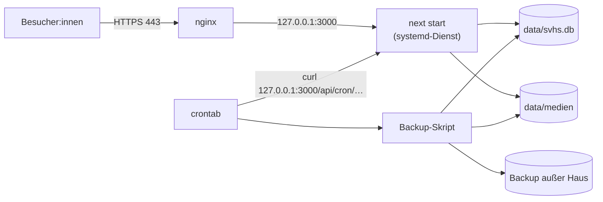

# OPERATIONS.md

Technische Betriebs- und Wartungsdokumentation für das Projekt **sv-holm-seppensen**.

---

## Ziel / Scope

Dieses Dokument beschreibt den Betrieb auf einem **eigenen Server** (geplant: Hetzner): Aufbau,
Umgebungsvariablen, Cronjobs, Backups und Wiederherstellung, Deployment, Recovery und Sicherheit.

Stand: 2026-10-03. Die Website ist noch **nicht produktiv**; der Server ist noch nicht eingerichtet.
Pfade, Dienst- und Benutzernamen in den Beispielen (`/srv/sv-holm-seppensen`, `svhs`) sind
Vorschläge und bei der Einrichtung festzulegen.

---

## 1) Hosting

### 1.1 Zielbild

- **Ein Linux-Server** (z. B. Hetzner Cloud mit Ubuntu LTS) für Website, Datenbank, Medien und Cronjobs.
- **Node.js 22 oder neuer.** `better-sqlite3` 13 setzt Node ≥ 22 voraus.
- **Next.js im Produktionsmodus**: `npm run build` und `npm run start` (= `next start`), als
  systemd-Dienst, nur auf `127.0.0.1:3000` erreichbar.
- **nginx** davor als Reverse Proxy mit TLS (Let's Encrypt).
- **Eine** Instanz der Anwendung (kein Cluster-Modus): SQLite verträgt viele Leser, aber
  Schreibzugriffe und das automatische Einspielen der Migrationen sollen aus einem Prozess kommen.



### 1.2 Warum nicht mehr Vercel

- SQLite braucht ein **dauerhaft beschreibbares Dateisystem**. Vercel-Funktionen haben das nicht:
  Ihr Dateisystem ist schreibgeschützt bzw. flüchtig, und jede Instanz hätte ihre eigene Kopie.
- Dasselbe gilt für den Medienordner.
- Die Cronjobs aus `vercel.json` laufen auf dem eigenen Server per crontab (Abschnitt 3).

### 1.3 Rendering und Aktualität

- Alle Seiten, die aus der Datenbank lesen, rendern dynamisch (`export const dynamic = 'force-dynamic'`).
  Es gibt kein ISR und kein Revalidate-Fenster mehr: Eine Änderung in der Datenbank ist beim
  nächsten Seitenaufruf sichtbar.
- Ausnahme: `/fussball` und `/tischtennis` laden Spiele direkt bei fussball.de bzw. click-tt und
  werden höchstens stündlich neu erzeugt (`revalidate = 3600`).

### 1.4 Arbeitsverzeichnis und persistente Daten

- Die Anwendung muss **im Projektverzeichnis** gestartet werden. Der Migrationsordner `drizzle/`
  und die Standardpfade `data/svhs.db` und `data/medien` werden relativ zum Arbeitsverzeichnis
  aufgelöst (`lib/db/index.ts`, `lib/medien.ts`). Im systemd-Dienst also `WorkingDirectory` setzen.
- Persistent und zu sichern ist der Ordner `data/`:

| Pfad | Inhalt | Hinweis |
|---|---|---|
| `data/svhs.db` | die Datenbank | dazu im Betrieb `svhs.db-wal` und `svhs.db-shm` (WAL-Modus) |
| `data/medien/` | Bilder und Dateien, ausgeliefert unter `/medien/<pfad>` | |
| `data/backup/` | nächtliche Datenbank-Kopien (Vorschlag) | zusätzlich außer Haus sichern |
| `data/import/` | Sanity-Export vom 03.10.2026 | nur für die Erstbefüllung; enthält personenbezogene Daten |

- `data/` steht in `.gitignore`. `git pull` fasst den Ordner nicht an.
- Wer die Daten außerhalb des Checkouts ablegen will (z. B. `/var/lib/svhs`), setzt
  `DATENBANK_PFAD` und `MEDIEN_PFAD` (Abschnitt 2).

---

## 2) Umgebungsvariablen

### 2.1 Übersicht

| Variable | Pflicht | Standard | Zweck | Sensibilität |
|---|---|---|---|---|
| `CRON_SECRET` | **ja (Produktion)** | – | Absicherung von `/api/cron/*` per `Authorization: Bearer <secret>` | **hoch** |
| `DATENBANK_PFAD` | nein | `data/svhs.db` | Pfad der SQLite-Datei; auch von `drizzle.config.ts` genutzt | niedrig |
| `MEDIEN_PFAD` | nein | `data/medien` | Medienordner | niedrig |
| `SEITEN_URL` | **ja (Produktion)** | – | öffentliche Adresse der Website (z. B. `https://www.<vereinsdomain>.de`); daraus werden absolute Vorschaubild-URLs (`og:image`) beim Teilen von News gebaut. Ohne sie zeigen sie auf `http://localhost:<port>` | niedrig |
| `NEXT_PUBLIC_SANITY_PROJECT_ID`, `NEXT_PUBLIC_SANITY_DATASET` | nur für `npm run export:sanity` | – | einmaliger Export aus Sanity | niedrig |
| `SANITY_API_READ_TOKEN` bzw. `SANITY_API_WRITE_TOKEN` | nur für `npm run export:sanity` | – | Lesezugriff für den Export | **kritisch** – nach dem Umzug widerrufen und löschen |

Für den späteren Telegram-Bot kommen Schlüssel für Telegram und OpenRouter hinzu (siehe
`CMS_KONZEPT.md`). Die Namen der Variablen sind noch offen.

### 2.2 Wo die Variablen stehen

- **Next.js** liest `.env` und `.env.local` aus dem Projektverzeichnis, auch im Produktionsmodus.
- **drizzle-kit** (`npm run db:studio`, `db:migrate`, `db:generate`) liest nur `.env`, nicht
  `.env.local`. Abweichende Pfade deshalb in `.env` eintragen oder beim Aufruf mitgeben:
  `DATENBANK_PFAD=/var/lib/svhs/svhs.db npm run db:studio`.
- `scripts/sanity-export.mjs` liest `.env.local` selbst ein.
- `npm run import:sanity` (tsx) liest **keine** Env-Datei. Abweichende Pfade beim Aufruf mitgeben:
  `DATENBANK_PFAD=/var/lib/svhs/svhs.db MEDIEN_PFAD=/var/lib/svhs/medien npm run import:sanity`.
  Sonst baut der Import `./data/svhs.db` und `./data/medien` auf, während die Website den
  konfigurierten Pfad liest.
- `.env` und `.env*.local` sind gitignored. Geheimnisse gehören **nie** in versionierte Dateien.
- Die crontab braucht `CRON_SECRET` ebenfalls (Abschnitt 3.1). Bei einem Wechsel des Secrets
  beide Stellen gleichzeitig ändern.

---

## 3) Cronjobs

### 3.1 crontab einrichten

Die Cron-Endpunkte werden lokal per `curl` aufgerufen. Beispiel für die crontab des Dienstbenutzers
(`crontab -e`):

```cron
CRON_SECRET=hier-das-secret-aus-der-env-datei
0 4 * * * curl -fsS -H "Authorization: Bearer $CRON_SECRET" http://127.0.0.1:3000/api/cron/sync-fussball
0 5 * * * curl -fsS -H "Authorization: Bearer $CRON_SECRET" http://127.0.0.1:3000/api/cron/sync-tischtennis
30 3 * * * /usr/local/bin/svhs-backup.sh
```

- Die Zeiten gelten in der **Zeitzone des Servers**. Empfohlen:
  `timedatectl set-timezone Europe/Berlin`.
- `curl -fsS` meldet HTTP-Fehler auf stderr. Mit `MAILTO=…` in der crontab oder einer Umleitung in
  eine Logdatei (`>> /var/log/svhs-cron.log 2>&1`) bleiben Fehler sichtbar.
- In der crontab hat `%` eine Sonderbedeutung. Befehle mit `date +%F` deshalb in ein Skript
  auslagern (wie beim Backup in Abschnitt 4.2).

### 3.2 Was die Jobs tun

1. `GET /api/cron/sync-fussball` (täglich 04:00)
   - lädt kommende und vergangene Spiele von fussball.de, dedupliziert
   - schreibt sie per Upsert über (`quelle`, `externe_id`) in die Tabelle `termine`
   - löscht verlegte oder abgesagte Spiele, aber nur im verlässlich abgedeckten Datumsfenster
     (`findeVeralteteTermine`)

2. `GET /api/cron/sync-tischtennis` (täglich 05:00)
   - lädt die Spiele der kommenden sechs Monate und der letzten sieben Tage aus click-tt, dedupliziert
   - Upsert in `termine` wie oben
   - löscht verlegte oder abgesagte Spiele im gelieferten Datumsbereich

Beide Jobs löschen gar nichts, wenn mehr als die Hälfte der Termine im Fenster verschwinden würde.
Die JSON-Antwort enthält dann `loeschenUebersprungen: true`, und das Log zeigt eine Warnung.
Details: `CONTENT_FLOW.md`, Abschnitt 2.

### 3.3 Authentifizierung

- Bei gesetztem `CRON_SECRET` wird ein exakter Bearer-Vergleich erzwungen. Falscher oder fehlender
  Header ⇒ `401 Unauthorized`.
- **Ohne** `CRON_SECRET` sind die Endpunkte offen. In Produktion daher immer setzen.
- Optional zusätzlich in nginx sperren, da crontab ohnehin über `127.0.0.1:3000` aufruft:

```nginx
location /api/cron/ {
  deny all;
}
```

### 3.4 Manuell auslösen

```bash
curl -fsS -H "Authorization: Bearer $CRON_SECRET" http://127.0.0.1:3000/api/cron/sync-fussball
```

---

## 4) Backups und Wiederherstellung

### 4.1 Was gesichert wird

| Was | Wie | Warum |
|---|---|---|
| `data/svhs.db` | täglich konsistente Kopie per SQLite-Backup (nicht per `cp`) | alle Inhalte |
| `data/medien/` | täglich per `rsync` | Bilder und Dateien |
| `.env` / `.env.local` | einmalig und nach Änderungen, getrennt und zugriffsgeschützt | Secrets |
| Code | liegt im Git | – |

Die Datenbank läuft im WAL-Modus. Ein einfaches `cp` während des Betriebs kann eine inkonsistente
Kopie erzeugen. Deshalb die Backup-Funktion von SQLite nutzen.

### 4.2 Nächtliches Backup (Beispiel)

`/usr/local/bin/svhs-backup.sh`:

```sh
#!/bin/sh
set -eu
cd /srv/sv-holm-seppensen
mkdir -p data/backup

# Konsistente Kopie der Datenbank
sqlite3 data/svhs.db ".backup data/backup/svhs-$(date +%F).db"

# 30 Tage aufbewahren
find data/backup -name 'svhs-*.db' -mtime +30 -delete

# Außer Haus kopieren, z. B. auf eine Hetzner Storage Box (Ziel anpassen)
# rsync -a data/backup data/medien <benutzer>@<storage-box>:svhs/
```

Ohne das `sqlite3`-Kommandozeilenwerkzeug geht dasselbe mit Node und `better-sqlite3`:

```sh
node -e "require('better-sqlite3')('data/svhs.db').backup('data/backup/svhs-' + new Date().toISOString().slice(0, 10) + '.db').then(() => console.log('Backup ok'))"
```

Empfehlungen:

- Backups **außer Haus** halten (anderer Server oder Storage Box). Ein Backup auf demselben Server
  hilft nicht, wenn der Server ausfällt.
- Backups enthalten personenbezogene Daten: Zugriff beschränken, außer Haus möglichst verschlüsselt.
- Die Wiederherstellung regelmäßig testen (z. B. vierteljährlich lokal).

### 4.3 Wiederherstellung (komplett)

```sh
sudo systemctl stop svhs
cd /srv/sv-holm-seppensen
mv data/svhs.db data/svhs.db.defekt          # aktuellen Stand aufheben …
if [ -f data/svhs.db-wal ]; then mv data/svhs.db-wal data/svhs.db.defekt-wal; fi   # … samt WAL (enthält die letzten Änderungen)
rm -f data/svhs.db-shm                        # Index-Datei wird neu angelegt
cp data/backup/svhs-2026-10-02.db data/svhs.db
sudo systemctl start svhs
```

- Die WAL-Datei **nicht löschen**: Beim Stoppen schließt die Anwendung die Datenbank nicht
  ausdrücklich, die letzten bestätigten Änderungen können deshalb noch in `svhs.db-wal` stehen.
  Nur zusammen mit `svhs.db.defekt-wal` ist die aufgehobene Kopie vollständig.

- Ist das Backup älter als die aktuelle Code-Version, spielt die Anwendung fehlende Migrationen
  beim ersten Zugriff automatisch ein.
- Danach Startseite, Sparten, Trainingszeiten, Kontaktseite und News prüfen.
- Medien bei Bedarf per `rsync` aus der Sicherung zurückholen.

### 4.4 Einzelne Daten zurückholen

Für einen versehentlich gelöschten Eintrag nicht die ganze Datenbank zurückspielen. Stattdessen
das Backup getrennt öffnen und die Werte von Hand übertragen:

```sh
DATENBANK_PFAD=data/backup/svhs-2026-10-02.db npm run db:studio
```

Die bei einer Wiederherstellung aufgehobene Kopie (Abschnitt 4.3) lässt sich genauso öffnen:
`DATENBANK_PFAD=data/svhs.db.defekt npm run db:studio`. SQLite liest `svhs.db.defekt-wal` dabei
automatisch mit ein.

---

## 5) Deployment

### 5.1 Ersteinrichtung (grob)

1. **Server anlegen** (z. B. Hetzner Cloud, Ubuntu LTS). Firewall nur für SSH, HTTP und HTTPS
   öffnen, SSH nur mit Schlüssel, Zeitzone `Europe/Berlin`, automatische Sicherheitsupdates.
2. **Pakete installieren**: Node.js 22 LTS (oder neuer), git, nginx, certbot, sqlite3.
   Build-Werkzeuge (`build-essential`, `python3`) nur, falls `better-sqlite3` kein fertiges
   Binary für die Plattform findet.
3. **Dienstbenutzer** anlegen (z. B. `svhs`) und das Repository nach `/srv/sv-holm-seppensen` klonen.
4. **Umgebung**: `.env` bzw. `.env.local` anlegen (mindestens `CRON_SECRET`, siehe Abschnitt 2).
5. **Abhängigkeiten und Build**: `npm ci` und `npm run build`.
6. **Daten**: die gepflegte `data/svhs.db` und `data/medien/` per `scp`/`rsync` auf den Server
   kopieren. Alternativ einmalig `npm run import:sanity`, falls `data/import/` dort liegt
   (bei abweichenden Pfaden diese beim Aufruf setzen, siehe Abschnitt 2.2).
   Ab dann wird **nur noch auf dem Server** gepflegt.
7. **systemd-Dienst** einrichten (Beispiel unten), aktivieren und starten.
8. **nginx** als Reverse Proxy einrichten (Beispiel unten) und TLS mit `certbot --nginx` holen.
9. **crontab** und Backup-Skript einrichten (Abschnitte 3 und 4).
10. **Domain** auf den Server zeigen lassen, `SEITEN_URL` in der Env-Datei auf die öffentliche
    Adresse setzen (Abschnitt 2.1; mit oder ohne „www“ vorher klären), Dienst neu starten und alle
    Seiten prüfen.

systemd-Dienst `/etc/systemd/system/svhs.service` (Beispiel):

```ini
[Unit]
Description=SV Holm-Seppensen Website
After=network.target

[Service]
User=svhs
WorkingDirectory=/srv/sv-holm-seppensen
Environment=NODE_ENV=production
ExecStart=/usr/bin/npm run start -- -H 127.0.0.1 -p 3000
Restart=on-failure

[Install]
WantedBy=multi-user.target
```

nginx (Beispiel, TLS-Teil ergänzt certbot):

```nginx
server {
  server_name www.example.de;

  location / {
    proxy_pass http://127.0.0.1:3000;
    proxy_set_header Host $host;
    proxy_set_header X-Forwarded-For $proxy_add_x_forwarded_for;
    proxy_set_header X-Forwarded-Proto $scheme;
  }
}
```

### 5.2 Update einspielen

```sh
cd /srv/sv-holm-seppensen
git pull
npm ci
npm run build
sudo systemctl restart svhs
```

- **Vorher ein Backup ziehen**, wenn neue Dateien in `drizzle/` dabei sind (Schemaänderung).
  Migrationen werden beim ersten Datenbankzugriff nach dem Neustart automatisch eingespielt.
- `next build` überschreibt `.next/`, während die alte Instanz noch läuft. In dieser Zeit können
  einzelne Seiten kurz fehlschlagen. Updates daher zu ruhigen Zeiten einspielen.
- **Zurückrollen**: vorherigen Commit auschecken, `npm ci`, `npm run build`, neu starten. Wurde
  dabei schon eine Migration eingespielt, zusätzlich das Backup von vor dem Update zurückspielen
  (Drizzle-Migrationen haben keinen Rückwärtsschritt).

---

## 6) Externe Abhängigkeiten

### 6.1 fussball.de

- Modul: `lib/fussball-de.ts`
- Zugriff auf öffentliche AJAX-Endpunkte:
  - `https://www.fussball.de/ajax.club.next.games/...`
  - `https://www.fussball.de/ajax.club.prev.games/...`
- Parsing über HTML/Regex (struktursensitiv)
- Risiko: HTML-Strukturänderungen brechen die Extraktion.

### 6.2 click-tt (nuLiga/TTVN)

- Modul: `lib/click-tt.ts`
- Zugriff per POST auf:
  - `https://ttvn.click-tt.de/cgi-bin/WebObjects/nuLigaTTDE.woa/wa/clubMeetings`
- Parsing aus der HTML-Tabelle (`result-set`)
- Risiko: Markup- oder Formularänderungen brechen das Parsing.

### 6.3 Keine weiteren Laufzeitdienste

- Sanity wird nicht mehr genutzt. Die Website braucht zur Laufzeit außer fussball.de und click-tt
  keinen externen Dienst.
- Später kommen Telegram und OpenRouter für den Bot dazu (`CMS_KONZEPT.md`).

---

## 7) Recovery / Wartung

### 7.1 Typische Störungen

| Symptom | Mögliche Ursache | Vorgehen |
|---|---|---|
| Website liefert 500 | Datenbankdatei fehlt, ist nicht lesbar oder falsches Arbeitsverzeichnis | `journalctl -u svhs -n 100`; Pfad und Rechte von `data/` prüfen; `WorkingDirectory` prüfen |
| Fehler beim ersten Seitenaufruf nach einem Update | Migration schlägt fehl (sie läuft beim ersten Datenbankzugriff) | Log lesen; Backup zurückspielen (Abschnitt 4.3); Migration korrigieren |
| `database is locked` | lange Schreibtransaktion (z. B. offenes Drizzle Studio mit großem Vorgang) | kurz warten (Timeout 5 s), Drizzle Studio schließen, ggf. Dienst neu starten |
| Cron liefert `401` | `CRON_SECRET` in crontab und Env-Datei unterschiedlich | beide angleichen |
| Cron liefert 0 Spiele oder `loeschenUebersprungen: true` | Parser passt nicht mehr zur Quelle | `lib/fussball-de.ts` bzw. `lib/click-tt.ts` prüfen; Bestand bleibt erhalten |
| Bild oder Download liefert 404 | Datei fehlt im Medienordner oder Pfad in der Datenbank falsch | Datei unter `data/medien/<pfad>` prüfen; Pfad ohne `/medien/`-Präfix eintragen |
| Inhalt versehentlich gelöscht oder geändert | Pflegefehler | Einzelwerte aus dem Backup übertragen (Abschnitt 4.4) |
| Platte voll | Backups, Logs, WAL-Datei | alte Backups und Logs löschen; Dienst neu starten |

### 7.2 Inhalte auf dem Server pflegen (Drizzle Studio per SSH-Tunnel)

Bis die Verwaltung `/verwaltung` existiert, ist Drizzle Studio der Weg, Inhalte zu pflegen.
Drizzle Studio lauscht nur lokal (Port 4983) und darf **nie** öffentlich erreichbar sein.

1. Vom eigenen Rechner einen Tunnel öffnen: `ssh -L 4983:127.0.0.1:4983 svhs@<server>`
2. In dieser SSH-Sitzung: `cd /srv/sv-holm-seppensen && npm run db:studio`
3. Im lokalen Browser `https://local.drizzle.studio` öffnen.
4. Nach der Arbeit Drizzle Studio beenden (`Strg+C`) und den Tunnel schließen.

Alternative für Einzelkorrekturen: `sqlite3 data/svhs.db`, dann zuerst
`PRAGMA foreign_keys = ON;`. Sonst greifen die Lösch- und Fremdschlüsselregeln nicht.

### 7.3 Neu aufbauen aus dem Sanity-Export

`npm run import:sanity` löscht Datenbank und Medienordner und baut beide aus `data/import/sanity-export.json` neu auf.
Das ist **nur** für eine frische Entwicklungsumgebung gedacht. Auf dem Server würde es alle
Änderungen seit dem 03.10.2026 verwerfen.

### 7.4 Medien ersetzen oder löschen (Cache)

`/medien/<pfad>` wird gecacht (`app/medien/[...pfad]/route.ts`):

- Dateinamen mit 8-stelligem Hash-Suffix (`…-1a2b3c4d.webp`, so legt der Import Bilder ab) gelten
  als unveränderlich: `Cache-Control: public, max-age=31536000, immutable`.
- Alle anderen Dateien (z. B. `downloads/satzung.pdf`) werden bei jedem Abruf nachgeprüft
  (`max-age=0, must-revalidate` mit ETag und Last-Modified, unverändert ⇒ `304`).

Daraus folgt:

- **Ersetzen**: neue Fassung immer unter **neuem Dateinamen** ablegen (z. B. mit Datum oder Hash im
  Namen) und den Pfad in der Tabelle anpassen. Eine unter gleichem Namen überschriebene Datei mit
  Hash-Suffix bliebe bei Besucher:innen bis zu ein Jahr alt.
- **Foto löschen oder ersetzen** (z. B. Widerruf einer Einwilligung): `next/image` hält verkleinerte
  Kopien in `.next/cache/images` (der Ordner übersteht auch `npm run build`) und liefert einen
  abgelaufenen Eintrag weiter aus, selbst wenn das Original fehlt. Deshalb danach den Bildcache
  leeren:

  ```sh
  cd /srv/sv-holm-seppensen
  rm -rf .next/cache/images
  sudo systemctl restart svhs
  ```

  Kopien in den Browsern der Besucher:innen lassen sich serverseitig nicht zurückholen.

---

## 8) Sicherheit

### 8.1 Sofortmaßnahme: Sanity-Tokens widerrufen

- In der **Git-Historie dieses öffentlichen Repositorys** stehen Sanity-Schreibtokens. Sie waren
  früher in `scripts/patch-*.mjs` hart kodiert. Das Löschen der Skripte entfernt sie **nicht** aus
  der Historie, und vorhandene Klone oder Forks behalten sie.
- Deshalb in der Sanity-Verwaltung (sanity.io/manage) im Projekt **alle API-Tokens widerrufen**,
  auch die aus `.env.local` und Vercel.
- Nach erfolgreichem Umzug das **Sanity-Projekt löschen**. Dann sind auch unbekannte Kopien der
  Tokens wertlos.
- Die Sanity-Variablen anschließend aus `.env.local` entfernen. Im Vercel-Projekt hinterlegte
  Variablen ebenfalls löschen bzw. das Vercel-Projekt nach dem Umzug abschalten.

### 8.2 Personenbezogene Daten

- `data/` (Datenbank, Medien, Sanity-Export, Backups) ist gitignored und darf **nie** committet
  oder in versionierte Dateien kopiert werden. Das Repository ist öffentlich.
- Kontaktdaten erscheinen öffentlich auf der Website: nur mit Einverständnis der Personen eintragen.
- Alles im Medienordner ist über `/medien/<pfad>` öffentlich abrufbar. Interne Dokumente gehören
  nicht dorthin. Die Route lässt keine Pfade außerhalb des Medienordners zu (`medienDatei()`).
- Wird ein Foto gelöscht (z. B. Widerruf der Einwilligung), reicht das Entfernen von Datei und
  Datenbankeintrag nicht: zusätzlich den Bildcache leeren (Abschnitt 7.4).
- Für die spätere Verwaltung: beim Hochladen immer einen Inhalts-Hash in den Dateinamen schreiben
  und beim Löschen eines Bildes den Bildcache leeren (`CMS_KONZEPT.md`).
- Die Datenschutzerklärung (`app/datenschutz/page.tsx`) um das Hosting auf dem eigenen Server
  ergänzen, später um Telegram-Bot und LLM.

### 8.3 Server

- SSH nur mit Schlüssel, kein Passwort-Login; Firewall nur für 22, 80 und 443.
- Node.js lauscht nur auf `127.0.0.1`; von außen ist nur nginx erreichbar.
- `data/` und die Env-Dateien gehören dem Dienstbenutzer und sind für andere nicht lesbar.
- Automatische Sicherheitsupdates einschalten; Node.js und npm-Abhängigkeiten regelmäßig aktualisieren.

### 8.4 Cron-Endpunkte

- `CRON_SECRET` lang und zufällig wählen (z. B. `openssl rand -base64 32`).
- Optional `/api/cron/` in nginx von außen sperren (Abschnitt 3.3).

### 8.5 Priorisierte Risiken

1. **Hoch**: Sanity-Tokens in der öffentlichen Git-Historie, solange sie nicht widerrufen sind.
2. **Hoch**: Datenverlust ohne Backup außer Haus (ein Server, eine Datei).
3. **Mittel-Hoch**: Scraper-Abhängigkeit von externem HTML (fussball.de, click-tt).
4. **Mittel**: Pflegefehler in Drizzle Studio ohne Verlauf und Rückgängig.
5. **Mittel**: offene Cron-Endpunkte, falls `CRON_SECRET` fehlt.

### 8.6 Empfehlungen

1. **Sofort**: Sanity-Tokens widerrufen (Abschnitt 8.1).
2. **Vor dem Livegang**: Backups außer Haus einrichten und eine Wiederherstellung testen.
3. **Monitoring**: Cron-Ergebnisse per Mail oder Log prüfen; Alarm bei Fehlern oder wiederholt
   0 synchronisierten Spielen; optional ein externer Uptime-Check der Startseite.
4. **Mittelfristig**: die Verwaltung `/verwaltung` mit Rechten, Verlauf und Wiederherstellen
   (`CMS_KONZEPT.md`) ersetzt die Pflege per Drizzle Studio.

---

## Anhang: Relevante Betriebsdateien

- `package.json` (Skripte `build`, `start`, `db:*`, `export:sanity`, `import:sanity`)
- `next.config.js`
- `drizzle.config.ts`, `drizzle/`
- `lib/db/index.ts`, `lib/db/schema.ts`
- `lib/medien.ts`, `app/medien/[...pfad]/route.ts`
- `app/api/cron/sync-fussball/route.ts`
- `app/api/cron/sync-tischtennis/route.ts`
- `lib/fussball-de.ts`
- `lib/click-tt.ts`
- `scripts/sanity-export.mjs`, `scripts/import-aus-sanity.ts`
- `.env.local.example`
